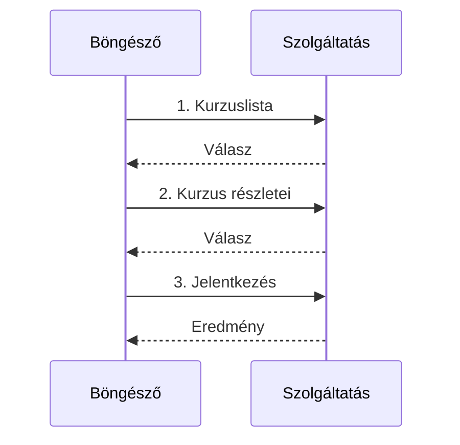
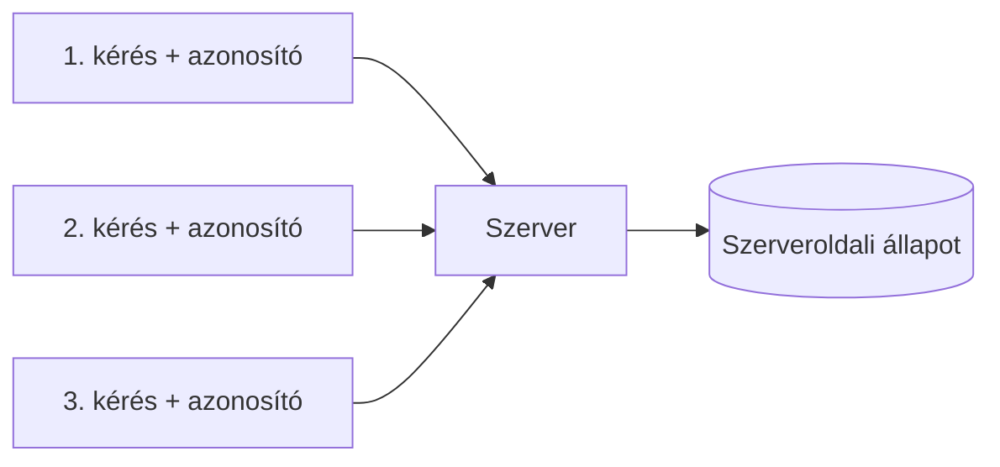
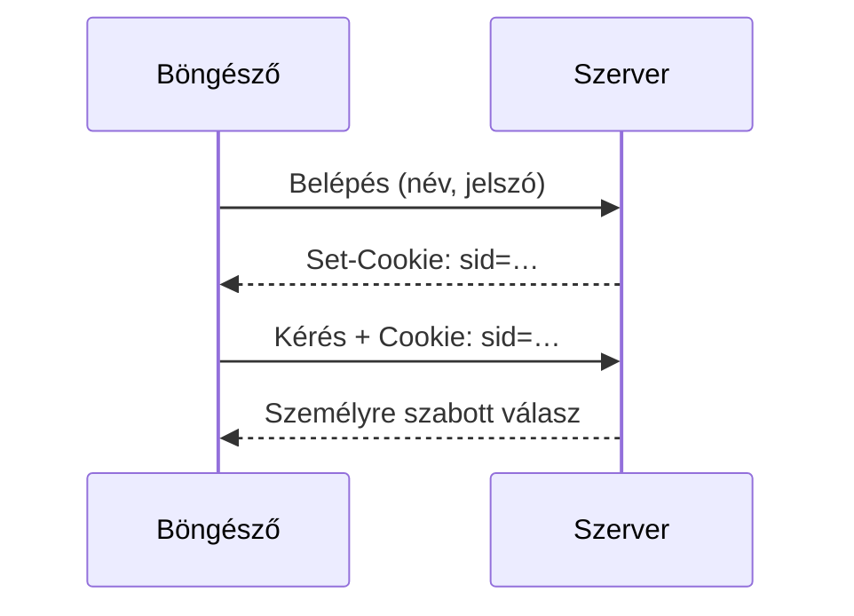
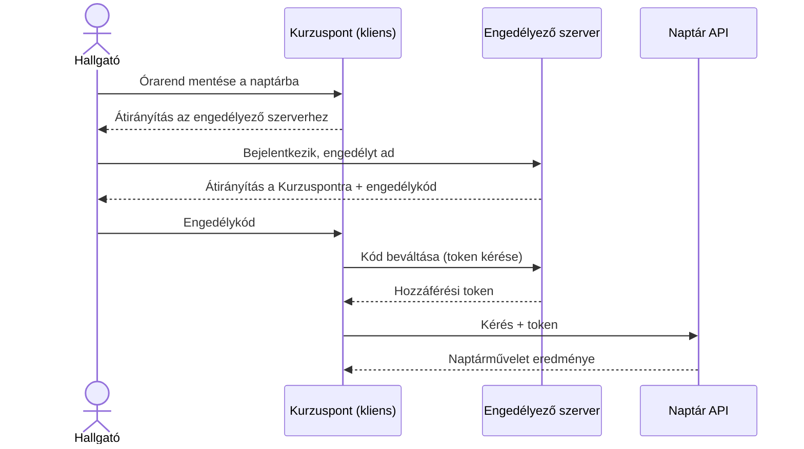
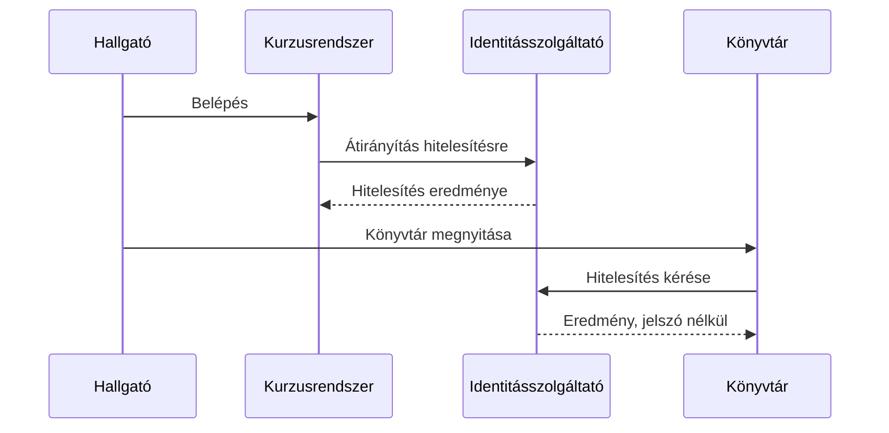
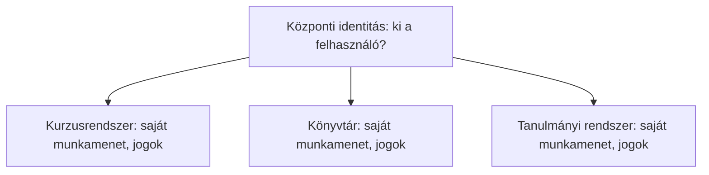

<!-- @slide Címlap -->
<!-- @slide-theme zinc sky zinc -->
<!-- @slide-gradient down zinc-950 -> sky-950 -->

<!-- @color sky -->
## Webprogramozás 1 · 7. fejezet

# Állapot, identitás és hozzáférés

<!-- @width 70% -->
Hogyan teremt a web folytonosságot és azonosságot az állapotmentes HTTP fölött?

<!-- @note -->
> A fejezet kérdése: ha a HTTP minden kérést külön kezel, hogyan marad valaki bejelentkezve, hogyan dönti el a rendszer, mit tehet, és hogyan bízhatjuk a bejelentkezést egy külső szolgáltatóra? Hat leckén megyünk végig, a Kurzuspont példáján.

---

<!-- @slide Áttekintés -->
<!-- @slide-theme zinc sky zinc -->
<!-- @grid ABC/DEF -->

<!-- @color sky -->
### 7.1

Állapotmentes HTTP és alkalmazási állapot

***

<!-- @color amber -->
### 7.2

Cookie-k és szerveroldali munkamenetek

***

<!-- @color violet -->
### 7.3

Böngészős tárolás és tokenek

***

<!-- @color rose -->
### 7.4

Hitelesítés és jogosultságkezelés

***

<!-- @color emerald -->
### 7.5

OAuth 2.0 és OpenID Connect

***

<!-- @color cyan -->
### 7.6

Egyszeri és külső szolgáltatós bejelentkezés

<!-- @note -->
> A hat lecke egymásra épül. Először a problémát nézzük meg (7.1), aztán két eszközt a megoldására: a cookie-t és a munkamenetet (7.2), valamint a tokeneket (7.3). Utána szétválasztjuk a „ki vagy?” és a „mit tehetsz?” kérdést (7.4), végül a bejelentkezést külső szolgáltatóra bízzuk (7.5, 7.6).

---

<!-- @slide 7.1 nyitó -->
<!-- @slide-theme zinc sky zinc -->
<!-- @slide-gradient down zinc-950 -> sky-950 -->

<!-- @color sky -->
## 7.1

# Állapotmentes HTTP és alkalmazási állapot

<!-- @width 65% -->
Miért nem emlékszik a szerver az előző kérésre, hol élhet az állapot, és miért kell egy azonosító?

<!-- @note -->
> A lecke végére el kell tudni magyarázni, miért nem emlékszik a szerver az előző kérésre, hol élhet az alkalmazás állapota (URL, kliens, szerver), és miért kell egy azonosító ahhoz, hogy több kérést ugyanahhoz a felhasználóhoz kössünk.

---

<!-- @slide Egy hallgató három kérése -->
<!-- @slide-theme zinc sky zinc -->
<!-- @layout AB -->

<!-- @color sky -->
## 7.1

# Három külön kérés

<!-- @set-align left -->

- Minden kérés **önálló** üzenet
- A HTTP nem emlékszik az előzőre
- ✅ Egyszerű, jól skálázható szerver
- ❌ Ki küldte a kérést?

```http
$ curl -i …/jelentkezesek/anne
HTTP/1.1 401 Unauthorized
{"hiba":"nincs bejelentkezve"}
```

***

<!-- @contain -->



<!-- @note -->
> A szerver olyan, mint egy Python-függvény globális változók nélkül: csak azzal dolgozhat, amit a hívásban megkap. Ezért bármelyik szerverpéldány kiszolgálhat bármelyik kérést, és könnyű skálázni. A hallgató viszont három kérést küld, és a szerver mindhármat úgy látja, mintha az első lenne. A curl példában az URL-ben ott van az `anne` név, de azt bárki beírhatja — ezért 401: „nem tudom, ki vagy”.

---

<!-- @slide Állapotmentes, de nem munkamenet nélküli -->
<!-- @slide-theme zinc sky zinc -->

# Állapotmentes, de nem munkamenet nélküli

<!-- @set-width 75% -->

<!-- @callout info -->
> A protokoll nem visz át automatikusan „beszélgetési emléket” egyik kérésből a másikba — de a kérések **hordozhatnak azonosítót**.

<!-- @set-align left -->

- A szerver **tárolhat** adatot (kurzusok, jelentkezések)
- A weben **lehet** bejelentkezni
- A folytonosságot nem a protokoll adja, hanem **az alkalmazás** teremti meg

<!-- @note -->
> Gyakori félreértés, hogy az állapotmentesség azt jelenti, nincs sehol állapot. A szakirodalom szerint a HTTP állapotmentes, de nem munkamenet nélküli: lehetőséget ad arra, hogy a kérésekben például egy cookie utazzon. Ez kapcsolódik a REST állapotmentességéhez (5.3): ott is minden kérésnek magával kell hoznia az értelmezéséhez szükséges információt — a felhasználó azonosságát is.

---

<!-- @slide Hol élhet az állapot -->
<!-- @slide-theme zinc sky zinc -->

# Hol élhet az állapot?

<!-- @set-scale 75% -->

| Állapot | Természetes hely | Miért? |
| --- | --- | --- |
| Kurzuslista szűrője, kiválasztott kurzus | URL | Megosztható, visszakereshető |
| Megnyitott panel, még el nem küldött szöveg | Kliens memóriája | Rövid életű nézetállapot |
| Félbehagyott helyi vázlat | Böngészős tárolás | Későbbi folytatáshoz |
| Elfogadott jelentkezés, hozzáférési jog | **Szerver** | Hivatalos, több felhasználót érint |

<!-- @callout tip -->
> Ami **hivatalos** vagy **biztonsági** jelentőségű, az a szerveré — a kliens módosítható.

<!-- @note -->
> A 6.5 leckében már láttuk az URL–kliens–szerver felosztást, itt a böngészős tárolással egészül ki. Az ökölszabály egyszerű: a böngésző a felhasználó gépén fut, tehát amit ott tárolunk, azt ő módosíthatja. Ha az „elfogadva” állapotot csak a böngésző tárolná, bárki beállíthatná magának bármelyik kurzusra.

---

<!-- @slide Ruhatári jegy -->
<!-- @slide-theme zinc sky zinc -->
<!-- @layout AB -->

# A ruhatári jegy

<!-- @set-align left -->

- Leadod a kabátot, kapsz egy **számozott jegyet**
- A jegyen nincs rajta a neved
- A kabát a ruhatárban marad
- **Session ID**: véletlen, hosszú, kitalálhatatlan
- Utazhat **cookie**-ban (7.2) vagy **tokenként** (7.3)

***

<!-- @contain -->



<!-- @note -->
> A megoldás egy azonosító, amelyet a kliens minden kéréssel elküld, és amely alapján a szerver megtalálja a nála tárolt állapotot. Pont mint a ruhatárban: a jegy csak egy szám, a kabát a ruhatárosnál van. Ha az azonosító kitalálható lenne (pl. `anne` vagy egy sorszám), bárki más felhasználónak adhatná ki magát — ezért véletlenszerű és hosszú (8. fejezet).

---

<!-- @slide Példa repülőjegy -->
<!-- @slide-theme zinc sky zinc -->

# Példa: repülőjegy-foglalás

<!-- @set-scale 85% -->

| Állapotelem | Mi hordozza? |
| --- | --- |
| Kiválasztott járat és dátum | **URL** — `/foglalas?jarat=XY123&datum=2026-12-20` |
| „Csak kézipoggyász” a következő lépés előtt | **Kliens memóriája** — frissítéskor elveszhet |
| Ki foglal? | **Munkamenet-azonosító** a kérésben |
| Ideiglenesen lefoglalt ülőhely, kész foglalás | **Szerver adatbázisa** |

<!-- @note -->
> Figyeljük meg a harmadik és negyedik sort. A foglaló kilétét nem az URL vagy egy űrlapmező árulja el, hanem egy azonosító, amelyet a böngésző magától csatol. Az ülőhelyet a szerver tartja nyilván, mert több felhasználót érint — különben két utas is lefoglalhatná ugyanazt. Ha órák múlva tér vissza, a szerver az azonosító alapján felismeri, ha az még érvényes; különben újra be kell lépnie.

---

<!-- @slide 7.1 tévhitek -->
<!-- @slide-theme zinc sky zinc -->

# 7.1 — Gyakori tévhitek

<!-- @set-scale 78% -->

| Állítás | Pontosítás |
| --- | --- |
| „Állapotmentes HTTP mellett nem lehet bejelentkezni.” | Cookie, token és szerveroldali munkamenet összekötheti a kéréseket. |
| „Ha a HTTP állapotmentes, a szerver nem tárol adatot.” | A protokoll és az alkalmazás adattárolása két külön dolog. |
| „A kliens által látott férőhelyszám a végleges igazság.” | A szerver a művelet pillanatában dönt. |
| „Az azonosító a felhasználó neve.” | Kitalálhatatlan, véletlen jel, amelyet a szerver vezet vissza. |

<!-- @note -->
> A harmadik sorhoz: ha két hallgató egyszerre próbálja megszerezni az utolsó helyet, a szerver dönt, és a vesztesnek 409-cel válaszol (2.4). A böngészőben látott szám csak pillanatnyi információ volt.

---

<!-- @slide 7.2 nyitó -->
<!-- @slide-theme zinc amber zinc -->
<!-- @slide-gradient down zinc-950 -> amber-950 -->

<!-- @color amber -->
## 7.2

# Cookie-k és szerveroldali munkamenetek

<!-- @width 65% -->
`Set-Cookie`, `Cookie`, attribútumok — és miért kell a kijelentkezést a szerveren is megoldani?

<!-- @note -->
> Célok: hogyan működik a cookie (Set-Cookie, Cookie), mi a különbség cookie és munkamenet között, melyek a fő attribútumok (Secure, HttpOnly, SameSite, Max-Age), és miért kell a kijelentkezést a szerveren is megvalósítani.

---

<!-- @slide Mire jó a cookie -->
<!-- @slide-theme zinc amber zinc -->
<!-- @layout AAA/BCD -->

# Mire jó a cookie?

<!-- @width 70% -->
A szerver küld egy kis adatot, a böngésző eltárolja, és **magától visszaküldi** minden egyező kérésnél.

***

<!-- @color amber -->
### 🔑 Munkamenet

Bejelentkezés, a felhasználó választásai

***

<!-- @color amber -->
### 🎨 Személyre szabás

Választott nyelv, megjelenés

***

<!-- @color amber -->
### 👁️ Követés

Viselkedés több oldalon át (9.6)

<!-- @note -->
> A ruhatári hasonlatban a cookie olyan, mintha a ruhatáros a jegyet egyenesen a zsebedbe tenné, és te minden alkalommal automatikusan felmutatnád. A lecke elsősorban az első céllal, a munkamenet-kezeléssel foglalkozik; a követésről a 9.6 lecke szól.

---

<!-- @slide Bejelentkezés cookie-val -->
<!-- @slide-theme zinc amber zinc -->
<!-- @layout AB -->

```http
POST /login  {"nev":"anne",…}

HTTP/1.1 200 OK
Set-Cookie: sid=b8734e…3b42;
  Path=/; HttpOnly;
  SameSite=Lax; Max-Age=3600

GET /jelentkezesek/anne
Cookie: sid=b8734e…3b42

HTTP/1.1 200 OK
["webprog"]
```

***

<!-- @contain -->



<!-- @note -->
> Belépéskor a szerver létrehoz egy munkamenetet: feljegyzi, hogy ez a véletlen azonosító Anne-hez tartozik. Az azonosítót a `Set-Cookie` fejlécben küldi, a böngésző pedig ettől kezdve a `Cookie` fejlécben visszaküldi. Ugyanaz a kérés, ami az előző leckében 401-et kapott, most 200-at kap. A cookie-ban **csak** egy véletlen azonosító van — ha `felhasznalo=anne` állna benne, bárki átírhatná `bill`-re.

---

<!-- @slide Cookie vs munkamenet -->
<!-- @slide-theme zinc amber zinc -->
<!-- @grid AB -->

<!-- @color amber -->
## Cookie

# A jegy

<!-- @set-align left -->
<!-- @set-width 85% -->

- Továbbítási eszköz böngésző és szerver között
- Kb. **4 KB**, minden egyező kéréssel elmegy
- Nagy adatra nem való → Web Storage, IndexedDB

***

<!-- @color violet -->
## Munkamenet

# A kabát

<!-- @set-align left -->
<!-- @set-width 85% -->

- **Szerveroldali** állapot az azonosítóhoz
- Ha a szerver törli → a régi cookie semmit sem ér
- Ha a böngésző törli → újra be kell lépni

<!-- @note -->
> A két fogalom gyakran összemosódik. A cookie a jegy, a munkamenet a kabát a ruhatárban. Ha a ruhatáros kidobja a kabátot, hiába mutatod fel a jegyet. Egy nagy cookie minden kérést lassít, mert minden képpel és stíluslappal együtt elmegy — helyi adatra a 3.6 leckében látott Web Storage vagy IndexedDB való.

---

<!-- @slide Cookie attribútumok -->
<!-- @slide-theme zinc amber zinc -->

# A cookie attribútumai

<!-- @set-scale 80% -->

| Attribútum | Mit tesz? |
| --- | --- |
| `Domain` | Melyik domainre (és aldomainjeire) küldhető; alapból csak a beállító hosztra |
| `Path` | Csak az ezzel kezdődő útvonalakra — kényelmi szűrés, nem biztonsági határ |
| `Expires` / `Max-Age` | Meddig él; ha nincs, munkamenet-cookie (a böngésző bezárásakor törlődik) |
| `Secure` | Csak HTTPS-en küldhető (a localhost kivétel) |
| `HttpOnly` | A kérésekhez csatolódik, de a JavaScript nem olvashatja |
| `SameSite` | Elmenjen-e, ha a kérést egy másik webhely indította |

<!-- @note -->
> Az attribútumok nem a cookie tartalmát, hanem a kezelésének feltételeit adják meg: mikor, hová és milyen kapcsolaton küldje a böngésző. Ha az `Expires` és a `Max-Age` is szerepel, a `Max-Age` dönt. A következő dián a két legfontosabb biztonsági attribútumot nézzük meg részletesen.

---

<!-- @slide HttpOnly és SameSite -->
<!-- @slide-theme zinc amber zinc -->
<!-- @grid AB -->

<!-- @color amber -->
## XSS ellen

# HttpOnly

<!-- @set-align left -->

A bejuttatott idegen JavaScript **nem tudja kiolvasni** és elküldeni a munkamenet-azonosítót.

A böngésző a kérésekhez továbbra is csatolja.

***

<!-- @color violet -->
## CSRF ellen

# SameSite

<!-- @set-align left -->

- **Strict** — csak ugyanarról a webhelyről
- **Lax** — + linkre kattintás (alapértelmezés)
- **None** — mindig, csak `Secure`-ral

<!-- @note -->
> HttpOnly: ha egy támadó saját kódot juttat az oldalba (XSS), az nem fér hozzá az azonosítóhoz (8. fejezet). SameSite: ha Anne be van lépve, és megnyit egy rosszindulatú oldalt, az a háttérben kérést indíthatna a Kurzuspont felé, és a böngésző csatolná Anne cookie-ját — ez a CSRF (8.4). Bónusz: a `__Host-` előtagú cookie-t a böngésző csak `Secure`, `Path=/` és `Domain` nélkül fogadja el, így hosztra kötött.

---

<!-- @slide Harmadik fél cookie -->
<!-- @slide-theme zinc amber zinc -->
<!-- @layout AB -->

<!-- @color amber -->
## Első fél

# A meglátogatott webhely

<!-- @set-align left -->

A cookie-t az a webhely állítja be, amelyet a felhasználó megnyitott.

***

<!-- @color rose -->
## Harmadik fél

# Beágyazott szolgáltató

<!-- @set-align left -->

- Videó, hirdetés, látogatásmérő
- Sok webhelyen jelen → **profilépítés**
- A böngészők egyre inkább blokkolják
- **GDPR**, **ePrivacy**: hozzájárulás kell

<!-- @note -->
> Ugyanaz a hirdetési szolgáltató sok webhelyen jelen lehet, és a cookie-ja alapján bárhol felismerheti a felhasználót. Ezért blokkolják a böngészők egyre inkább alapértelmezésként, és ezért kér az EU-s szabályozás átláthatóságot, illetve a működéshez nem szükséges cookie-khoz hozzájárulást. Részletesen: 9.6.

---

<!-- @slide Kijelentkezés -->
<!-- @slide-theme zinc amber zinc -->
<!-- @layout AABBB -->

<!-- @set-scale 90% -->

<!-- @color amber -->
## 7.2

# Kijelentkezés

<!-- @set-align left -->

- A munkamenetet a **szerveren** kell megszüntetni
- A cookie másolata máshol is lehet
- Belépéskor **új azonosító** (session fixation ellen)
- Érzékeny munkamenet: **rövid** élettartam

***

```http
POST /logout
HTTP/1.1 204 No Content
Set-Cookie: sid=; Path=/; Max-Age=0

# a régi azonosító kézzel visszaküldve:
GET /jelentkezesek/anne
Cookie: sid=b8734e…3b42

HTTP/1.1 401 Unauthorized
{"hiba":"nincs bejelentkezve"}
```

<!-- @note -->
> Nem elég, ha a felület „kijelentkezettnek” mutatja a felhasználót, vagy csak a böngészőből törlődik a cookie. Ha valaki korábban megszerezte a cookie másolatát, és a szerver még elfogadja, belép vele. A második kérés a lényeg: kézzel küldjük a régi azonosítót, és a szerver 401-et ad, mert a munkamenetet megszüntette. Session fixation: ha a belépés előtti azonosítót használnánk tovább, egy támadó előre ráerőltethetne egy általa ismert azonosítót (8.6).

---

<!-- @slide Példa netbank -->
<!-- @slide-theme zinc amber zinc -->

# Példa: netbank belépési cookie

<!-- @set-scale 75% -->

| Beállítás | Érték | Indok |
| --- | --- | --- |
| Név | `__Host-sid` | Hosztra kötött, csak Secure és `Path=/` mellett |
| Érték | 128 bites véletlen szám | Nem kitalálható, nem hordoz adatot |
| HttpOnly | igen | Bejuttatott idegen program se olvashassa |
| Secure | igen | Csak HTTPS-en |
| SameSite | Strict | Más oldalról induló kéréshez soha, linkre kattintáskor sem |
| Élettartam | 10 perc tétlenség után lejár | Közös gépen se maradjon nyitva |
| Kijelentkezés | A szerver törli a munkamenetet | A régi azonosító használhatatlan |

<!-- @note -->
> Vessük össze egy hírportállal, ahol a `SameSite=Lax` a jobb: aki egy közösségi oldalon a cikk linkjére kattint, bejelentkezett előfizetőként szeretne érkezni. A bank tudatosan feláldozza ezt a kényelmet — aki e-mailben kapott linkről érkezik, mindig a belépőoldalon találja magát, ami az adathalász linkek ellen is véd. A cookie-beállítás tehát kockázathoz igazított döntés.

---

<!-- @slide 7.2 tévhitek -->
<!-- @slide-theme zinc amber zinc -->

# 7.2 — Gyakori tévhitek

<!-- @set-scale 70% -->

| Állítás | Pontosítás |
| --- | --- |
| „A cookie maga a teljes munkamenet.” | Gyakran csak az azonosítót hordozza; az állapot a szerveren van. |
| „A böngésző minden cookie-t minden kéréshez elküld.” | A hatókör és az attribútumok korlátozzák. |
| „A kijelentkezés a cookie törlése a böngészőből.” | A szerveroldali munkamenetet is meg kell szüntetni. |
| „A helyi adatokat cookie-ban érdemes tárolni.” | Kicsi és minden kéréssel elmegy; Web Storage / IndexedDB való rá. |
| „A HttpOnly minden támadás ellen véd.” | Csak a JavaScriptből való kiolvasást akadályozza. |

<!-- @note -->
> Az utolsó sor fontos: a HttpOnly cookie-t a böngésző továbbra is csatolja a kérésekhez, így a CSRF ellen önmagában nem véd — arra a SameSite (és a 8.4 lecke technikái) valók.

---

<!-- @slide 7.3 nyitó -->
<!-- @slide-theme zinc violet zinc -->
<!-- @slide-gradient down zinc-950 -> violet-950 -->

<!-- @color violet -->
## 7.3

# Böngészős tárolás és tokenek

<!-- @width 65% -->
Cookie, Web Storage, IndexedDB — mi a token, mi a JWT, és miért két külön döntés a token és a tárolási helye?

<!-- @note -->
> Célok: a böngészős tárolók megkülönböztetése, a token és a JWT fogalma, és annak megértése, hogy a token fogalma és a tárolásának helye két külön döntés.

---

<!-- @slide Cookie vagy token -->
<!-- @slide-theme zinc violet zinc -->
<!-- @layout AB -->

<!-- @color violet -->
## 7.3

# „Cookie vagy token?”

<!-- @callout warning -->
> **Rossz kérdés** — a két fogalom nem ugyanabba a kategóriába tartozik.

***

<!-- @space -->

<!-- @set-align left -->

- **Tárolási hely**: cookie, localStorage, IndexedDB — *hová* tesszük
- **Token**: egy *érték*, amely hozzáférést vagy azonosságot képvisel
- Token = a jegy · tároló = zseb, pénztárca vagy kéz

<!-- @space -->

<!-- @note -->
> Sok vita szól arról, hogy „cookie vagy token” a jobb. A helyes kérdés: mit akarunk igazolni, hol őrizzük az igazolást, és hogyan juttatjuk el a szerverhez. Egy token tárolható cookie-ban, localStorage-ban vagy csak a futó program memóriájában — és ez a döntés a biztonságot is befolyásolja.

---

<!-- @slide Mit hová -->
<!-- @slide-theme zinc violet zinc -->

# Három adat, három hely

<!-- @set-scale 85% -->

| Adat | Természetes hely | Miért? |
| --- | --- | --- |
| Nyelvi beállítás (kicsi) | Cookie vagy localStorage | Egyszerű, nem érzékeny |
| Félbehagyott jegyzet (strukturált) | IndexedDB | Strukturált, nagyobb adat |
| A bejelentkezés igazolása | Munkamenet-cookie vagy token | Érzékeny — biztonsági szempontok döntenek |

<!-- @note -->
> A Kurzuspont három különböző adatot tarthat a böngészőben: a felület nyelvét, egy félbehagyott jegyzetet és a bejelentkezés igazolását. Mindhárom más célt szolgál, ezért máshová való. A token nem egy negyedik tárolási hely, hanem egy érték, amelyet valamelyik tárolóba teszünk — vagy egyikbe sem.

---

<!-- @slide Tárolók összehasonlítása -->
<!-- @slide-theme zinc violet zinc -->

# A tárolók összehasonlítása

<!-- @set-scale 75% -->

| | Cookie | localStorage | sessionStorage | IndexedDB |
| --- | --- | --- | --- | --- |
| Hatókör | domain + útvonal | eredet | eredet + lap | eredet |
| Elmegy a kérésekkel? | **igen** | nem | nem | nem |
| JS olvashatja? | **nem, ha HttpOnly** | igen | igen | igen |
| Méret | ~4 KB / cookie | ~5 MiB | ~5 MiB | nagy |
| Élettartam | Max-Age / Expires | amíg nem törlik | amíg a lap nyitva | amíg nem törlik |

<!-- @note -->
> Két sor különösen fontos. A cookie magától csatolódik — kényelmes, de egy más webhelyről indított kéréshez is csatolódhat, ha a SameSite nem akadályozza (8.4). A localStorage és az IndexedDB tartalmát bármely, az oldalon futó program elolvashatja — egy XSS-sel bejuttatott kód is, amely így elküldheti magának a tokent. Egy HttpOnly cookie-t ezzel szemben semmilyen program nem lát.

---

<!-- @slide Bearer token -->
<!-- @slide-theme zinc violet zinc -->
<!-- @layout AABBB -->

<!-- @set-scale 90% -->

<!-- @color violet -->
## Hozzáférési token

# Bearer

<!-- @set-align left -->

„Birtokos”: aki felmutatja, használhatja — mint egy bemutatóra szóló koncertjegy.

- Csak **TLS**-en
- Soha nem az **URL**-ben
- **Rövid** élettartam

***

```http
GET /jelentkezesek/anne HTTP/1.1
Host: kurzuspont.example
Authorization: Bearer <token>
```

<!-- @note -->
> A token egy érték, amelyet egy protokoll meghatározott célra ad ki és ellenőriz. API-knál a leggyakoribb a hozzáférési token: egy mobilalkalmazás belépéskor kap egyet, és minden kérésnél ezzel igazolja magát az `Authorization` fejlécben. A bearer szabályok: TLS nélkül útközben ellopható; az URL naplókba, előzményekbe, megosztott linkekbe kerül; a rövid élettartam korlátozza egy ellopott token kárát.

---

<!-- @slide JWT -->
<!-- @slide-theme zinc violet zinc -->
<!-- @layout AABBB -->

<!-- @set-scale 90% -->

<!-- @color violet -->
## JSON Web Token

# JWT

<!-- @set-align left -->

Három rész, pontokkal elválasztva:

1. **header** — algoritmus
2. **payload** — állítások (claims)
3. **aláírás**

A base64url **nem titkosítás**.

***

```text
eyJhbGciOiJIUzI1NiIsInR5cCI6IkpXVCJ9
.eyJzdWIiOiJhbm5lIiwic3plcmVwIjoi…
.YnlcA_naaV9_TOVe_vipmQz-lkZdHQygXlzQ

header : {"alg":"HS256","typ":"JWT"}
payload: {"sub":"anne",
          "szerep":"hallgato",
          "exp":1791741600}

eredeti token          → ÉRVÉNYES
szerep=oktato átírva   → ÉRVÉNYTELEN
```

<!-- @note -->
> A JWT egy kompakt, URL-barát formátum állítások továbbítására. Fontos: nem minden token JWT, és egy JWT sem biztonságos csak attól, hogy JWT. A példát Node.js crypto modullal készítettük HS256 aláírással (közös titokkal számolt HMAC SHA-256, 5.5). A tartalmat bárki dekódolhatja, de amikor a szerepet `oktato`-ra írtuk át, az aláírás érvénytelenné vált.

---

<!-- @slide JWT tanulságok -->
<!-- @slide-theme zinc violet zinc -->
<!-- @grid ABC -->

<!-- @color violet -->
## 👀 Nem titkos

<!-- @set-align left -->

A tartalmat **bárki** elolvashatja. Aláírt, de nem titkosított JWT-be soha ne tegyünk titkot.

***

<!-- @color violet -->
## ✍️ Sértetlen

<!-- @set-align left -->

Az aláírás miatt **észrevétlenül nem módosítható** — aki nem ismeri a titkot, nem tud érvényes aláírást készíteni.

***

<!-- @color violet -->
## ⏱️ Nehéz visszavonni

<!-- @set-align left -->

Önálló token: az `exp`-et a szerver ellenőrzi, de lejárat előtti visszavonáshoz **nyilvántartás** kell.

<!-- @note -->
> Az `exp` egy Unix-időbélyeg: az 1970. január 1. óta eltelt másodpercek. A JWT önálló (self-contained): a szerver az aláírásból, nyilvántartás nélkül dönti el, érvényes-e — ez jól illik az állapotmentes szolgáltatásokhoz, de a visszavonást megnehezíti. A munkamenet-azonosítónál fordítva: minden kérésnél nyilvántartást kell nézni, viszont egyetlen törléssel megszüntethető.

---

<!-- @slide Példa üzenetküldő -->
<!-- @slide-theme zinc violet zinc -->

# Példa: üzenetküldő weben és mobilon

<!-- @set-scale 80% -->

| Kliens | Igazolás | Tárolás | Indok |
| --- | --- | --- | --- |
| Böngésző | Munkamenet-cookie (HttpOnly) | A böngésző cookie-tárolója | A JS nem éri el, a böngésző magától csatolja |
| Mobilalkalmazás | Hozzáférési token | Az OS biztonságos tárolója | Nincs böngészős cookie-modell; rövid életű token |

<!-- @callout tip -->
> Mindkét esetben a szerver ellenőriz **minden kérésnél**, és mindkét igazolás **visszavonható**.

<!-- @note -->
> Egy üzenetküldőben idegenek által írt szövegek jelennek meg, ezért a böngészőben különösen fontos az XSS elleni védelem — erre jó a HttpOnly cookie. Mobilon nincs böngésző és cookie-kezelés, ott a token a természetes megoldás, az operációs rendszer titkosított tárolójában. Ha a felhasználó elveszíti a telefonját, a webes „Eszközeim” oldalon kijelentkeztetheti: a szerver érvényteleníti a tokent.

---

<!-- @slide 7.3 tévhitek -->
<!-- @slide-theme zinc violet zinc -->

# 7.3 — Gyakori tévhitek

<!-- @set-scale 70% -->

| Állítás | Pontosítás |
| --- | --- |
| „A token egy böngészős tárhely neve.” | A token egy érték; a tárolása külön döntés. |
| „Minden token JWT.” | Sokféle formátum van, köztük átláthatatlan azonosító is. |
| „A localStorage adatai elmennek a szervernek.” | A cookie-val ellentétben nem csatolódnak a kérésekhez. |
| „A böngészőben tárolt jelentkezés a hivatalos eredmény.” | A szerveroldali állapot a mérvadó. |
| „A JWT tartalma titkosított.” | Base64url-lel kódolt, bárki elolvashatja. |

<!-- @note -->
> Összefoglalva: a „cookie vagy token” választás hamis. A cookie továbbítási és tárolási mechanizmus, a token egy protokollban meghatározott érték — egy token akár cookie-ban is utazhat. Az OAuth 2.0 és az OpenID Connect (7.5) többféle tokent is használ, különböző célokra.

---

<!-- @slide 7.4 nyitó -->
<!-- @slide-theme zinc rose zinc -->
<!-- @slide-gradient down zinc-950 -> rose-950 -->

<!-- @color rose -->
## 7.4

# Hitelesítés és jogosultságkezelés

<!-- @width 65% -->
Ki vagy? Mit tehetsz? 401 vagy 403? És miért nem védelem egy gomb elrejtése?

<!-- @note -->
> Célok: a hitelesítés (ki vagy?) és a jogosultságkezelés (mit tehetsz?) elkülönítése, a 401 és a 403 megkülönböztetése, és annak megértése, miért nem jogosultság-ellenőrzés egy gomb elrejtése.

---

<!-- @slide Két kérdés -->
<!-- @slide-theme zinc rose zinc -->
<!-- @grid AB -->

<!-- @color rose -->
## Authentication

# Hitelesítés

<!-- @set-align left -->
<!-- @set-width 85% -->

- **Ki a kérő?**
- A portás elkéri a belépőkártyát
- Jelszó, külső szolgáltató, második tényező
- Hiánya: **401**

***

<!-- @color violet -->
## Authorization

# Jogosultság

<!-- @set-align left -->
<!-- @set-width 85% -->

- **Mit tehet?**
- A kártyával sem nyílik minden ajtó
- Linuxon: `Permission denied`
- Hiánya: **403**

<!-- @note -->
> A két kérdés összekeverése a webes biztonsági hibák egyik leggyakoribb forrása. Két tipikus hiba: mindenkit mindenhová beenged, aki bejelentkezett, vagy a jogosultakat is elutasítja. A parancssoros példa ismerős lehet: bejelentkeztél, de egy másik felhasználó fájlját nem olvashatod — Pythonban ez egy `PermissionError`.

---

<!-- @slide Hitelesítés -->
<!-- @slide-theme zinc rose zinc -->
<!-- @layout AB -->

<!-- @color rose -->
## 7.4

# Hitelesítés

<!-- @set-align left -->

- A szolgáltatás egy **módszer szerint** elfogadja az identitást
- Nem tévedhetetlen: ellopott jelszóval a támadó „Anne”
- Utána munkamenet (7.2) — ne kelljen újra jelszó

***

<!-- @space -->

```http
HTTP/1.1 401 Unauthorized
WWW-Authenticate: Bearer
```

<!-- @callout warning -->
# Basic séma
> A jelszót csak **base64**-gyel kódolja — kizárólag HTTPS-en!

<!-- @space -->

<!-- @note -->
> A hitelesítés nem azt jelenti, hogy a szolgáltatás mindent tud a felhasználóról, hanem hogy egy meghatározott módszer szerint elfogadja az identitását. A szabvány szerint a 401-es válasznak tartalmaznia kell a `WWW-Authenticate` fejlécet, amely megmondja a módszert, például Basic vagy Bearer. A Basic séma a felhasználónevet és a jelszót csak kódolja, nem titkosítja.

---

<!-- @slide Jogosultság -->
<!-- @slide-theme zinc rose zinc -->
<!-- @layout AABBB -->

<!-- @set-scale 90% -->

<!-- @color rose -->
## 7.4

# Jogosultság

<!-- @set-align left -->

Mi alapján dönt?

- **Szerepkör**: hallgató, oktató, admin
- **Erőforrás**: a saját kurzusa, a saját jelentkezése
- **Környezet**: határidő, a kurzus állapota

***

```text
Anne (hallgató) belépve:
  GET /jelentkezesek/anne → 200
  GET /jelentkezesek/bill → 403

Oktató belépve:
  GET /jelentkezesek/bill → 200

Nem belépve:
  GET /jelentkezesek/anne → 401
```

<!-- @note -->
> A döntéshez a szereplő, a művelet, az erőforrás és a körülmények együtt kellenek. Anne a saját jelentkezéseit látja, de amikor az URL-ben `anne`-t `bill`-re írja át, 403-at kap: a szerver tudja, hogy ő Anne, és Anne nem nézheti Bill adatait. A tanulság: a sikeres bejelentkezés után is **minden érzékeny műveletnél** ellenőrizni kell a jogosultságot.

---

<!-- @slide 401 403 404 -->
<!-- @slide-theme zinc rose zinc -->

# 401, 403 — és néha 404

<!-- @set-scale 80% -->

| Helyzet | Státuszkód | Mit jelent? | Mit tegyen a kliens? |
| --- | --- | --- | --- |
| Nincs elfogadott identitás | **401** Unauthorized | Hiányzik vagy érvénytelen a hitelesítés | Jelentkezzen be (újra) |
| Ismert felhasználó, nincs joga | **403** Forbidden | Érti a kérést, de megtagadja | Újabb belépés nem segít |
| A létezését sem akarják elárulni | **404** Not Found | Úgy tesz, mintha nem létezne | — |

<!-- @note -->
> A 403 finoman elárulja, hogy az erőforrás létezik. Ez néha önmagában érzékeny: ha valaki ki tudja deríteni, hogy egy adott azonosítójú hallgató létezik-e, az már adatszivárgás. Ezért a szabvány megengedi, hogy a szerver ilyenkor 404-et küldjön. Nem minden erőforrásnál célszerű részletesen megmagyarázni az elutasítást.

---

<!-- @slide Hol döntünk -->
<!-- @slide-theme zinc rose zinc -->
<!-- @layout AB -->

<!-- @color rose -->
## 7.4

# Hol döntünk?

<!-- @set-align left -->

- **Mindig a szerveren**, az adat közelében
- A böngésző, a CDN, a cache **nem** dönthet helyette
- Személyre szabott válasz → **ne** kerüljön közös cache-be

***

<!-- @space -->

<!-- @callout danger -->
# A gomb elrejtése nem védelem
> Az API közvetlenül is hívható. Egyetlen elfelejtett végpont megkerülhetővé teszi a felület **összes** tiltását.

<!-- @space -->

<!-- @note -->
> Alattomos eset: ha egy közvetítő a gyorsítótárából szolgálna ki egy személyes oldalt, a kérés el sem jutna a webalkalmazásig, a jogosultság-ellenőrzés kimaradna, és Anne oldala Billhez is eljuthatna (6.3, 10. fejezet). A hibás hozzáférés-ellenőrzés a webes biztonsági kockázatok listájának élén áll — egy támadónak elég egyetlen elfelejtett ajtót találnia.

---

<!-- @slide Jogosultsági mátrix -->
<!-- @slide-theme zinc rose zinc -->

# Példa: ki mit láthat a Kurzuspontban?

<!-- @set-scale 75% -->

| Erőforrás | Névtelen | Hallgató | Oktató (saját kurzus) | Adminisztrátor |
| --- | --- | --- | --- | --- |
| Kurzusleírás | olvashat | olvashat | olvashat, módosíthat | módosíthat |
| A saját jelentkezései | – | olvashat, létrehozhat | – | olvashat |
| Más hallgató jelentkezése | – | tiltott | a saját kurzusán olvashat | olvashat |
| A kurzus jelentkezési listája | – | – | olvashat | olvashat |

<!-- @note -->
> A táblázat minden cellája egy szabály, amelyet a szerveren kell érvényesíteni. Ez oktatási példa, nem a Kurzuspont valódi szabályzata. Kérdés a hallgatóknak: melyik cellánál a legkönnyebb elfelejteni az ellenőrzést? (Tipikusan a „más hallgató jelentkezése” — mert az URL átírásával érhető el.)

---

<!-- @slide 7.4 tévhitek -->
<!-- @slide-theme zinc rose zinc -->

# 7.4 — Gyakori tévhitek

<!-- @set-scale 70% -->

| Állítás | Pontosítás |
| --- | --- |
| „Aki be van jelentkezve, bármit megtehet.” | A jogosultság műveletenként és erőforrásonként változik. |
| „Ha a gomb nem látszik, a művelet tiltott.” | A szervernek külön ellenőriznie kell; az API közvetlenül hívható. |
| „A hitelesítés és a jogosultság ugyanaz.” | Az egyik azt dönti el, ki vagy, a másik, hogy mit tehetsz. |
| „A 401 és a 403 ugyanazt jelenti.” | Az egyik hitelesítési, a másik jogosultsági elutasítás. |
| „A Basic hitelesítés titkosítja a jelszót.” | Csak base64; HTTPS nélkül bárki elolvashatja. |

<!-- @note -->
> Ellenőrző kérdés a hallgatóknak: mondjanak egy példát a saját számítógépük használatából a hitelesítés és a jogosultság különbségére.

---

<!-- @slide 7.5 nyitó -->
<!-- @slide-theme zinc emerald zinc -->
<!-- @slide-gradient down zinc-950 -> emerald-950 -->

<!-- @color emerald -->
## 7.5

# OAuth 2.0 és OpenID Connect

<!-- @width 65% -->
Delegált hozzáférés jelszó nélkül — és identitás az OAuth tetején.

<!-- @note -->
> Célok: mire való az OAuth 2.0 és mire az OpenID Connect; az OAuth szereplői; az engedélykódos folyamat lépései; a hozzáférési token és az ID token különbsége.

---

<!-- @slide Miért nem adjuk át a jelszót -->
<!-- @slide-theme zinc emerald zinc -->
<!-- @layout AB -->

<!-- @color emerald -->
## 7.5

# Miért nem adjuk át a jelszót?

<!-- @set-align left -->

A Kurzuspont a hallgató **külső naptárába** írna. Ha elkérné a jelszót:

- ❌ Bármit megtehetne a nevében
- ❌ Tárolnia kellene a jelszót
- ❌ Visszavonás = jelszócsere mindenhol

***

<!-- @space -->

<!-- @callout tip -->
# 🏨 Szállodai kártya
> Nem a mesterkulcsot kapod, hanem egy kártyát, amely **csak a te szobádat** nyitja, **csak a tartózkodásod végéig**.

<!-- @space -->

<!-- @note -->
> A jó megoldás a delegált hozzáférés: a hallgató a naptárszolgáltatónál, a saját jelszavával jelentkezik be, és ott dönt arról, mit enged meg a Kurzuspontnak. A szolgáltató egy korlátozott jogosultságú tokent ad — csak naptárba írásra, csak egy ideig. A jelszó végig a szolgáltatónál marad. Erre való az OAuth 2.0.

---

<!-- @slide OAuth szereplők -->
<!-- @slide-theme zinc emerald zinc -->

# Az OAuth 2.0 szereplői

<!-- @set-scale 80% -->

| Szerep | Neve a szabványban | Példa |
| --- | --- | --- |
| Akinek az adatáról szó van, aki engedélyt ad | **resource owner** | a hallgató |
| Az alkalmazás, amely hozzáférést kér | **client** | a Kurzuspont |
| Azonosítja a felhasználót és kiadja a tokent | **authorization server** | a naptárszolgáltató bejelentkeztetője |
| A védett adatot tárolja | **resource server** | a naptár API-ja |

<!-- @note -->
> A kért engedély terjedelme a **scope** — pl. „csak a naptárba írás”. Figyeljük meg: itt a Kurzuspont a kliens, holott eddig szerverként láttuk. A kliens és a szerver szerep, nem a gép tulajdonsága (1.4). A token nem általános „be vagyok jelentkezve mindenhová” igazolás: egy meghatározott erőforráshoz szól, a megadott scope szerint, és csak az érvényességi idején belül.

---

<!-- @slide Engedélykódos folyamat -->
<!-- @slide-theme zinc emerald zinc -->
<!-- @layout AB -->

<!-- @color emerald -->
## Authorization code flow

# Engedélykódos folyamat

<!-- @set-align left -->

1. Átirányítás az engedélyező szerverhez
2. A hallgató belép, engedélyt ad
3. Vissza a Kurzuspontra **kóddal**
4. Kód beváltása, böngésző nélkül
5. **Hozzáférési token**

***

<!-- @space -->

<!-- @callout question -->
# Miért kód, és nem rögtön token?
> A kód **URL-ben** utazik — előzmények, naplók. Önmagában semmire sem jó: **rövid életű**, **egyszer** váltható be, és csak a kliens azonosításával.

<!-- @space -->

<!-- @note -->
> Az első lépésben a Kurzuspont a címben megadja a saját azonosítóját, a kért scope-ot és a visszairányítási címet. Az engedélyező szerver azonosítja a hallgatót, és megmutatja, mire kér engedélyt a Kurzuspont. Ha a hallgató engedélyt ad, rövid életű kód érkezik vissza a böngészőn át. A valódi token már közvetlenül, a két szerver között utazik — a böngésző nem látja.

---

<!-- @slide Engedélykódos folyamat diagram -->
<!-- @slide-theme zinc emerald zinc -->

<!-- @contain -->

<!-- @width 90% -->



<!-- @note -->
> Ugyanez a folyamat diagramon. Érdemes végigmutatni, melyik nyíl megy a böngészőn keresztül (átirányítások, kód), és melyik közvetlenül a szerverek között (kód beváltása, token, API-hívás). A token sosem jelenik meg a böngésző URL-jében.

---

<!-- @slide PKCE -->
<!-- @slide-theme zinc emerald zinc -->
<!-- @layout AB/CC -->

<!-- @set-scale 90% -->

<!-- @color emerald -->
### 1. Indításkor

<!-- @set-align left -->
Titkot választ (`code_verifier`), de csak a **SHA-256 lenyomatát** küldi el (`code_challenge`).

***

<!-- @set-scale 90% -->

<!-- @color emerald -->
### 2. Beváltáskor

<!-- @set-align left -->
Elküldi az eredeti titkot; a szerver kiszámolja a lenyomatot, és **összeveti**.

***

```text
code_verifier  = dBjftJeZ4CVP-mB92K27uhbUJU1p1r_wW1gFWFOEjXk
code_challenge = BASE64URL(SHA256(code_verifier))
               = E9Melhoa2OwvFrEMTJguCHaoeK1t8URWbuGJSstw-cM
```

<!-- @note -->
> PKCE (Proof Key for Code Exchange): mobil- vagy böngészős alkalmazásnál egy másik program elfoghatja a visszairányítást a kóddal. Olyan, mint egy kettétépett jegy: az egyik felét előre leadod, a másikat megtartod. Aki elfogta a kódot, nem ismeri a titkot, és a lenyomatból sem tudja visszaszámolni. A példa a szabvány értékeivel készült. Ajánlás: a nyilvános klienseknek kötelező, a többinek ajánlott, S256 módszerrel; az implicit folyamatot ne használjuk.

---

<!-- @slide OAuth nem bejelentkezés -->
<!-- @slide-theme zinc emerald zinc -->
<!-- @layout AB -->

<!-- @color emerald -->
## 7.5

# Az OAuth 2.0 nem bejelentkezés

<!-- @set-align left -->

- Arra válaszol: **hozzáférhet-e** a kliens egy erőforráshoz
- A hozzáférési token a **naptár API-nak** szól
- A kliensnek lehet **átláthatatlan** érték

***

<!-- @space -->

<!-- @callout warning -->
# A kártya nem mondja meg, ki vagy
> A szállodai kártya csak azt tudja, **melyik ajtót** nyitja. A hozzáférési token nem identitásigazolás.

<!-- @space -->

<!-- @note -->
> Gyakori félreértés, hogy az OAuth 2.0 egyben bejelentkezési protokoll. Nem az. A hozzáférési token lehet, hogy nem is JWT, csak egy véletlen azonosító, amelyből a Kurzuspont semmit sem tud kiolvasni. Ezért nem szabad identitás igazolásaként értelmezni.

---

<!-- @slide OpenID Connect -->
<!-- @slide-theme zinc emerald zinc -->
<!-- @layout AB -->

<!-- @color emerald -->
## Identitás az OAuth tetején

# OpenID Connect

<!-- @set-align left -->

Ugyanaz a folyamat, de a kliens egy **ID tokent** is kap: egy JWT-t arról, kit és hogyan hitelesítettek.

***

<!-- @set-scale 85% -->

| Állítás | Jelentése |
| --- | --- |
| `iss` | Ki állította ki (https cím) |
| `sub` | A felhasználó azonosítója a kiállítónál |
| `aud` | Kinek szól — a kliens azonosítója |
| `exp` | Meddig fogadható el |

<!-- @callout tip -->
> Ellenőrizd: kiállító, **közönség**, lejárat, aláírás.

<!-- @note -->
> Ha a kliens azt akarja tudni, ki a felhasználó, arra az OIDC való. A `sub` a kiállítónál egyedi, és nem használják újra. Az `aud` ellenőrzése különösen fontos: egy másik alkalmazásnak kiadott ID tokent nem szabad elfogadni. És: a külső bejelentkezés nem ad automatikusan jogosultságot — a Kurzuspontnak a saját szabályai szerint kell döntenie (7.4).

---

<!-- @slide OAuth vs OIDC -->
<!-- @slide-theme zinc emerald zinc -->

# Mit akar az alkalmazás?

<!-- @set-scale 85% -->

| Feladat | Protokoll | Mit kap a Kurzuspont? |
| --- | --- | --- |
| A hallgató az egyetemi azonosítójával lép be | **OpenID Connect** | ID tokent: ki a hallgató (`sub`), ki állította ki (`iss`) |
| Órarend mentése a hallgató külső naptárába | **OAuth 2.0** | Hozzáférési tokent a naptár API-hoz, korlátozott scope-pal |

<!-- @callout info -->
> Külső API-t használni → **OAuth 2.0** · a felhasználót bejelentkeztetni → **OpenID Connect**

<!-- @note -->
> A felhasználónak a kettő akár egyetlen lépésnek is tűnhet („Belépés és naptár engedélyezése”), de fogalmilag különböznek: az első azonosít, a második hozzáférést delegál. Mindkét esetben érvényben marad a Kurzuspont saját jogosultsági döntése: attól, hogy Anne az egyetemi azonosítójával belépett, még nem nézheti meg Bill jelentkezéseit.

---

<!-- @slide 7.5 tévhitek -->
<!-- @slide-theme zinc emerald zinc -->

# 7.5 — Gyakori tévhitek

<!-- @set-scale 70% -->

| Állítás | Pontosítás |
| --- | --- |
| „Az OAuth 2.0 egy bejelentkezési protokoll.” | Delegált hozzáférésre való; azonosításra az OIDC. |
| „A hozzáférési tokenből kiderül, ki a felhasználó.” | Az erőforrás-szervernek szól, és lehet átláthatatlan. |
| „Az ID tokennel bármely API meghívható.” | Hitelesítési állítás a kliensnek, nem hozzáférési engedély. |
| „Külső belépés után minden művelet engedélyezett.” | A helyi szolgáltatás saját jogosultsági döntést hoz. |
| „A PKCE csak mobilalkalmazásoknak kell.” | Nyilvános klienseknek kötelező, a többinek ajánlott. |

<!-- @note -->
> A hozzáférési token és az ID token célja és közönsége eltér: az előbbi az API-nak szól, az utóbbi a kliensnek. Ezt érdemes egy mondatban is visszakérdezni a hallgatóktól.

---

<!-- @slide 7.6 nyitó -->
<!-- @slide-theme zinc cyan zinc -->
<!-- @slide-gradient down zinc-950 -> cyan-950 -->

<!-- @color cyan -->
## 7.6

# Egyszeri és külső szolgáltatós bejelentkezés

<!-- @width 65% -->
SSO, közös identitásszolgáltató — és miért nem oldja meg egyik sem a helyi jogosultságokat?

<!-- @note -->
> Célok: mit jelent az SSO és a külső szolgáltatóval történő bejelentkezés, miben különbözik a közös identitásszolgáltató a közös munkamenettől, és miért nem oldja meg egyik sem automatikusan a helyi jogosultságokat.

---

<!-- @slide Közös identitásszolgáltató -->
<!-- @slide-theme zinc cyan zinc -->
<!-- @layout AB -->

<!-- @color cyan -->
## 7.6

# Miért nem mindenhol külön jelszó?

<!-- @set-align left -->

- Tucatnyi rendszer, tucatnyi jelszó
- → gyenge vagy **újrahasznált** jelszavak
- Minden rendszer külön kezelné a jelszavakat, a 2FA-t

***

<!-- @space -->

<!-- @callout tip -->
# 🪪 Személyi igazolvány
> Egy központi hatóság állítja ki, mindenhol azzal igazolod magad — de **mindegyik hely maga dönti el**, mit tehetsz nála.

<!-- @space -->

<!-- @note -->
> A megoldás egy közös identitásszolgáltató (identity provider), amelyre a többi rendszer támaszkodik. Az SSO (Single Sign-On) az a felhasználói élmény, amelyet ez lehetővé tesz: egyszer igazolod magad, és ezt több alkalmazásba való belépéshez is felhasználhatod. A banki igazolvány-ellenőrzés sem ad jogot a posta raktárába való belépésre.

---

<!-- @slide SSO folyamat -->
<!-- @slide-theme zinc cyan zinc -->
<!-- @layout AABBB -->

<!-- @set-scale 90% -->

<!-- @color cyan -->
## Single Sign-On

# Egyszeri belépés

<!-- @set-align left -->

- Az alkalmazások **nem** olvassák egymás cookie-ját
- Mindegyiknek **saját munkamenete** van
- Az „egyszeri”: jelszót csak az identitásszolgáltatónál kell beírni

***

<!-- @contain -->



<!-- @note -->
> A kurzusrendszer átirányít az egyetemi identitásszolgáltatóhoz, ott a hallgató belép, és a kurzusrendszer létrehozza a saját munkamenetét. Később a könyvtár is oda irányít, de az identitásszolgáltató emlékszik a hallgatóra (neki is van munkamenete a böngészővel), ezért nem kér újra jelszót. Közös munkamenet nem is lehetne, hiszen a cookie-k a saját hosztjukhoz kötöttek (7.2).

---

<!-- @slide SSO előnyök és ár -->
<!-- @slide-theme zinc cyan zinc -->
<!-- @grid AB -->

<!-- @color cyan -->
## ✅ Előnyök

<!-- @set-align left -->
<!-- @set-width 85% -->

- Kevesebb jelszó → kevesebb gyenge jelszó
- **Központi** jelszószabály, MFA, figyelés
- Távozáskor **egy helyen** lehet megszüntetni a hozzáférést

***

<!-- @color rose -->
## ⚠️ Az ára

<!-- @set-align left -->
<!-- @set-width 85% -->

- **Függés**: ha az IdP nem elérhető, senki sem lép be
- Egy ellopott központi jelszó **sok kaput** nyit
- A központi védelemre kiemelt figyelem kell (8.6)

<!-- @note -->
> Fontos: az SSO nem egyetlen közös munkamenet. A kurzusrendszer és a könyvtár saját hozzáférési szabályokat, munkamenet-időtartamot és kijelentkezési működést használhat. Az identitásszolgáltató abban segít, hogy megállapítsák, ki a felhasználó; azt, hogy mit tehet, mindegyik helyi rendszer maga dönti el.

---

<!-- @slide Külső szolgáltató -->
<!-- @slide-theme zinc cyan zinc -->
<!-- @layout AB -->

<!-- @color cyan -->
## OpenID Connect

# Külső szolgáltatóval

<!-- @set-align left -->

„Belépés az egyetemi azonosítóval”

- A jelszó a szolgáltatónál marad
- A szolgáltató **nem** kap jogot az app adataira
- Adatkezelési kérdések (9.6)

***

<!-- @space -->

<!-- @callout danger -->
# Ne az e-mail-cím legyen a kulcs!
> Megváltozhat, és nem minden szolgáltató ellenőrzi. A megbízható kulcs: **(`iss`, `sub`)** párosa.

<!-- @space -->

<!-- @note -->
> Az SSO szervezeten belül működik; a külső szolgáltatós belépés a rokona: a webhely egy másik szervezet identitásszolgáltatóját használja. A helyi rendszer saját felhasználói rekordot vezet, és ehhez kapcsolja a külső identitást. A felhasználónak joga van tudni, melyik szolgáltatóhoz irányítják, milyen adatokat kap róla az alkalmazás, és hogyan kapcsolódik a külső identitása a helyi fiókjához.

---

<!-- @slide Kijelentkezés SSO -->
<!-- @slide-theme zinc cyan zinc -->
<!-- @layout AB -->

<!-- @color cyan -->
## 7.6

# Bejelentkezés ≠ kijelentkezés mindenhonnan

<!-- @set-align left -->

- A „Kijelentkezés” a **helyi** munkamenetet szünteti meg
- Az IdP-nél még be lehet lépve → jelszó nélkül vissza
- A felület jelezze, **honnan** lépett ki

***

<!-- @contain -->



<!-- @note -->
> A sikeres központi belépés után is minden saját API-kérésnél ellenőrizni kell a jogosultságot (7.4). Hogy egyetlen kijelentkezés minden kapcsolódó munkamenetet megszüntet-e, az a rendszerek megállapodásától függ. Egy könyvtári számítógépen ez kritikus: a felhasználó azt hiheti, hogy kilépett, miközben az identitásszolgáltatónál még be van jelentkezve.

---

<!-- @slide Kurzuspont belépése -->
<!-- @slide-theme zinc cyan zinc -->

# Példa: a Kurzuspont belépése

<!-- @set-scale 75% -->

| Lépés | Mi történik? |
| --- | --- |
| 1. | A hallgató a „Belépés az egyetemi azonosítóval” gombra kattint |
| 2. | Átirányítás az egyetemi IdP-hez (OIDC, engedélykódos folyamat + PKCE) |
| 3. | Belépés az IdP-nél: jelszó + második tényező |
| 4. | ID token: kiállító, közönség, lejárat, aláírás ellenőrzése |
| 5. | Helyi felhasználó keresése / létrehozása az (`iss`, `sub`) alapján |
| 6. | Saját munkamenet-cookie, saját jogosultsági szabályok |
| 7. | A könyvtárba később jelszó nélkül jut be |

<!-- @note -->
> A 4–6. lépés lényegében ugyanaz, mint egy saját jelszavas bejelentkezésnél: az azonosítás után a helyi rendszer szabályai érvényesek. Az egyetlen különbség, hogy az azonosítást nem a Kurzuspont végezte, hanem egy megbízható külső szolgáltató, akinek az állítását a Kurzuspont ellenőrizte. Ez a dia jól összefoglalja a fejezet szinte minden fogalmát.

---

<!-- @slide 7.6 tévhitek -->
<!-- @slide-theme zinc cyan zinc -->

# 7.6 — Gyakori tévhitek

<!-- @set-scale 70% -->

| Állítás | Pontosítás |
| --- | --- |
| „SSO esetén az alkalmazások egymás cookie-ját használják.” | Közös IdP-re támaszkodnak, de saját munkamenetük van. |
| „Az egyszeri belépés mindenhol ugyanazt a jogot adja.” | A helyi jogosultságok külön döntések. |
| „Külső belépéskor az app megkapja a külső jelszót.” | A jelszó a szolgáltatónál marad. |
| „Egy kijelentkezés minden munkamenetet megszüntet.” | A központi és a helyi munkamenetek élettartama eltérhet. |
| „A külső fiók azonosítására elég az e-mail-cím.” | Az (`iss`, `sub`) páros a megbízható azonosító. |

<!-- @note -->
> Ezzel a fejezet tartalmi része véget ért. Következik egy rövid összefoglaló és néhány ellenőrző kérdés.

---

<!-- @slide Összefoglalás -->
<!-- @slide-theme zinc sky zinc -->
<!-- @slide-gradient down zinc-950 -> sky-950 -->

# Összefoglalás

<!-- @set-scale 90% -->
<!-- @set-width 80% -->
<!-- @set-align left -->

- **7.1** A HTTP állapotmentes; a folytonosságot egy véletlen azonosító + szerveroldali állapot adja
- **7.2** Cookie = jegy, munkamenet = kabát; `HttpOnly`, `Secure`, `SameSite`; kilépés a szerveren
- **7.3** A token érték, a tárolás külön döntés; a JWT olvasható, de nem módosítható
- **7.4** Hitelesítés ≠ jogosultság; 401 ≠ 403; ellenőrzés mindig a szerveren
- **7.5** OAuth 2.0 = delegált hozzáférés; OIDC = identitás (ID token)
- **7.6** SSO: közös IdP, de saját munkamenet és saját jogosultság

<!-- @note -->
> Egy-egy mondat leckénként. Ha kevés az idő, ez a dia önmagában is jó ismétlés a következő óra elején.

---

<!-- @slide Ellenőrző kérdések -->
<!-- @slide-theme zinc sky zinc -->

# Ellenőrző kérdések

<!-- @set-scale 90% -->
<!-- @set-width 85% -->
<!-- @set-align left -->

1. Mit jelent, hogy a HTTP „állapotmentes, de nem munkamenet nélküli”?
2. Miért nem elég a kijelentkezéskor csak a böngészőből törölni a cookie-t?
3. Miért veszélyesebb egy tokent localStorage-ban tartani, mint HttpOnly cookie-ban?
4. Mikor 401 és mikor 403 a helyes válasz — és mikor jobb a 404?
5. Hogyan akadályozza meg a PKCE egy elfogott kód beváltását?
6. Miért az (`iss`, `sub`) páros a külső fiók kulcsa, és nem az e-mail-cím?

<!-- @note -->
> Leckénként egy kérdés a „Ellenőrző kérdések” szakaszokból. Érdemes párban megbeszéltetni, majd néhány választ közösen meghallgatni. A teljes kérdéssor a jegyzet egyes leckéinek végén található.
