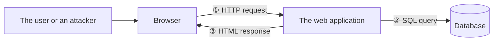
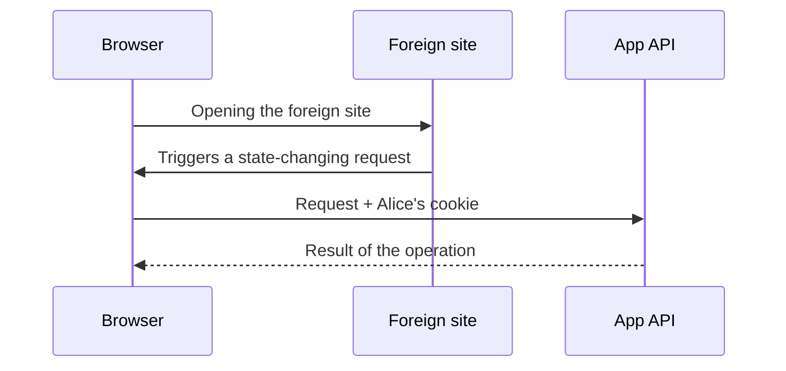

<!-- @slide Title -->
<!-- @slide-theme zinc rose zinc -->
<!-- @slide-gradient down zinc-950 -> rose-950 -->

<!-- @color rose -->
## Web Programming 1 · Chapter 8

# Web Security Basics

<!-- @width 70% -->
What are we protecting, from whom, and where does data cross a boundary beyond which we can no longer trust it?

<!-- @note -->
> The chapter starts with a way of thinking, not with a list of attacks. Then come the browser's isolation rules (same-origin policy, CORS), followed by the three big attack families: XSS, CSRF and injection. Finally: passwords, MFA, protecting sessions, and an OWASP-style review. The examples use a generic web application.

---

<!-- @slide Overview -->
<!-- @slide-theme zinc rose zinc -->
<!-- @grid ABCD/EFG. -->

<!-- @set-scale 85% -->

<!-- @color sky -->
### 8.1

Threat models and trust boundaries

***

<!-- @set-scale 85% -->

<!-- @color amber -->
### 8.2

Same-origin policy and CORS

***

<!-- @set-scale 85% -->

<!-- @color violet -->
### 8.3

XSS: when data becomes code

***

<!-- @set-scale 85% -->

<!-- @color rose -->
### 8.4

CSRF: requests triggered by a foreign site

***

<!-- @set-scale 85% -->

<!-- @color emerald -->
### 8.5

Injection: when data becomes a command

***

<!-- @set-scale 85% -->

<!-- @color cyan -->
### 8.6

Passwords, MFA and session protection

***

<!-- @set-scale 85% -->

<!-- @color orange -->
### 8.7

The OWASP mindset and a security review

<!-- @note -->
> Seven lessons. The first gives the frame of thinking: asset, attacker, capability, defence, trust boundary. 8.2 shows the browser rules that the attacks in 8.3 and 8.4 build on. 8.5 looks at the same mistake as XSS, only towards the database. 8.6 covers the login chain, and 8.7 ties everything together with a checklist.

---

<!-- @slide What and from whom -->
<!-- @slide-theme zinc sky zinc -->
<!-- @layout AA/BC/BC collapse -->

<!-- @color sky -->
## 8.1 · Threat model

<!-- @scale 85% -->
# What do we protect, from whom?

***

<!-- @color sky -->
### Assets

<!-- @set-align left -->

- Users' **personal data**
- **Correctness** of operations
- Logged-in **sessions**
- **Availability** of the service

***

<!-- @color sky -->
### Attacker and capability

<!-- @set-align left -->

- Anonymous visitor
- **Another logged-in** user
- A malicious site in **another tab**
- Someone with a **stolen password**

<!-- @note -->
> Someone who only knows attack names is lost when facing a new attack; someone who understands the way of thinking asks good questions in new situations too. The starting questions: what do we protect, from whom, and where does data cross a boundary beyond which we can no longer trust it? A security question is always tied to a concrete attacker capability: can they read a response, can they make a browser send a request, can they reach an operation they have no right to? Writing this down in an orderly way is the threat model — not a prophecy and not a long document, but a tool for prioritising.

---

<!-- @slide Trust boundary -->
<!-- @slide-theme zinc sky zinc -->
<!-- @grid AAA/BBB/CDE/CDE collapse -->

<!-- @scale 80% -->
# Trust boundary: *who claims this, and why believe it?*

***

<!-- @contain -->



***

<!-- @set-scale 85% -->

<!-- @color sky -->
### ① Browser → server

**Anyone** can rewrite `userId` → identity comes from the **session** (7.4)

***

<!-- @set-scale 85% -->

<!-- @color sky -->
### ② Server → database

Input can turn into a **command** → injection (8.5)

***

<!-- @set-scale 85% -->

<!-- @color sky -->
### ③ Server → browser

Text can turn into **code** → XSS (8.3)

<!-- @note -->
> The key question at every boundary: who claims this, and why would I believe it? Familiar from C: input read with `scanf` crosses a trust boundary, and without a length check it can overflow the buffer. On the web the most important boundary is between the browser and the server. Anyone can rewrite the `userId` field, so the server takes the user's identity from its own session (7.2, 7.4). The other two boundaries carry the same danger: what should stay data gets interpreted as a command — that is what XSS and injection are about. A boundary doesn't mean the other side is malicious, only that we can't rely on its claims.

---

<!-- @slide Threat table -->
<!-- @slide-theme zinc sky zinc -->

# A web app's threat table

<!-- @set-scale 65% -->

| Asset | Attacker | Threat | Main defence | Lesson |
| --- | --- | --- | --- | --- |
| Personal data | Another user | Reads others' data by changing an ID | Server-side authorisation | 7.4 |
| Account actions | Foreign website | Makes the browser send a request | CSRF protection | 8.4 |
| Comments | Malicious commenter | Injects code into the page | Output encoding | 8.3 |
| Database | Any visitor | Their input becomes a command | Parameterised query | 8.5 |
| Accounts | Password guesser, phisher | Takes over the account | Password protection, MFA | 8.6 |

<!-- @note -->
> A sketch, not a full analysis, but also a map of the chapter: every row points to a later lesson. Keep in mind that no defence replaces another: HTTPS protects the request from an eavesdropper on public Wi-Fi, but doesn't decide whether the user may perform the action. Logging in proves the request came with Alice's cookie, not that it came from Alice's intention. After listing the defences, always ask: is there a gap left?

---

<!-- @slide Origin and same-origin policy -->
<!-- @slide-theme zinc amber zinc -->

<!-- @color amber -->
## 8.2 · Same-origin policy

# What is an origin?

<!-- @color amber -->
**scheme + host + port** — all three must match

<!-- @set-scale 70% -->

| Compared with `http://store.company.com/dir/page.html` | Same? | Why? |
| --- | --- | --- |
| `http://store.company.com/dir2/other.html` | ✅ yes | only the path differs |
| `https://store.company.com/page.html` | ❌ no | different scheme |
| `http://store.company.com:81/dir/page.html` | ❌ no | different port |
| `http://news.company.com/dir/page.html` | ❌ no | different host |

<!-- @note -->
> Why do we need it? Two tabs in one browser: one has a web app you're logged into; the other an unknown site. The browser attaches cookies based on the request's target (7.2), so if the foreign site could read the app's responses, it could read the user's data. The same-origin policy forbids this — perhaps the browser's most important security rule. The path is not part of the origin, but a subdomain already is a different origin. Cookies follow older, different rules; localStorage is separated per origin (3.6).

---

<!-- @slide What it blocks and allows -->
<!-- @slide-theme zinc amber zinc -->
<!-- @grid AB -->

<!-- @color amber -->
## ❌ Blocked (by default)

<!-- @set-align left -->

- **Reading the response** of another origin (`fetch()`)
- Another origin's **stored data**

***

<!-- @color amber -->
## ✅ Allowed

<!-- @set-align left -->

- **Writing**: link, redirect, form submission
- **Embedding**: ``, `<script src>`, `<iframe>`
- The request **goes out** and can have side effects — only the result can't be read

<!-- @note -->
> An important distinction: the same-origin policy doesn't say no request may go to another origin; it says the sending page's script can't read the response. The request reaches the server, and a change may well happen — this is the gap CSRF exploits (8.4). Why does the browser allow it? Because without it, links, forms posting to other sites and scripts loaded from a CDN wouldn't work.

---

<!-- @slide CORS -->
<!-- @slide-theme zinc amber zinc -->
<!-- @layout AB -->

<!-- @color amber -->
## 8.2

# CORS

<!-- @set-align left -->

- `app.example` → `api.app.example`: **different origin**
- Browser: `Origin` header
- Server: `Access-Control-Allow-Origin`
- ⚠️ curl gets the same body: **not access control**

***

<!-- @set-scale 85% -->

```http
$ curl -i …/api -H 'Origin:
    https://app.example'
HTTP/1.1 200 OK
Vary: Origin
Access-Control-Allow-Origin:
  https://app.example
{"products":["…"]}

$ curl -i …/api -H 'Origin:
    https://foreign.example'
HTTP/1.1 200 OK
{"products":["…"]}
```

<!-- @note -->
> CORS (Cross-Origin Resource Sharing) works with HTTP headers: the server tells the browser which other origins may read its responses. In the second response the server handed out the body just the same; only the allowing header is missing — the browser holds it back, curl doesn't. The API needs its own authentication and authorisation (7.4). A common mistake is to "fix" a CORS error with `Access-Control-Allow-Origin: *`: that lifts the read restriction for everyone. With cookies (`credentials: "include"` + `Allow-Credentials: true`) the `*` can't even be used; the origin must be named exactly.

---

<!-- @slide CORS in 100 Seconds video -->
<!-- @slide-theme zinc amber zinc -->

<!-- @cover -->

<!-- @youtube -->
[CORS in 100 Seconds](https://www.youtube.com/watch?v=4KHiSt0oLJ0)

<!-- @note -->
> Fireship, about 2.5 minutes: the same-origin policy, the Access-Control-Allow-Origin header and the preflight in one go. A good recap after the two CORS slides.

---

<!-- @slide Preflight and clickjacking -->
<!-- @slide-theme zinc amber zinc -->
<!-- @grid AB -->

<!-- @color amber -->
## Preflight request

<!-- @set-align left -->

- **Simple request** (GET, HEAD, POST with a form): sent immediately
- **Anything else** (JSON, custom header): `OPTIONS` first
- No permission → the real request **is never sent**

***

<!-- @color amber -->
## Clickjacking

<!-- @set-align left -->

- The real site in an **invisible frame**, a decoy button on top
- The click lands on the real "Delete account" button

```http
Content-Security-Policy:
  frame-ancestors 'self'
```

<!-- @note -->
> The preflight exists because with a simple request the server performs the operation before the browser decides whether it's allowed. A simple request is one a classic form could have sent without CORS. The server answers the preflight with `Access-Control-Allow-Methods`, `-Headers` and `-Max-Age` (Max-Age defaults to 5 seconds). Clickjacking abuses the permission to embed; the older defence is `X-Frame-Options: DENY`.

---

<!-- @slide XSS essence -->
<!-- @slide-theme zinc violet zinc -->
<!-- @layout AB -->

<!-- @color violet -->
## 8.3 · XSS

# When data becomes code

<!-- @set-scale 90% -->
<!-- @set-align left -->

- **HTML and a script** instead of a comment
- The browser **runs it** — for everyone
- It runs in the vulnerable site's **own origin**

```c
printf(text);       // wrong
printf("%s", text); // right
```

***

<!-- @set-scale 85% -->

| Variant | From where? |
| --- | --- |
| **Stored** | The server stores it, everyone sees it |
| **Reflected** | From a URL parameter into the response |
| **DOM-based** | Client-side code writes it into the DOM |

<!-- @note -->
> XSS = Cross-Site Scripting: crossing the interpretation boundary from 8.1. It's the same as the C printf bug: given `%s%s%s`, printf interprets the text as formatting instructions. It's serious because the attacker's script runs in the vulnerable page's origin, so the same-origin policy doesn't help. Stored is the most dangerous: one comment affects every visitor. Reflected needs the victim to click a link; with DOM-based, the server never even sees the attacker's input.

---

<!-- @slide Output encoding tried out -->
<!-- @slide-theme zinc violet zinc -->

<!-- @color violet -->
## 8.3

# Tried out: without and with encoding

<!-- @set-scale 90% -->

```html
attacker : 
unsafe   : <p></p>
encoded  : <p>&lt;img src=x onerror=&quot;alert(…)&quot;&gt;</p>
```

```js
greeting.innerHTML   = `Hi, ${name}!`; // as HTML: unsafe
greeting.textContent = `Hi, ${name}!`; // as text: safe
```

<!-- @set-width 75% -->
<!-- @set-align left -->

- **Output encoding**: `<` → `&lt;` — shown as text
- **Context-dependent**: in an attribute a single quote is enough to break out

<!-- @note -->
> The `src=x` image deliberately doesn't exist, so the `onerror` handler runs; a real attacker would send the cookies to themselves. Encoding is the same idea as percent-encoding (2.1). In an attribute, the input `" onmouseover="alert(1)` closes the value and starts a new event handler — hence auto-encoding templates, quoted attributes, and almost never any outside data in JS or CSS contexts. innerHTML is the main source of DOM-based XSS; we flagged it in the CSR example of 6.2 too.

---

<!-- @slide Layers of defence -->
<!-- @slide-theme zinc violet zinc -->
<!-- @grid AB/CD -->

<!-- @set-scale 90% -->

<!-- @color violet -->
### 1. Output encoding

At display time, for the right context, with a template engine — **not** when storing.

***

<!-- @set-scale 90% -->

<!-- @color violet -->
### 2. `textContent`

Insert text instead of using `innerHTML`.

***

<!-- @set-scale 90% -->

<!-- @color violet -->
### 3. Sanitising

If HTML is needed: a **well-known** sanitiser library with an allowlist. Never a home-made filter.

***

<!-- @set-scale 90% -->

<!-- @color violet -->
### 4. CSP with a nonce

`script-src 'nonce-…'` — the injected script doesn't know the nonce, so it **doesn't run**.

<!-- @note -->
> The rule: insert user text as text; if HTML is needed, sanitise it with a known library; add CSP as a backup. We don't encode when storing because at that point we don't know where it will be shown: the same comment goes out as HTML, as JSON to the mobile app and in an email. The nonce is a new random value per response, the same in the header and in the page's own script elements; CSP also blocks inline event handlers and `javascript:` URLs. CSP doesn't replace encoding. A newer layer is Trusted Types, with limited support.

---

<!-- @slide Cross-Site Scripting (XSS) video -->
<!-- @slide-theme zinc violet zinc -->

<!-- @cover -->

<!-- @youtube -->
[Cross-Site Scripting (XSS): What It Is, How It Works and How to Prevent It](https://www.youtube.com/watch?v=H_-8GM6hsN0)

<!-- @note -->
> Database Dive, about 3 minutes: how XSS works and how to prevent it (encoding, sanitising, CSP). An animated summary of the previous slides.

---

<!-- @slide If it gets in anyway -->
<!-- @slide-theme zinc violet zinc -->
<!-- @layout AB -->

<!-- @color violet -->
## 8.3

# If it gets in anyway

<!-- @set-align left -->

In the user's name, the script can modify, delete, read — anything the user could do.

***

<!-- @set-align left -->

### HttpOnly cookie (7.2)

- ✅ It **can't read** the session ID
- ❌ It doesn't need to: the browser **attaches** it
- ❌ It **can** steal a token from `localStorage`
- ❌ It bypasses CSRF defences too (8.4)

<!-- @note -->
> HttpOnly limits the damage — the attacker can't steal the session and use it elsewhere — but it doesn't replace preventing XSS: through the victim's browser, "locally", the attacker can do everything. Since the requests come from the page's own origin, the CSRF token is readable too, and Sec-Fetch-Site will be same-origin.

---

<!-- @slide CSRF flow -->
<!-- @slide-theme zinc rose zinc -->
<!-- @layout AB -->

<!-- @color rose -->
## 8.4 · CSRF

# A request triggered by a foreign site

<!-- @set-scale 90% -->
<!-- @set-align left -->

- Alice is logged in and opens a **foreign site**
- Hidden form: `POST /account/email`
- The browser **attaches** Alice's cookie
- The server sees a valid session → **changes it**

***

<!-- @contain -->



<!-- @note -->
> CSRF = Cross-Site Request Forgery. Two earlier rules together open the gap: the cookie is attached based on the request's target (7.2), and the same-origin policy allows writing to another origin (8.2). Three conditions are needed: a state-changing HTTP request, identification by cookie only, and guessable parameters. The attacker doesn't need to read the response — the side effect is enough. Alice knows nothing about it; she just opened a web page. The attacker sets their own email address and then takes over the account with a password reset.

---

<!-- @slide Three servers tried out -->
<!-- @slide-theme zinc rose zinc -->

<!-- @color rose -->
## 8.4

# Tried out: the same request on three servers

<!-- @set-scale 65% -->

| Defence on the server | From a foreign site | From our own site |
| --- | --- | --- |
| None (cookie only) | **200**: "email changed on behalf of alice" | 200 |
| CSRF token (`X-CSRF-Token`) | **403**: "missing or invalid CSRF token" | 200 |
| Fetch metadata (`Sec-Fetch-Site`) | **403**: "cross-site request" | 200 |

<!-- @set-scale 100% -->

<!-- @callout warning -->
> **Never** change state with GET — an `` sends it too.

<!-- @note -->
> The request carried Alice's cookie plus `Origin: https://foreign.example` and `Sec-Fetch-Site: cross-site` headers — the browser adds these on its own; here curl imitated them. The unprotected server changed the email address in Alice's name. On the GET rule: if the action were `GET /account/delete`, an image would be enough for the attack, and a Lax cookie is sent with a GET when clicking a link.

---

<!-- @slide CSRF defences -->
<!-- @slide-theme zinc rose zinc -->

<!-- @color rose -->
## 8.4

# CSRF defences

<!-- @set-scale 75% -->

| Defence | Essence | Role |
| --- | --- | --- |
| **CSRF token** | Random value in the form; a foreign site can't read it | Primary |
| **Fetch metadata** | `Sec-Fetch-Site: cross-site` → reject | Primary |
| **Non-simple request** | JSON or custom header → preflight (8.2) | Supplementary |
| **SameSite cookie** | Not attached to requests started from another site | Defence in depth |
| **Origin check** | Accepts writes only from its own origin | Supplementary |

<!-- @note -->
> CORS is not CSRF protection: it controls reading, and a simple request still goes out. The token works because the browser attaches the cookie on its own, but the token has to be put into the request by the page — and for that the attacker would have to read the app's page, which the same-origin policy forbids. A header with the `Sec-` prefix can't be forged by a web page, but it's only sent over HTTPS. SameSite works at site level and treats a subdomain as the same site, so it's only defence in depth. Online banking example: POST, SameSite=Strict, token, header checks, and a second factor for a new payee (8.6) — so a single mistake isn't enough to cause damage.

---

<!-- @slide Cross Site Request Forgery (CSRF) — OWASP Top 10 Explainer video -->
<!-- @slide-theme zinc rose zinc -->

<!-- @cover -->

<!-- @youtube -->
[Cross Site Request Forgery (CSRF) — OWASP Top 10 Explainer](https://www.youtube.com/watch?v=Rm1GoSYqaUA)

<!-- @note -->
> Secure Code Warrior, about 4 minutes: an animated summary of CSRF and its defences (token, SameSite).

---

<!-- @slide Concatenated vs parameterised -->
<!-- @slide-theme zinc emerald zinc -->

<!-- @color emerald -->
## 8.5 · Injection

# Concatenated or parameterised?

<!-- @set-scale 85% -->

```js
const naive = `SELECT id, name FROM product WHERE public = 1 AND id = '${input}'`;
const par   = db.prepare('SELECT id, name FROM product WHERE public = 1 AND id = ?');
```

Input: `x' OR '1'='1`

```sql
… WHERE public = 1 AND id = 'x' OR '1'='1'  -> every product, internal ones too
… WHERE public = 1 AND id = ?               -> []
```

<!-- @set-width 75% -->
<!-- @set-align left -->

- The apostrophe **closed** the value — from there on it's a command
- `AND` binds tighter: **(public AND id = x) OR 1=1**

<!-- @note -->
> The essence of injection is mixing code and data — the same mistake as XSS, only here the interpreter is the database. With normal input (`42`) both versions return the same, which is why it's sneaky: nothing reveals it in everyday use. Just as multiplication binds tighter than addition, in SQL AND binds tighter than OR. An even more targeted input: `x' OR public = 0 --` — the `--` starts a comment, and it asks specifically for the non-public products. The parameterised version looks for a product whose ID is literally that text. Tried out with SQLite under Node.js 24.

---

<!-- @slide What are SQL Injections? Explained in 180 seconds video -->
<!-- @slide-theme zinc emerald zinc -->

<!-- @cover -->

<!-- @youtube -->
[What are SQL Injections? Explained in 180 seconds](https://www.youtube.com/watch?v=O9Yye537soM)

<!-- @note -->
> Cybr, about 4 minutes: static vs dynamic queries, untrusted input, and the defences. A short recap of the previous slide.

---

<!-- @slide Defences ranked -->
<!-- @slide-theme zinc emerald zinc -->

<!-- @color emerald -->
## 8.5

# Defences, ranked

<!-- @set-width 70% -->
<!-- @set-align left -->

1. **Parameterised query** — primary
2. Stored procedure, if parameterised inside too
3. **Allowlist** where a parameter isn't possible
4. ~~Escaping~~ — fragile

<!-- @set-align center -->

<!-- @callout tip -->
> Supplementary: **least privilege**

<!-- @note -->
> With parameters, the structure and the value travel separately: the database first parses the structure, only a value can go in place of `?`, and there's no character to break out with. Same as `printf("%s", text)`. In Python: `cursor.execute("... WHERE id = ?", (value,))`. With escaping it's easy to forget a case. Input validation is useful but doesn't replace parameters. Allowlists are for things like column names or sort direction (`ASC`/`DESC`). Least privilege: the app's database account can only read the product table, so even a broken query does less damage.

---

<!-- @slide Hacking Websites with SQL Injection video -->
<!-- @slide-theme zinc emerald zinc -->

<!-- @cover -->

<!-- @youtube -->
[Hacking Websites with SQL Injection](https://www.youtube.com/watch?v=_jKylhJtPmI)

<!-- @note -->
> Computerphile, about 9 minutes: a vulnerable site attacked with SQL injection, and the basic defence. Watch in parts in class, or at home.

---

<!-- @slide Other interpreters -->
<!-- @slide-theme zinc emerald zinc -->
<!-- @grid AB -->

<!-- @color emerald -->
## Other interpreters

<!-- @set-align left -->

- **Shell**: file name + `;` → a new command
- **Template engine**, search query language
- **Browser**: that was XSS (8.3)
- Principle: structure and value on **separate channels**

***

<!-- @color emerald -->
## SSRF

<!-- @set-align left -->

- The server downloads from a user-supplied **URL**
- The attacker gives an **internal** address
- Reaches systems protected from the outside
- Defence: an **allowlist**

<!-- @note -->
> Injection can happen whenever a program builds text that another interpreter reads as a command. Where structure and value can't be separated, handle the value with a proven library, following that interpreter's rules. SSRF (Server-Side Request Forgery) is a related but different bug, for example when fetching a profile picture link; OWASP files it under broken access control (A01).

---

<!-- @slide Password storage -->
<!-- @slide-theme zinc cyan zinc -->
<!-- @layout AB -->

<!-- @color cyan -->
## 8.6 · Passwords

# A fast hash? No.

<!-- @set-scale 90% -->

```text
SHA-256: 20000 tries 16 ms
  (~1 288 269 tries/s)
scrypt (N=2^17, r=8, p=1):
  20 tries 3457 ms
  (~6 tries/s)
```

100 million passwords: **90 seconds** vs. **half a year**

***

<!-- @set-scale 85% -->

| Algorithm | When? |
| --- | --- |
| **Argon2id** | First choice |
| **scrypt** | If no Argon2id |
| **bcrypt** | Older systems |
| **PBKDF2** | If a standard requires it |

\+ a unique **salt** per password

<!-- @note -->
> Login is a chain and breaks at its weakest link. Storing readable passwords is forbidden; a hash is one-way (1.6), but the attacker can guess with hashes of common passwords, and a fast hash helps them. The measurement ran on a single CPU core. Minimum parameters: Argon2id 19 MiB / 2 iterations; scrypt N=2^17; bcrypt cost 10 (truncates above 72 bytes); PBKDF2-HMAC-SHA256 600,000 iterations. A salt is a unique random value, not a secret: it gives different hashes even for identical passwords and makes precomputed tables useless. Never write your own scheme.

---

<!-- @slide How NOT to Store Passwords! video -->
<!-- @slide-theme zinc cyan zinc -->

<!-- @cover -->

<!-- @youtube -->
[How NOT to Store Passwords!](https://www.youtube.com/watch?v=8ZtInClXe1Q)

<!-- @note -->
> Computerphile, about 9.5 minutes: plain text, encryption, fast hash, salt — why the first three are bad and what the right way is. It complements the slow-hash measurement.

---

<!-- @slide NIST and MFA -->
<!-- @slide-theme zinc cyan zinc -->
<!-- @grid AB -->

<!-- @color cyan -->
## Password rules (NIST)

<!-- @set-align left -->

- ✅ **Length**: at least 15 characters
- ❌ Mandatory character mixing
- ❌ Forced periodic changes
- ✅ Blocking leaked passwords
- ✅ Password managers, pasting
- ✅ Rate-limiting attempts

***

<!-- @color cyan -->
## MFA

<!-- @set-align left -->

- Something you **know** · **have** · **are**
- Two passwords are **not** two factors
- ❌ SMS, OTP: can be typed into a fake site
- ✅ **Passkey**, WebAuthn: bound to the site's origin

<!-- @note -->
> NIST SP 800-63B is surprising at first: complexity rules push people towards predictable patterns (`Password1!`); 64-character passwords must also be allowed. Password reset is just as much a door to the account and must not be weaker than login. MFA greatly reduces the value of a stolen password but doesn't make account takeover impossible. Phishing is resisted by origin-bound cryptographic authentication, because it doesn't respond on a fake domain. Web shop example: MFA mandatory for admins, offered to customers — the defence matches the risk.

---

<!-- @slide Make Your Accounts Safer with Multifactor Authentication (MFA) video -->
<!-- @slide-theme zinc cyan zinc -->

<!-- @cover -->

<!-- @youtube -->
[Make Your Accounts Safer with Multifactor Authentication (MFA)](https://www.youtube.com/watch?v=XIlF2qkav5c)

<!-- @note -->
> CISA (the US cybersecurity agency), about 1.5 minutes: what MFA is and why it lowers the value of a stolen password. From the user's point of view.

---

<!-- @slide Understand passkeys in 4 minutes video -->
<!-- @slide-theme zinc cyan zinc -->

<!-- @cover -->

<!-- @youtube -->
[Understand passkeys in 4 minutes](https://www.youtube.com/watch?v=2xdV-xut7EQ)

<!-- @note -->
> Chrome for Developers, about 4 minutes: how passkeys work and why they resist phishing. It expands the right half of the MFA slide.

---

<!-- @slide Session -->
<!-- @slide-theme zinc cyan zinc -->

<!-- @color cyan -->
## 8.6

# The session: the key after login

<!-- @set-width 80% -->
<!-- @set-align left -->

- Whoever gets it can use it **without password or MFA**
- **Unguessable**, **new** at login — against *session fixation*
- **Expires**, and the server can **invalidate** it
- Cookie: `Secure; HttpOnly; SameSite`
- On logout the **server** ends it too — the label isn't enough

<!-- @note -->
> Session fixation: if the server kept the pre-login ID, an attacker could force an ID they know onto the user in advance and use it after the user logs in. The three cookie attributes act against separate risks; a token kept in localStorage can be read during XSS (7.3). Sensitive systems need shorter idle timeouts and re-authentication before changing the password; NIST assigns different time limits to different assurance levels.

---

<!-- @slide Session vs Token Authentication in 100 Seconds video -->
<!-- @slide-theme zinc cyan zinc -->

<!-- @cover -->

<!-- @youtube -->
[Session vs Token Authentication in 100 Seconds](https://www.youtube.com/watch?v=UBUNrFtufWo)

<!-- @note -->
> Fireship, about 2 minutes: server-side sessions in a cookie versus token-based authentication (JWT). A recap from chapter 7, as background to session protection.

---

<!-- @slide OWASP Top 10 -->
<!-- @slide-theme zinc orange zinc -->

# OWASP Top 10:2025

<!-- @set-scale 55% -->

| | Category | Where did we see it? |
| --- | --- | --- |
| **A01** | Broken Access Control | 7.4, 8.1, SSRF |
| **A02** | Security Misconfiguration | HTTPS/HSTS, CORS |
| **A03** | Software Supply Chain Failures | – |
| **A04** | Cryptographic Failures | 4.3, 7.3, 8.6 |
| **A05** | Injection | 8.3, 8.5 |
| **A06** | Insecure Design | 8.1 |
| **A07** | Authentication Failures | 7.4, 8.6 |
| **A08** | Software or Data Integrity Failures | – |
| **A09** | Security Logging and Alerting Failures | 10.5 |
| **A10** | Mishandling of Exceptional Conditions | 10.2 |

<!-- @note -->
> OWASP is an open professional community; the Top 10 is a checking frame, like a pilot's checklist — not because we don't know the attacks, but because it's easy not to think of them in a given place. A01 is at the top. A03 is about external packages — most of a modern app's code isn't written by its developers. A05 includes both SQL injection and XSS. With A06 the flaw is in the design. A10: an error message leaks internal details, or an error causes a check to be skipped. It's not ten boxes to tick, and it doesn't replace your own threat model.

---

<!-- @slide Four bugs -->
<!-- @slide-theme zinc orange zinc -->

<!-- @color orange -->
## 8.7

# A flawed order API — with HTTPS

<!-- @set-scale 70% -->

| Bug | Why is it a bug? | Cat. | Fix |
| --- | --- | --- | --- |
| `userId` comes from the request | Anyone can order as someone else | A01 | ID from the session (7.4) |
| Concatenated SQL | Input can become a command | A05 | Parameterised query (8.5) |
| The note is shown as HTML | XSS | A05 | Output encoding, `textContent` (8.3) |
| Cookie only, nobody checks intent | CSRF | A01 | Token, SameSite, Fetch metadata (8.4) |

<!-- @note -->
> The exercise: an order API that gets the product and user IDs from the browser, only checks for a valid session, concatenates the IDs into SQL, shows the note as HTML, and runs over HTTPS. Ask the students first how many bugs they see. HTTPS protects the connection, but four bugs remain. Method: follow the request's path — who sent it, are they allowed to act for this user, does the input stay data, is it the user's intention, is the response displayed safely. At each step: which party decides, what data does it rely on, and what happens if an attacker chooses that data?

---

<!-- @slide Responsibility and checklist -->
<!-- @slide-theme zinc orange zinc -->
<!-- @layout AB -->

<!-- @color orange -->
## 8.7

# Who enforces what?

<!-- @set-scale 75% -->

| Actor | What? |
| --- | --- |
| **Browser** | SOP, CORS, cookies, CSP |
| **Developer** | Output, authorisation, parameters |
| **Operator** | TLS, updates, secrets, logging |
| **User** | Long password, MFA |

***

<!-- @set-scale 90% -->
<!-- @set-align left -->

### Checklist

- Input · authorisation · output
- Interpreters · session · connection
- CORS, CSP, framing
- Secrets and dependencies
- Logging · error handling

<!-- @note -->
> The roles are connected, but none replaces another: the strongest password doesn't help if the server hands other users' data to anyone. Every checklist item points to a lesson (8.1–8.6, 7.2, 4.3, 10.2, 10.5). The review doesn't end in a "secure / insecure" verdict but in a ranked list of fixes, and every new feature, package or architectural change restarts it: security is an ongoing activity.

---

<!-- @slide Common misconceptions -->
<!-- @slide-theme zinc rose zinc -->

# Common misconceptions

<!-- @set-scale 65% -->

| Claim | Clarification |
| --- | --- |
| "An HTTPS site is secure." | It protects the connection, not the app's bugs (4.3). |
| "Data from our own form is trustworthy." | Anyone can modify the request. |
| "CORS protects the API / prevents CSRF." | It only controls reading, in the browser. |
| "HttpOnly prevents all XSS damage." | The script can still send requests as the user. |
| "Deleting special characters is enough." | SQL needs parameterised queries. |
| "A SHA-256-hashed password is safe." | It needs a slow algorithm and a unique salt. |
| "An SMS code resists phishing." | It can be typed into a fake site just the same. |

<!-- @note -->
> Picked from the misconception tables of the chapter's lessons. What they share: each relies on a single mechanism that was actually built against a different risk. The HTTPS misconception comes back in almost every lesson.

---

<!-- @slide Summary -->
<!-- @slide-theme zinc rose zinc -->
<!-- @slide-gradient down zinc-950 -> rose-950 -->

# Summary

<!-- @set-scale 85% -->
<!-- @set-width 85% -->
<!-- @set-align left -->

- **8.1** Asset, attacker, capability, defence; at every boundary: *who claims this, why believe it?*
- **8.2** The same-origin policy blocks reading, not requests; CORS is not access control
- **8.3** XSS: data becomes code — output encoding, `textContent`, sanitising, CSP
- **8.4** CSRF: a foreign site uses the browser — CSRF token, Fetch metadata, SameSite
- **8.5** Injection: parameterised queries, allowlists, least privilege
- **8.6** Slow hash + salt, phishing-resistant MFA, protected sessions
- **8.7** OWASP Top 10 as a checklist; security is ongoing

<!-- @note -->
> One idea ties the chapter together: defences complement each other, they don't replace each other. Review questions to close: Why can't the server accept the `userId` given in the request? Is https://app.example the same origin as its :8443 variant? Why doesn't CORS protect against a script run with curl? Why can't a foreign site get the CSRF token? Why did the input `x' OR '1'='1` reveal the internal products? Why is SHA-256 bad for storing passwords? Which OWASP category is it if someone rewrites another user's ID (A01)?
