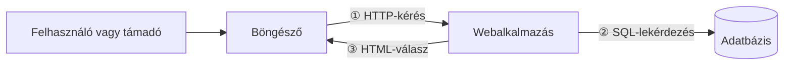
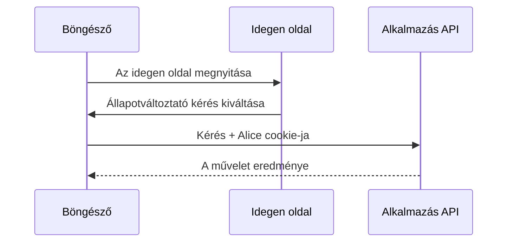

<!-- @slide Címlap -->
<!-- @slide-theme zinc rose zinc -->
<!-- @slide-gradient down zinc-950 -> rose-950 -->

<!-- @color rose -->
## Webprogramozás 1 · 8. fejezet

# Webbiztonsági alapok

<!-- @width 70% -->
Mit védünk, kitől, és hol lép át az adat olyan határt, ahol már nem bízhatunk benne?

<!-- @note -->
> A fejezet a gondolkodásmóddal kezd, nem a támadások listájával. Utána a böngésző elkülönítési szabályai jönnek (same-origin policy, CORS), majd a három nagy támadáscsalád: XSS, CSRF, injekció. Végül a jelszavak, az MFA és a munkamenetek védelme, és egy OWASP-szemléletű áttekintés. A példák általános webalkalmazásra épülnek.

---

<!-- @slide Áttekintés -->
<!-- @slide-theme zinc rose zinc -->
<!-- @grid ABCD/EFG. -->

<!-- @set-scale 85% -->

<!-- @color sky -->
### 8.1

Fenyegetési modell és bizalmi határok

***

<!-- @set-scale 85% -->

<!-- @color amber -->
### 8.2

Same-origin policy és CORS

***

<!-- @set-scale 85% -->

<!-- @color violet -->
### 8.3

XSS: amikor az adat kóddá válik

***

<!-- @set-scale 85% -->

<!-- @color rose -->
### 8.4

CSRF: kérés idegen oldal hatására

***

<!-- @set-scale 85% -->

<!-- @color emerald -->
### 8.5

Injekció: amikor az adatból utasítás lesz

***

<!-- @set-scale 85% -->

<!-- @color cyan -->
### 8.6

Jelszavak, MFA és munkamenet-védelem

***

<!-- @set-scale 85% -->

<!-- @color orange -->
### 8.7

OWASP-szemlélet és biztonsági áttekintés

<!-- @note -->
> Hét lecke. Az első adja a gondolkodási keretet: érték, támadó, képesség, védelem, bizalmi határ. A 8.2 a böngésző szabályait mutatja meg, amelyekre a 8.3 és 8.4 támadásai épülnek. A 8.5 ugyanazt a hibát nézi, mint az XSS, csak az adatbázis felé. A 8.6 a belépés láncát, a 8.7 pedig összeköti az egészet egy ellenőrzőlistával.

---

<!-- @slide Mit és kitől -->
<!-- @slide-theme zinc sky zinc -->
<!-- @layout AA/BC/BC collapse -->

<!-- @color sky -->
## 8.1 · Fenyegetési modell

<!-- @scale 85% -->
# Mit védünk, kitől?

***

<!-- @color sky -->
### Érték

<!-- @set-align left -->

- A felhasználók **személyes adatai**
- A műveletek **helyessége**
- A bejelentkezett **munkamenetek**
- A szolgáltatás **elérhetősége**

***

<!-- @color sky -->
### Támadó és képessége

<!-- @set-align left -->

- Névtelen látogató
- **Másik bejelentkezett** felhasználó
- Rosszindulatú oldal egy **másik fülön**
- Valaki **ellopott jelszóval**

<!-- @note -->
> Aki csak támadásneveket ismer, egy új támadás előtt tanácstalan; aki érti a gondolkodásmódot, új helyzetben is jól kérdez. A kiinduló kérdések: mit védünk, kitől, és hol lép át az adat olyan határt, ahol már nem bízhatunk benne? A biztonsági kérdés mindig egy konkrét támadói képességhez kötődik: el tud-e olvasni egy választ, rá tud-e venni egy böngészőt, hogy kérést küldjön, el tud-e érni egy műveletet, amihez nincs joga? Ennek rendezett leírása a fenyegetési modell — nem jóslat és nem hosszú dokumentum, hanem a rangsorolás eszköze.

---

<!-- @slide Bizalmi határ -->
<!-- @slide-theme zinc sky zinc -->
<!-- @grid AAA/BBB/CDE/CDE collapse -->

<!-- @scale 80% -->
# Bizalmi határ: *ki állítja ezt, és miért hinnék neki?*

***

<!-- @contain -->



***

<!-- @set-scale 85% -->

<!-- @color sky -->
### ① Böngésző → szerver

A `userId`-t **bárki** átírhatja → a kilét a **munkamenetből** jön (7.4)

***

<!-- @set-scale 85% -->

<!-- @color sky -->
### ② Szerver → adatbázis

A bemenet **utasítássá** válhat → injekció (8.5)

***

<!-- @set-scale 85% -->

<!-- @color sky -->
### ③ Szerver → böngésző

A szöveg **kóddá** válhat → XSS (8.3)

<!-- @note -->
> Kulcskérdés minden határon: ki állítja ezt, és miért hinnék neki? C-ből ismerős: a `scanf`-fel beolvasott bemenet bizalmi határon lép át, ellenőrzés nélkül túlírhatja a puffert. A weben a legfontosabb határ a böngésző és a szerver között van. A `userId` mezőt bárki átírhatja, ezért a szerver a felhasználó kilétét a saját munkamenetéből veszi (7.2, 7.4). A másik két határon ugyanaz a veszély: ami adat kellene legyen, utasításként értelmeződik — erről szól az XSS és az injekció. A határ nem azt jelenti, hogy a másik fél rosszindulatú, csak azt, hogy nem hagyatkozhatunk az állítására.

---

<!-- @slide Fenyegetési táblázat -->
<!-- @slide-theme zinc sky zinc -->

# Egy webalkalmazás fenyegetési táblázata

<!-- @set-scale 65% -->

| Érték | Támadó | Fenyegetés | Fő védelem | Lecke |
| --- | --- | --- | --- | --- |
| Személyes adatok | Másik felhasználó | Átírt azonosítóval más adatát olvassa | Szerveroldali jogosultság | 7.4 |
| Fiókműveletek | Idegen weboldal | A böngészővel kérést küldet | CSRF-védelem | 8.4 |
| Hozzászólások | Rosszindulatú hozzászóló | Programkódot juttat az oldalba | Kimeneti kódolás | 8.3 |
| Adatbázis | Bármely látogató | A bemenete utasítássá válik | Paraméterezett lekérdezés | 8.5 |
| Fiókok | Jelszótippelő, adathalász | Átveszi a fiókot | Jelszóvédelem, MFA | 8.6 |

<!-- @note -->
> Egy vázlat, nem teljes elemzés, de egyben a fejezet térképe: minden sor egy későbbi leckére mutat. Egyik védelem sem váltja ki a másikat: a HTTPS megvédi a kérést a Wi-Fin hallgatózótól, de nem dönti el, hogy a felhasználó jogosult-e a műveletre. A bejelentkezés igazolja, hogy a kérés Alice cookie-jával jött, de nem azt, hogy Alice szándékából indult. A védelmek felsorolása után mindig meg kell kérdezni: maradt-e rés?

---

<!-- @slide Eredet és same-origin policy -->
<!-- @slide-theme zinc amber zinc -->

<!-- @color amber -->
## 8.2 · Same-origin policy

# Mi az eredet?

<!-- @color amber -->
**séma + hosztnév + port** — mindháromnak egyeznie kell

<!-- @set-scale 70% -->

| Összevetve: `http://store.company.com/dir/page.html` | Azonos? | Miért? |
| --- | --- | --- |
| `http://store.company.com/dir2/other.html` | ✅ igen | csak az útvonal más |
| `https://store.company.com/page.html` | ❌ nem | más a séma |
| `http://store.company.com:81/dir/page.html` | ❌ nem | más a port |
| `http://news.company.com/dir/page.html` | ❌ nem | más a hosztnév |

<!-- @note -->
> Miért kell? Két fül egy böngészőben: az egyiken egy webalkalmazás, ahová be vagyunk jelentkezve, a másikon egy ismeretlen oldal. A böngésző a cookie-t a kérés célja szerint csatolja (7.2), tehát ha az idegen oldal elolvashatná az alkalmazás válaszait, kiolvasná a felhasználó adatait. Ezt tiltja a same-origin policy, talán a böngésző legfontosabb biztonsági szabálya. Az útvonal nem része az eredetnek, egy aldomain viszont már más eredet. A cookie-k régebbi, más szabályokat követnek; a localStorage eredetenként különül el (3.6).

---

<!-- @slide Mit korlátoz és mit enged -->
<!-- @slide-theme zinc amber zinc -->
<!-- @grid AB -->

<!-- @color amber -->
## ❌ Tiltott (alapesetben)

<!-- @set-align left -->

- Más eredet **válaszának olvasása** (`fetch()`)
- Más eredet **tárolt adatai**

***

<!-- @color amber -->
## ✅ Megengedett

<!-- @set-align left -->

- **Írás**: link, átirányítás, űrlap küldése
- **Beágyazás**: ``, `<script src>`, `<iframe>`
- A kérés **elmegy**, mellékhatása lehet — csak az eredmény nem olvasható

<!-- @note -->
> Fontos különbség: a same-origin policy nem azt mondja, hogy nem indulhat kérés egy másik eredet felé, hanem hogy a küldő oldal programja nem olvashatja a választ. A kérés eljut a szerverhez, és akár egy módosítás is megtörténhet — ezt a rést használja ki a CSRF (8.4). Hogy miért engedi a böngésző? Mert enélkül nem működnének a linkek, a más oldalra küldött űrlapok és a CDN-ről betöltött programok.

---

<!-- @slide CORS -->
<!-- @slide-theme zinc amber zinc -->
<!-- @layout AB -->

<!-- @color amber -->
## 8.2

# CORS

<!-- @set-align left -->

- `app.example` → `api.app.example`: **más eredet**
- Böngésző: `Origin` fejléc
- Szerver: `Access-Control-Allow-Origin`
- ⚠️ A curl ugyanazt a törzset kapja: **nem hozzáférés-védelem**

***

<!-- @set-scale 85% -->

```http
$ curl -i …/api -H 'Origin:
    https://app.example'
HTTP/1.1 200 OK
Vary: Origin
Access-Control-Allow-Origin:
  https://app.example
{"products":["…"]}

$ curl -i …/api -H 'Origin:
    https://idegen.example'
HTTP/1.1 200 OK
{"products":["…"]}
```

<!-- @note -->
> A CORS (Cross-Origin Resource Sharing) HTTP-fejlécekkel működik: a szerver megmondja a böngészőnek, mely más eredetek olvashatják a válaszait. A második válaszban a szerver ugyanúgy kiadta a törzset, csak az engedélyező fejléc hiányzik — a böngésző tartja vissza, a curl nem. Az API-nak saját hitelesítés és jogosultság kell (7.4). Gyakori hiba a CORS-hibát `Access-Control-Allow-Origin: *`-gal „megoldani”: ez mindenkinek feloldja az olvasást. Cookie-s kérésnél (`credentials: "include"` + `Allow-Credentials: true`) a `*` nem is használható, az eredetet pontosan meg kell nevezni.

---

<!-- @slide CORS in 100 Seconds videó -->
<!-- @slide-theme zinc amber zinc -->

<!-- @cover -->

<!-- @youtube -->
[CORS in 100 Seconds](https://www.youtube.com/watch?v=4KHiSt0oLJ0)

<!-- @note -->
> Fireship, kb. 2,5 perc: a same-origin policy, az Access-Control-Allow-Origin fejléc és a preflight egyben. Jó ismétlés a két CORS-dia után.

---

<!-- @slide Preflight és clickjacking -->
<!-- @slide-theme zinc amber zinc -->
<!-- @grid AB -->

<!-- @color amber -->
## Előzetes ellenőrző kérés

<!-- @set-align left -->

- **Egyszerű kérés** (GET, HEAD, POST űrlappal): azonnal elmegy
- **Más** (JSON, egyedi fejléc): előbb `OPTIONS`
- Nincs engedély → a tényleges kérés **el sem megy**

***

<!-- @color amber -->
## Clickjacking

<!-- @set-align left -->

- **Láthatatlan keretben** a valódi oldal, fölötte csali gomb
- A kattintás a valódi „Fiók törlése” gombra megy

```http
Content-Security-Policy:
  frame-ancestors 'self'
```

<!-- @note -->
> A preflight azért kell, mert egy egyszerű kérésnél a szerver végrehajtja a műveletet, mielőtt a böngésző eldöntené, hogy engedélyezett-e. Az egyszerű kérés olyan, amit egy hagyományos űrlap CORS nélkül is el tudott volna küldeni. A preflightra a szerver `Access-Control-Allow-Methods`, `-Headers` és `-Max-Age` fejlécekkel válaszol (a Max-Age alapértéke 5 másodperc). A clickjacking a beágyazás engedélyét használja ki; a régebbi védelem az `X-Frame-Options: DENY`.

---

<!-- @slide XSS lényege -->
<!-- @slide-theme zinc violet zinc -->
<!-- @layout AB -->

<!-- @color violet -->
## 8.3 · XSS

# Amikor az adat kóddá válik

<!-- @set-scale 90% -->
<!-- @set-align left -->

- Hozzászólás helyett **HTML és program**
- A böngésző **lefuttatja** — mindenkinél
- A sérülékeny oldal **saját eredetében** fut

```c
printf(szoveg);       // hibás
printf("%s", szoveg); // helyes
```

***

<!-- @set-scale 85% -->

| Változat | Honnan? |
| --- | --- |
| **Tárolt** | A szerver eltárolja, mindenki látja |
| **Visszatükrözött** | URL-paraméterből a válaszba |
| **DOM-alapú** | A kliensprogram írja a DOM-ba |

<!-- @note -->
> XSS = Cross-Site Scripting, a 8.1 értelmezési határának átlépése. Ugyanaz, mint a C printf-hiba: `%s%s%s` bemenetre a printf formázási utasításként értelmezi a szöveget. Azért súlyos, mert a támadó programja a sérülékeny oldal eredetében fut, így a same-origin policy nem segít. A tárolt a legveszélyesebb: egy hozzászólás minden látogatót érint. A visszatükrözötthöz az áldozatnak egy linkre kell kattintania, a DOM-alapúnál a szerver nem is látja a támadó bemenetet.

---

<!-- @slide Kipróbálva kimeneti kódolás -->
<!-- @slide-theme zinc violet zinc -->

<!-- @color violet -->
## 8.3

# Kipróbálva: kódolás nélkül és azzal

<!-- @set-scale 90% -->

```html
támadó   : 
veszélyes: <p></p>
kódolva  : <p>&lt;img src=x onerror=&quot;alert(…)&quot;&gt;</p>
```

```js
udvozles.innerHTML   = `Üdv, ${nev}!`; // HTML-ként: veszélyes
udvozles.textContent = `Üdv, ${nev}!`; // szövegként: biztonságos
```

<!-- @set-width 75% -->
<!-- @set-align left -->

- **Kimeneti kódolás**: `<` → `&lt;` — szövegként jelenik meg
- **Kontextusfüggő**: attribútumban egy idézőjel is elég a kitöréshez

<!-- @note -->
> Az `src=x` kép szándékosan nem létezik, ezért lefut az `onerror` kezelő; egy valódi támadó elküldené magának a cookie-kat. A kódolás ugyanaz a gondolat, mint a százalékos kódolás (2.1). Attribútumban a `" onmouseover="alert(1)` bemenet lezárja az értéket, és új eseménykezelőt kezd — ezért kell automatikusan kódoló sablonmotor, idézőjeles attribútum, és JS- vagy CSS-környezetbe szinte soha nem kerülhet külső adat. Az innerHTML a DOM-alapú XSS fő forrása; a 6.2 CSR-példájában is jeleztük.

---

<!-- @slide A védelem rétegei -->
<!-- @slide-theme zinc violet zinc -->
<!-- @grid AB/CD -->

<!-- @set-scale 90% -->

<!-- @color violet -->
### 1. Kimeneti kódolás

Megjelenítéskor, a kontextusnak megfelelően, sablonmotorral — **nem** tároláskor.

***

<!-- @set-scale 90% -->

<!-- @color violet -->
### 2. `textContent`

Szöveges beillesztés az `innerHTML` helyett.

***

<!-- @set-scale 90% -->

<!-- @color violet -->
### 3. Tisztítás

Ha HTML kell: **ismert** tisztító könyvtár engedélyezőlistával. Saját szűrőt soha.

***

<!-- @set-scale 90% -->

<!-- @color violet -->
### 4. CSP nonce-szal

`script-src 'nonce-…'` — a bejuttatott program nem ismeri a nonce-t, ezért **nem fut**.

<!-- @note -->
> Alapszabály: a felhasználótól érkező szöveget szövegként illeszd be; ha HTML kell, tisztítsd ismert könyvtárral; a CSP-t tartalékként add hozzá. Tároláskor azért nem kódolunk, mert akkor még nem tudjuk, hol jelenik meg: ugyanaz a hozzászólás megy HTML-ben, JSON-ban a mobilappnak és e-mailben is. A nonce válaszonként új véletlen érték, ugyanaz a fejlécben és a saját script elemekben; a CSP a HTML-be írt eseménykezelőket és a `javascript:` címeket is tiltja. A CSP nem pótolja a kódolást. Újabb réteg a Trusted Types, korlátozott támogatással.

---

<!-- @slide Cross-Site Scripting (XSS): What It Is, How It Works and How to Prevent It videó -->
<!-- @slide-theme zinc violet zinc -->

<!-- @cover -->

<!-- @youtube -->
[Cross-Site Scripting (XSS): What It Is, How It Works and How to Prevent It](https://www.youtube.com/watch?v=H_-8GM6hsN0)

<!-- @note -->
> Database Dive, kb. 3 perc: az XSS működése és a megelőzés (kódolás, tisztítás, CSP). Az előző diák összefoglalása animációval.

---

<!-- @slide Ha mégis bejut -->
<!-- @slide-theme zinc violet zinc -->
<!-- @layout AB -->

<!-- @color violet -->
## 8.3

# Ha mégis bejut

<!-- @set-align left -->

A program a felhasználó nevében módosíthat, törölhet, olvashat — bármit, amit ő maga megtehetne.

***

<!-- @set-align left -->

### HttpOnly cookie (7.2)

- ✅ A munkamenet-azonosítót **nem tudja kiolvasni**
- ❌ De nincs is rá szüksége: a böngésző **csatolja**
- ❌ A `localStorage` tokenjét el **is** lophatja
- ❌ A CSRF-védelmeket is megkerüli (8.4)

<!-- @note -->
> A HttpOnly enyhíti a kárt — a támadó nem tudja ellopni és máshonnan használni a munkamenetet —, de nem pótolja az XSS megelőzését: az áldozat böngészőjén keresztül „helyben” mindent megtehet. Mivel a kérések a saját eredetből indulnak, a CSRF-token is olvasható, és a Sec-Fetch-Site is same-origin lesz.

---

<!-- @slide CSRF folyamat -->
<!-- @slide-theme zinc rose zinc -->
<!-- @layout AB -->

<!-- @color rose -->
## 8.4 · CSRF

# Kérés idegen oldal hatására

<!-- @set-scale 90% -->
<!-- @set-align left -->

- Alice be van jelentkezve, megnyit egy **idegen oldalt**
- Rejtett űrlap: `POST /account/email`
- A böngésző **csatolja** Alice cookie-ját
- A szerver érvényes munkamenetet lát → **átírja**

***

<!-- @contain -->



<!-- @note -->
> CSRF = Cross-Site Request Forgery. Két korábbi szabály együtt nyitja a rést: a cookie a kérés célja szerint csatolódik (7.2), és a same-origin policy megengedi a más eredetre való írást (8.2). Három feltétel kell: állapotváltoztató HTTP-kérés, kizárólag cookie-alapú azonosítás, kitalálható paraméterek. A támadónak nem kell elolvasnia a választ — elég a mellékhatás. Alice erről semmit sem tud, ő csak megnyitott egy weboldalt; a támadó a saját e-mail-címét állítja be, és utána jelszó-visszaállítással átveszi a fiókot.

---

<!-- @slide Kipróbálva három szerver -->
<!-- @slide-theme zinc rose zinc -->

<!-- @color rose -->
## 8.4

# Kipróbálva: ugyanaz a kérés három szerveren

<!-- @set-scale 65% -->

| Védelem a szerveren | Idegen oldalról | Saját oldalról |
| --- | --- | --- |
| Nincs (csak cookie) | **200**: „e-mail-cím módosítva alice nevében” | 200 |
| CSRF-token (`X-CSRF-Token`) | **403**: „hiányzó vagy hibás CSRF-token” | 200 |
| Fetch metadata (`Sec-Fetch-Site`) | **403**: „idegen eredetű kérés” | 200 |

<!-- @set-scale 100% -->

<!-- @callout warning -->
> Állapotot **soha** ne változtass GET-tel — egy `` is elküldi.

<!-- @note -->
> A kérésben Alice cookie-ja, valamint `Origin: https://idegen.example` és `Sec-Fetch-Site: cross-site` fejléc volt — ezeket a böngésző magától teszi a kéréshez, itt a curl utánozta őket. A védelem nélküli szerver Alice nevében átírta az e-mail-címet. A GET-szabályhoz: ha a művelet `GET /account/delete` lenne, egy kép is elég volna a támadáshoz, és egy Lax cookie linkre kattintáskor GET-tel is elmegy.

---

<!-- @slide A CSRF védelmei -->
<!-- @slide-theme zinc rose zinc -->

<!-- @color rose -->
## 8.4

# A CSRF védelmei

<!-- @set-scale 75% -->

| Védelem | Lényege | Szerep |
| --- | --- | --- |
| **CSRF-token** | Véletlen érték az űrlapban; az idegen oldal nem olvashatja ki | Elsődleges |
| **Fetch metadata** | `Sec-Fetch-Site: cross-site` → elutasítás | Elsődleges |
| **Nem egyszerű kérés** | JSON vagy egyedi fejléc → preflight (8.2) | Kiegészítő |
| **SameSite cookie** | Más webhelyről indított kéréshez nem csatolódik | Mélységi |
| **Origin ellenőrzése** | Csak a saját eredetről fogad el írást | Kiegészítő |

<!-- @note -->
> A CORS nem CSRF-védelem: az olvasást szabályozza, az egyszerű kérés elmegy. A token azért működik, mert a cookie-t a böngésző magától csatolja, a tokent viszont az oldalnak kell beletennie — ahhoz el kellene olvasni az alkalmazás oldalát, amit a same-origin policy tilt. A `Sec-` előtagú fejlécet weboldal nem hamisíthatja, de csak HTTPS-en küldik. A SameSite webhelyszinten dolgozik, egy aldomaint azonos webhelynek tekint, ezért csak mélységi védelem. Netbank-példa: POST, SameSite=Strict, token, fejlécellenőrzés, és új kedvezményezettnél második tényező (8.6) — így egyetlen hiba nem elég a károkozáshoz.

---

<!-- @slide Cross Site Request Forgery (CSRF) — OWASP Top 10 Explainer videó -->
<!-- @slide-theme zinc rose zinc -->

<!-- @cover -->

<!-- @youtube -->
[Cross Site Request Forgery (CSRF) — OWASP Top 10 Explainer](https://www.youtube.com/watch?v=Rm1GoSYqaUA)

<!-- @note -->
> Secure Code Warrior, kb. 4 perc: animált összefoglaló a CSRF-ről és a védelmekről (token, SameSite).

---

<!-- @slide Összefűzött és paraméterezett -->
<!-- @slide-theme zinc emerald zinc -->

<!-- @color emerald -->
## 8.5 · Injekció

# Összefűzött vagy paraméterezett?

<!-- @set-scale 85% -->

```js
const naiv = `SELECT id, nev FROM termek WHERE nyilvanos = 1 AND id = '${bemenet}'`;
const par  = db.prepare('SELECT id, nev FROM termek WHERE nyilvanos = 1 AND id = ?');
```

Bemenet: `x' OR '1'='1`

```sql
… WHERE nyilvanos = 1 AND id = 'x' OR '1'='1'  -> minden termék, a belsők is
… WHERE nyilvanos = 1 AND id = ?               -> []
```

<!-- @set-width 75% -->
<!-- @set-align left -->

- Az aposztróf **lezárta** az értéket — onnantól utasítás
- `AND` erősebben köt: **(nyilvános ÉS id = x) VAGY 1=1**

<!-- @note -->
> Az injekció lényege a kód és az adat összekeveredése — ugyanaz a hiba, mint az XSS, csak itt az értelmező az adatbázis. Normál bemenetnél (`42`) mindkét változat ugyanazt adja, ezért alattomos: hétköznapi használatnál semmi sem jelzi. Ahogy a matematikában a szorzás erősebben köt az összeadásnál, az SQL-ben az AND erősebben köt az OR-nál. Még célzottabb bemenet: `x' OR nyilvanos = 0 --` — a `--` megjegyzést kezd, és kifejezetten a nem nyilvános termékeket kéri le. A paraméterezett változat olyan terméket keres, aminek ez szó szerint az azonosítója. A kipróbálás SQLite-tal, Node.js 24 alatt készült.

---

<!-- @slide What are SQL Injections? Explained in 180 seconds videó -->
<!-- @slide-theme zinc emerald zinc -->

<!-- @cover -->

<!-- @youtube -->
[What are SQL Injections? Explained in 180 seconds](https://www.youtube.com/watch?v=O9Yye537soM)

<!-- @note -->
> Cybr, kb. 4 perc: statikus és dinamikus lekérdezés, megbízhatatlan bemenet, és a védekezés. Rövid ismétlés az előző diához.

---

<!-- @slide Miért működik a paraméterezés -->
<!-- @slide-theme zinc emerald zinc -->

<!-- @color emerald -->
## 8.5

# Védekezés rangsor szerint

<!-- @set-width 70% -->
<!-- @set-align left -->

1. **Paraméterezett lekérdezés** — elsődleges
2. Tárolt eljárás, ha belül is paraméteres
3. **Engedélyezőlista**, ahol nem lehet paraméter
4. ~~Escape-elés~~ — törékeny

<!-- @set-align center -->

<!-- @callout tip -->
> Kiegészítő: **legkisebb jogosultság**


<!-- @note -->
> A paraméterezésnél a szerkezet és az érték két külön úton jut el: az adatbázis előbb értelmezi a szerkezetet, a `?` helyére csak érték kerülhet, nincs karakter, amivel ki lehetne lépni. Ugyanaz, mint a `printf("%s", szoveg)`. Pythonban: `kurzor.execute("... WHERE id = ?", (bemenet,))`. Az escape-elésnél könnyű egy esetet elfelejteni. A bemenet ellenőrzése hasznos, de nem helyettesíti a paraméterezést. Legkisebb jogosultság: az alkalmazás adatbázis-fiókja csak olvashatja a termék táblát, így egy elrontott lekérdezés is kisebb kárt okoz.

---

<!-- @slide Hacking Websites with SQL Injection videó -->
<!-- @slide-theme zinc emerald zinc -->

<!-- @cover -->

<!-- @youtube -->
[Hacking Websites with SQL Injection](https://www.youtube.com/watch?v=_jKylhJtPmI)

<!-- @note -->
> Computerphile, kb. 9 perc: egy sérülékeny oldal SQL-injekcióval, és az alapvető védekezés. Órán részletekben, vagy otthoni nézésre.

---

<!-- @slide Más értelmezők -->
<!-- @slide-theme zinc emerald zinc -->
<!-- @grid AB -->

<!-- @color emerald -->
## Más értelmezők

<!-- @set-align left -->

- **Parancssor**: fájlnév + `;` → új parancs
- **Sablonmotor**, keresőnyelv
- **Böngésző**: ez volt az XSS (8.3)
- Elv: szerkezet és érték **külön csatornán**

***

<!-- @color emerald -->
## SSRF

<!-- @set-align left -->

- A szerver a felhasználó **URL-jéről** tölt le
- A támadó **belső** címet ad meg
- Kívülről védett rendszereket ér el
- Védelem: **engedélyezőlista**

<!-- @note -->
> Az injekció bármikor előfordulhat, amikor egy program szöveget állít össze, amit egy másik értelmező utasításként olvas. Ahol a szerkezet és az érték nem választható szét, bevált könyvtárral, az adott értelmező szabályai szerint kell kezelni az értéket. Az SSRF (Server-Side Request Forgery) rokon, de másféle hiba, például egy profilkép linkjének letöltésekor; az OWASP a hibás hozzáférés-ellenőrzéshez (A01) sorolja.

---

<!-- @slide Jelszótárolás -->
<!-- @slide-theme zinc cyan zinc -->
<!-- @layout AB -->

<!-- @color cyan -->
## 8.6 · Jelszavak

# Gyors hash? Nem.

<!-- @set-scale 90% -->

```text
SHA-256: 20000 próba 16 ms
  (~1 288 269 próba/s)
scrypt (N=2^17, r=8, p=1):
  20 próba 3457 ms
  (~6 próba/s)
```

100 millió jelszó: **másfél perc** vs. **fél év**

***

<!-- @set-scale 85% -->

| Eljárás | Mikor? |
| --- | --- |
| **Argon2id** | Elsődleges |
| **scrypt** | Ha nincs Argon2id |
| **bcrypt** | Régebbi rendszer |
| **PBKDF2** | Ha előírás követeli |

\+ jelszavanként egyedi **salt**

<!-- @note -->
> A belépés egy lánc, a leggyengébb láncszemén szakad el. Olvasható jelszót tárolni tilos; a hash egyirányú (1.6), de a támadó a gyakori jelszavak lenyomatával találgathat, és a gyors hash ebben neki kedvez. A mérés egy processzormagon készült. Minimum paraméterek: Argon2id 19 MiB / 2 iteráció; scrypt N=2^17; bcrypt munkatényező 10 (72 bájt felett levág); PBKDF2-HMAC-SHA256 600 000 iteráció. A salt egyedi véletlen érték, nem titok: azonos jelszavakhoz is különböző lenyomatot ad, és használhatatlanná teszi az előre kiszámolt táblákat. Saját eljárást írni soha.

---

<!-- @slide How NOT to Store Passwords! videó -->
<!-- @slide-theme zinc cyan zinc -->

<!-- @cover -->

<!-- @youtube -->
[How NOT to Store Passwords!](https://www.youtube.com/watch?v=8ZtInClXe1Q)

<!-- @note -->
> Computerphile, kb. 9,5 perc: olvasható jelszó, titkosítás, gyors hash, salt — miért rossz az első három, és mi a helyes út. Kiegészíti a lassú hash mérését.

---

<!-- @slide NIST és MFA -->
<!-- @slide-theme zinc cyan zinc -->
<!-- @grid AB -->

<!-- @color cyan -->
## Jelszószabályok (NIST)

<!-- @set-align left -->

- ✅ **Hosszúság**: min. 15 karakter
- ❌ Kötelező karakterkeverés
- ❌ Kényszerített rendszeres csere
- ✅ Kiszivárgott jelszavak tiltása
- ✅ Jelszókezelő, beillesztés
- ✅ Próbálkozások korlátozása

***

<!-- @color cyan -->
## MFA

<!-- @set-align left -->

- Amit **tud** · ami **megvan** · ami hozzá **kötődik**
- Két jelszó **nem** két tényező
- ❌ SMS, OTP: hamis oldalon is beírható
- ✅ **Passkey**, WebAuthn: az oldal eredetéhez kötve

<!-- @note -->
> A NIST SP 800-63B irányelve elsőre meglepő: a bonyolultsági szabályok kiszámítható mintákra (`Jelszo1!`) ösztönöznek; a 64 karakteres jelszót is meg kell engedni. A jelszó-visszaállítás ugyanúgy a fiók bejárata, nem lehet gyengébb a belépésnél. Az MFA nagyon csökkenti egy ellopott jelszó értékét, de nem teszi lehetetlenné a fiók átvételét. Az adathalászatnak az eredethez kötött kriptográfiai hitelesítés áll ellen, mert egy hamis domainen nem ad választ. Webáruház-példa: adminnak kötelező MFA, vásárlónak felajánlott — a védelem a kockázathoz igazodik.

---

<!-- @slide Make Your Accounts Safer with Multifactor Authentication (MFA) videó -->
<!-- @slide-theme zinc cyan zinc -->

<!-- @cover -->

<!-- @youtube -->
[Make Your Accounts Safer with Multifactor Authentication (MFA)](https://www.youtube.com/watch?v=XIlF2qkav5c)

<!-- @note -->
> CISA (az USA kiberbiztonsági ügynöksége), kb. 1,5 perc: mi az MFA, és miért csökkenti egy ellopott jelszó értékét. Felhasználói nézőpontból.

---

<!-- @slide Understand passkeys in 4 minutes videó -->
<!-- @slide-theme zinc cyan zinc -->

<!-- @cover -->

<!-- @youtube -->
[Understand passkeys in 4 minutes](https://www.youtube.com/watch?v=2xdV-xut7EQ)

<!-- @note -->
> Chrome for Developers, kb. 4 perc: hogyan működik a passkey, és miért áll ellen az adathalászatnak. Az MFA-dia jobb oldalát mutatja be.

---

<!-- @slide Munkamenet -->
<!-- @slide-theme zinc cyan zinc -->

<!-- @color cyan -->
## 8.6

# A munkamenet: belépés utáni kulcs

<!-- @set-width 80% -->
<!-- @set-align left -->

- Aki megszerzi, **jelszó és MFA nélkül** is használhatja
- **Kitalálhatatlan**, belépéskor **új** — *session fixation* ellen
- **Lejár**, és a szerver **érvénytelenítheti**
- Cookie: `Secure; HttpOnly; SameSite`
- Kijelentkezéskor a **szerver** is megszünteti — a felirat nem elég

<!-- @note -->
> Session fixation: ha a szerver megtartaná a belépés előtti azonosítót, a támadó előre ráerőltethetne egy általa ismert azonosítót a felhasználóra, és a belépés után azzal lépne be. A három cookie-attribútum külön kockázat ellen hat; a localStorage-ban tartott token XSS-nél kiolvasható (7.3). Érzékeny rendszerben rövidebb tétlenségi idő és jelszócsere előtt újbóli hitelesítés kell; a NIST az érzékenységi szintekhez különböző időkorlátokat rendel.

---

<!-- @slide Session vs Token Authentication in 100 Seconds videó -->
<!-- @slide-theme zinc cyan zinc -->

<!-- @cover -->

<!-- @youtube -->
[Session vs Token Authentication in 100 Seconds](https://www.youtube.com/watch?v=UBUNrFtufWo)

<!-- @note -->
> Fireship, kb. 2 perc: szerveroldali munkamenet cookie-ban és token alapú hitelesítés (JWT). Ismétlés a 7. fejezetből, a munkamenet-védelem hátteréhez.

---

<!-- @slide OWASP Top 10 -->
<!-- @slide-theme zinc orange zinc -->

# OWASP Top 10:2025

<!-- @set-scale 55% -->

| | Kategória | Hol láttuk? |
| --- | --- | --- |
| **A01** | Broken Access Control — hibás hozzáférés-ellenőrzés | 7.4, 8.1, SSRF |
| **A02** | Security Misconfiguration — hibás beállítás | HTTPS/HSTS, CORS |
| **A03** | Software Supply Chain Failures — ellátási lánc | – |
| **A04** | Cryptographic Failures — kriptográfiai hibák | 4.3, 7.3, 8.6 |
| **A05** | Injection — injekció | 8.3, 8.5 |
| **A06** | Insecure Design — nem biztonságos tervezés | 8.1 |
| **A07** | Authentication Failures — hitelesítési hibák | 7.4, 8.6 |
| **A08** | Software or Data Integrity Failures | – |
| **A09** | Security Logging and Alerting Failures | 10.5 |
| **A10** | Mishandling of Exceptional Conditions | 10.2 |

<!-- @note -->
> Az OWASP nyílt szakmai közösség; a Top 10 ellenőrző keret, mint a pilóták listája — nem azért kell, mert nem tudjuk a támadásokat, hanem mert egy adott helyen könnyű nem gondolni rájuk. Az A01 áll az élen. Az A03 a külső csomagokra vonatkozik — egy mai alkalmazás kódjának nagy része nem a fejlesztőké. Az A05 az SQL-injekciót és az XSS-t is magában foglalja. Az A06-nál a hiba a tervben van. Az A10: hibaüzenet belső részleteket árul el, vagy kimarad egy ellenőrzés. Nem tíz kipipálható teszt, és nem helyettesíti a saját fenyegetési modellt.

---

<!-- @slide Négy hiba -->
<!-- @slide-theme zinc orange zinc -->

<!-- @color orange -->
## 8.7

# Hibás rendelés-API, HTTPS-sel

<!-- @set-scale 65% -->

| Hiba | Miért hiba? | Kat. | Javítás |
| --- | --- | --- | --- |
| A `userId` a kérésből jön | Bárki más nevében rendelhet | A01 | Azonosító a munkamenetből (7.4) |
| Összefűzött SQL | A bemenet utasítássá válhat | A05 | Paraméterezett lekérdezés (8.5) |
| A megjegyzés HTML-ként jelenik meg | XSS | A05 | Kimeneti kódolás, `textContent` (8.3) |
| Csak cookie, a szándékot senki sem nézi | CSRF | A01 | Token, SameSite, Fetch metadata (8.4) |

<!-- @note -->
> A feladat: egy rendelés-API, amely a böngészőtől kapja a termék és a felhasználó azonosítóját, csak az érvényes munkamenetet nézi, összefűzve SQL-be illeszti az azonosítókat, a megjegyzést HTML-ként jeleníti meg, és HTTPS-en fut. Érdemes előbb megkérdezni a hallgatókat, hány hibát látnak. A HTTPS a kapcsolatot védi, de négy hiba marad. Módszer: kövesd a kérés útját — ki küldte, jogosult-e erre a felhasználóra, adat marad-e a bemenet, a felhasználó szándéka-e, biztonságosan jelenik-e meg a válasz. Minden lépésnél: melyik fél dönt, milyen adatra támaszkodik, és mi történik, ha ezt egy támadó választja meg?

---

<!-- @slide Felelősség és ellenőrzőlista -->
<!-- @slide-theme zinc orange zinc -->
<!-- @layout AB -->

<!-- @color orange -->
## 8.7

# Ki mit érvényesít?

<!-- @set-scale 75% -->

| Szereplő | Mit? |
| --- | --- |
| **Böngésző** | SOP, CORS, cookie, CSP |
| **Fejlesztő** | Kimenet, jogosultság, paraméterezés |
| **Üzemeltető** | TLS, frissítés, titkok, naplózás |
| **Felhasználó** | Hosszú jelszó, MFA |

***

<!-- @set-scale 90% -->
<!-- @set-align left -->

### Ellenőrzőlista

- Bemenet · jogosultság · kimenet
- Értelmezők · munkamenet · kapcsolat
- CORS, CSP, keretek
- Titkok és függőségek
- Naplózás · hibakezelés

<!-- @note -->
> A szerepek összekapcsolódnak, de egyik sem pótolja a másikat: a legerősebb jelszó sem véd, ha a szerver bárkinek kiadja más felhasználók adatait. Az ellenőrzőlista minden pontja egy leckére mutat (8.1–8.6, 7.2, 4.3, 10.2, 10.5). Az áttekintés eredménye nem „biztonságos / nem biztonságos” ítélet, hanem rangsorolt javítási lista, és minden új funkció, csomag vagy architekturális változás újraindítja: a biztonság folyamatos tevékenység.

---

<!-- @slide Gyakori tévhitek -->
<!-- @slide-theme zinc rose zinc -->

# Gyakori tévhitek

<!-- @set-scale 65% -->

| Állítás | Pontosítás |
| --- | --- |
| „A HTTPS-es oldal biztonságos.” | A kapcsolatot védi, az alkalmazás hibáit nem (4.3). |
| „A saját űrlapunkról érkező adat megbízható.” | A kérést bárki módosíthatja. |
| „A CORS megvédi az API-t / megakadályozza a CSRF-et.” | Csak a böngészőben szabályozza az olvasást. |
| „A HttpOnly minden XSS-kárt megakadályoz.” | A program továbbra is küldhet kéréseket a felhasználó nevében. |
| „Elég a különleges karaktereket törölni.” | SQL-nél paraméterezés kell. |
| „SHA-256-tal hash-elt jelszó biztonságos.” | Lassú eljárás és egyedi salt kell. |
| „Az SMS-kód ellenáll az adathalászatnak.” | Hamis oldalon ugyanúgy beírható. |

<!-- @note -->
> A fejezet leckéinek tévhit-táblázataiból válogatva. Közös pont: mindegyik egyetlen mechanizmusra bízza a védelmet, amely valójában más kockázat ellen készült. A HTTPS-tévhit szinte minden leckében visszatér.

---

<!-- @slide Összefoglalás -->
<!-- @slide-theme zinc rose zinc -->
<!-- @slide-gradient down zinc-950 -> rose-950 -->

# Összefoglalás

<!-- @set-scale 85% -->
<!-- @set-width 85% -->
<!-- @set-align left -->

- **8.1** Érték, támadó, képesség, védelem; minden határon: *ki állítja, miért hinnék neki?*
- **8.2** A same-origin policy az olvasást tiltja, nem a kérést; a CORS nem hozzáférés-védelem
- **8.3** XSS: adatból kód — kimeneti kódolás, `textContent`, tisztítás, CSP
- **8.4** CSRF: idegen oldal a böngészővel — CSRF-token, Fetch metadata, SameSite
- **8.5** Injekció: paraméterezett lekérdezés, engedélyezőlista, legkisebb jog
- **8.6** Lassú hash + salt, adathalászat-ellenálló MFA, védett munkamenet
- **8.7** OWASP Top 10 mint ellenőrzőlista; a biztonság folyamatos

<!-- @note -->
> Egy gondolat köti össze a fejezetet: a védelmek egymást kiegészítik, nem helyettesítik. Ellenőrző kérdések a záráshoz: Miért nem fogadhatja el a szerver a kérésben megadott userId-t? Azonos eredetű-e a https://app.example és a :8443-as változata? Miért nem véd a CORS egy curl-lel futtatott szkript ellen? Miért nem tudja egy idegen oldal megszerezni a CSRF-tokent? Miért tette láthatóvá a belső termékeket az `x' OR '1'='1` bemenet? Miért nem jó a SHA-256 jelszótárolásra? Melyik OWASP-kategória, ha valaki átírja egy másik felhasználó azonosítóját (A01)?
