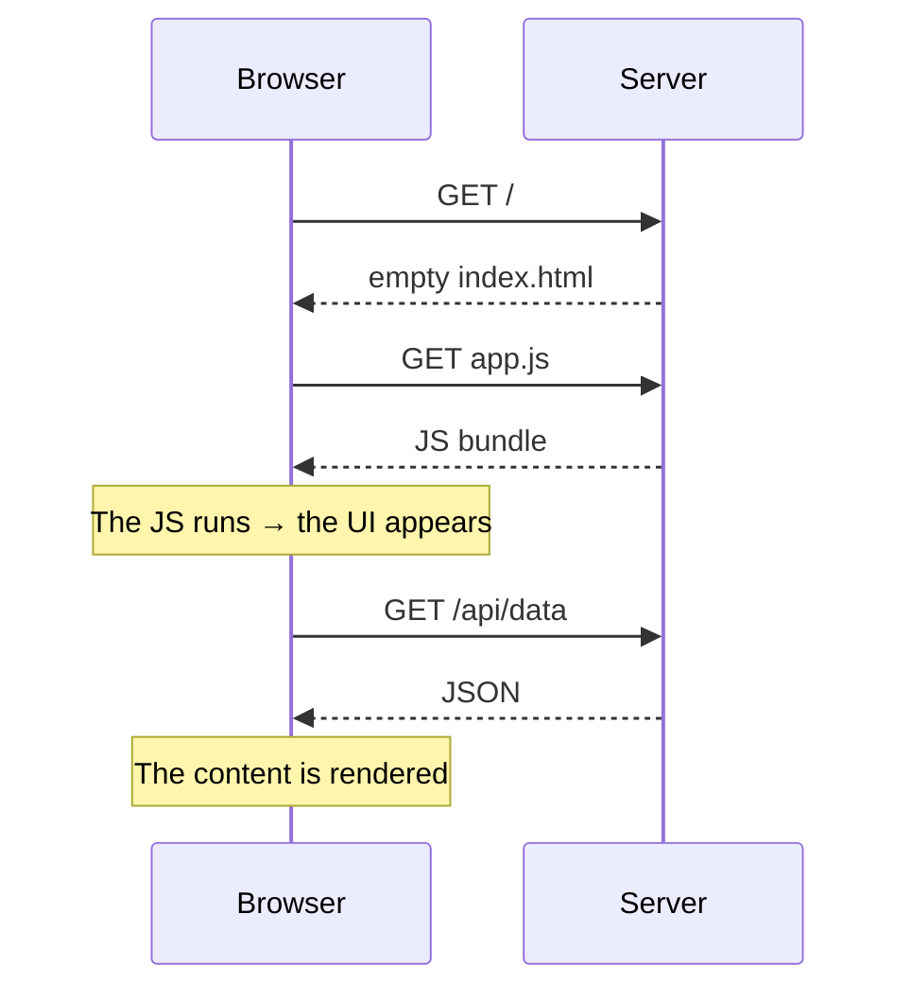
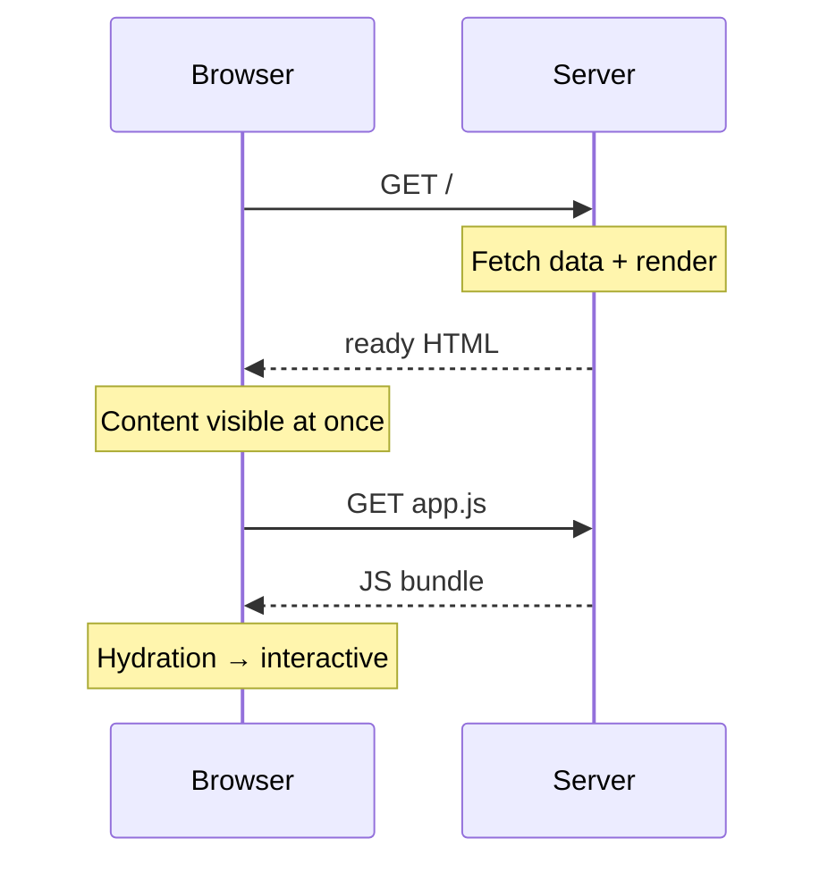
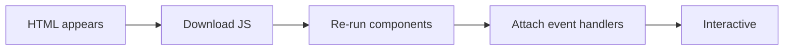

<!-- @slide Title -->
<!-- @slide-theme zinc violet zinc -->
<!-- @slide-gradient down zinc-950 -> violet-950 -->

<!-- @color violet -->
## Frontend development in 2026

# Library vs Framework

<!-- @width 70% -->
React · Angular · Vue · Svelte · Astro · htmx — and the rendering strategies behind them

<!-- @note -->
> Welcome and a short introduction. We look for answers to three questions: what is the difference between a library and a framework, what is the character of today's most important tools, and **where and when** is the HTML the user sees produced. About 40 minutes, questions at the end.

---

<!-- @slide Library vs Framework -->
<!-- @slide-theme zinc amber zinc -->
<!-- @grid AB -->

<!-- @color amber -->
## Library

# You call it

<!-- @set-align left -->
<!-- @set-width 80% -->

- Solves one specific problem
- **You** decide when and how to use it
- Easy to replace and combine
- Examples: *lodash*, *axios*, *date-fns*, **React**

***

<!-- @color violet -->
## Framework

# It calls you

<!-- @set-align left -->
<!-- @set-width 80% -->

- Provides structure and conventions
- The **framework** is in control
- You just “fill in the blanks”
- Examples: __Angular__, __Next.js__, __Nuxt__, __Astro__

<!-- @note -->
> The most common misconception is that the difference is size: “a library is small, a framework is big”. The real question is **who calls whom**. You call a library when you need it; a framework calls your code according to its own lifecycle. Question for the audience: is React a library or a framework?

---

<!-- @slide Inversion of Control -->
<!-- @slide-theme zinc amber zinc -->
<!-- @layout AB/AB/CC -->

<!-- @color amber -->
### Library — you're in control

```js
import { format }
  from "date-fns";

render(format(now, "yyyy"));
```

***

<!-- @color violet -->
### Framework — it calls you

```ts
@Component({
  template: "{{ d }}",
})
class DateCmp {
  d = "";
  ngOnInit() { this.d = now() }
}
```

***

<!-- @set-scale 78% -->

<!-- @callout tip -->
> **Inversion of Control** — *“Don't call us, we'll call you.”*

<!-- @note -->
> On the left we call `format` ourselves and decide what happens with the result. On the right we never call `ngOnInit`: Angular calls it once the component is created. That's **Inversion of Control** — control is turned around, also known as the “Hollywood principle”. The more of these “hooks” there are, the more we're talking about a framework.

---

<!-- @slide Spectrum -->
<!-- @slide-theme zinc amber zinc -->
<!-- @layout AAAA/BCDE -->

# Not black and white: a spectrum

<!-- @width 70% -->
Library ⟶ Framework: the further right you go, the more decisions the tool makes for you.

***

<!-- @set-scale 85% -->

<!-- @color amber -->
### Library

React, Preact, Solid, htmx

***

<!-- @set-scale 85% -->

<!-- @color orange -->
### Progressive

Vue, Svelte

***

<!-- @set-scale 85% -->

<!-- @color rose -->
### Meta-framework

Next.js, Nuxt, SvelteKit, Astro

***

<!-- @set-scale 85% -->

<!-- @color violet -->
### Full framework

Angular

<!-- @note -->
> In reality there's no sharp line. React calls itself “the library for web and native user interfaces”, but we almost always use it with a meta-framework (Next.js, React Router) — and that already feels like a framework. Vue and Svelte are “progressive”: usable as a library in small doses, but extendable into a full framework with an official router and meta-framework.

---

<!-- @slide Library vs Framework table -->
<!-- @slide-theme zinc amber zinc -->

# Library vs Framework

<!-- @set-scale 90% -->

<!-- @width 80% -->
| | Library | Framework |
| --- | --- | --- |
| Control | Yours | The framework's |
| Freedom | High | Lower, but consistent |
| Decisions to make | Many (router, state, build…) | Few, made up front |
| Learning curve | Flat at first | Steeper at first |

<!-- @note -->
> A library's freedom is also a burden: you pick the router, the state management and the build tool — and you keep them compatible. A framework decides for you: less freedom, but a new team member finds their way faster because every project looks similar.

---

<!-- @slide React history -->
<!-- @slide-theme slate cyan sky -->
<!-- @layout AAAA/BCDE/BCDE -->

# React — a brief history

***

<!-- @set-scale 85% -->

<!-- @color cyan -->
### 2011–2013

Jordan Walke, Facebook — open source in 2013

***

<!-- @set-scale 85% -->

<!-- @color cyan -->
### 2015

**React Native** — the same model on mobile

***

<!-- @set-scale 85% -->

<!-- @color cyan -->
### 2019

**Hooks** (React 16.8) — functions instead of classes

***

<!-- @set-scale 85% -->

<!-- @color cyan -->
### 2024–2025

**React 19**, Server Components, **React Compiler**

<!-- @note -->
> React was born from a Facebook news feed problem: keeping the DOM in sync with the data by hand had become too complex. At its first presentation many people laughed at JSX — “HTML in JavaScript?” — today it's the industry standard. Hooks completely changed how React code is written in 2019, and Server Components shift the focus back to the server.

---

<!-- @slide React -->
<!-- @slide-theme slate cyan sky -->
<!-- @layout AABBB -->

<!-- @set-scale 90% -->

<!-- @color cyan -->
## Meta · 2013

# React

<!-- @set-align left -->

- `UI = f(state)`, **JSX**
- **Virtual DOM** + diffing
- Hooks, one-way data flow
- **React 19:** Server Components
- **React Compiler**

***

```jsx
import { useState } from "react";

export function Counter() {
  const [count, setCount] = useState(0);
  const inc = () => setCount(count + 1);

  return (
    <button onClick={inc}>
      Clicks: {count}
    </button>
  );
}
```

<!-- @note -->
> React's core idea: the UI is a function of state. Every state change **re-runs** the component function, then only the changed parts of the DOM are updated based on the Virtual DOM diff. The React Compiler memoizes automatically, so most `useMemo` / `useCallback` calls can go. Its biggest strengths are the ecosystem and the job market.

---

<!-- @slide React video -->
<!-- @slide-theme slate cyan sky -->

<!-- @color cyan -->
## Fireship · video

# React in 100 seconds

<!-- @width 64% -->
<!-- @youtube -->
[React in 100 seconds](https://www.youtube.com/watch?v=Tn6-PIqc4UM)

<!-- @note -->
> Fireship's short summary of React (about 2 minutes). A good recap of JSX, components and hooks; if time is short, recommend it for watching at home.

---

<!-- @slide Angular history -->
<!-- @slide-theme slate red rose -->
<!-- @layout AAAA/BCDE/BCDE -->

# Angular — a brief history

***

<!-- @set-scale 85% -->

<!-- @color red -->
### 2010

**AngularJS** (Google) — two-way data binding

***

<!-- @set-scale 85% -->

<!-- @color red -->
### 2016

**Angular 2** — complete rewrite in TypeScript

***

<!-- @set-scale 85% -->

<!-- @color red -->
### 2022–2023

Standalone components, **Signals**, new control flow

***

<!-- @set-scale 85% -->

<!-- @color red -->
### 2025

**Zoneless** by default — a modern, lighter Angular

<!-- @note -->
> AngularJS was a huge success in 2010, but two-way data binding proved slow in large applications. So Angular 2 became a complete rewrite, which scared off many teams — and helped React and Vue rise. Since 2023 people talk about an “Angular renaissance”: signals, a new template syntax, new docs (angular.dev), and a farewell to Zone.js.

---

<!-- @slide Angular -->
<!-- @slide-theme slate red rose -->
<!-- @layout AABBB -->

<!-- @set-scale 90% -->

<!-- @color red -->
## Google · 2016

# Angular

<!-- @set-align left -->

- **Full framework**, TypeScript
- Router, forms, HTTP, DI, CLI
- **Signals**, zoneless mode
- `@if` · `@for` · `@defer`
- Enterprise favorite

***

```ts
import { Component, signal }
  from "@angular/core";
@Component({
  template: `
    <button (click)="inc()">
      Clicks: {{ count() }}
    </button>
  `,
})
export class Counter {
  count = signal(0);
  inc() {
    this.count.update(c => c + 1);
  }
}
```

<!-- @note -->
> Angular is “batteries included”: router, forms, HTTP client, i18n, dependency injection and CLI are all part of the package, maintained by one team. With signal-based reactivity it no longer has to check the whole component tree, only the affected parts. It's popular in enterprises because of its strong conventions: every team builds the same way.

---

<!-- @slide Angular video -->
<!-- @slide-theme slate red rose -->

<!-- @color red -->
## Fireship · video

# Angular in 100 seconds

<!-- @width 64% -->
<!-- @youtube -->
[Angular in 100 seconds](https://www.youtube.com/watch?v=Ata9cSC2WpM)

<!-- @note -->
> Fireship's summary of Angular: components, decorators, dependency injection, the CLI. The video is older and shows Angular before standalone components and signals.

---

<!-- @slide Vue history -->
<!-- @slide-theme slate emerald green -->
<!-- @layout AAAA/BCDE/BCDE -->

# Vue — a brief history

***

<!-- @set-scale 85% -->

<!-- @color emerald -->
### 2014

Side project of Evan You (ex-Google, AngularJS)

***

<!-- @set-scale 85% -->

<!-- @color emerald -->
### 2016

**Vue 2** — Virtual DOM, explosive growth

***

<!-- @set-scale 85% -->

<!-- @color emerald -->
### 2020

**Vue 3** — Composition API, Proxy reactivity

***

<!-- @set-scale 85% -->

<!-- @color emerald -->
### 2025

**Vapor Mode** — compiling without a Virtual DOM

<!-- @note -->
> Evan You worked with AngularJS at Google and wanted to keep what was good about it — templates and reactivity — without the heavy parts. Vue grew big without a corporation behind it, funded by its community, especially popular in Asia and the Laravel community. The Vue 3 migration was painful, but today it's a stable foundation.

---

<!-- @slide Vue -->
<!-- @slide-theme slate emerald green -->
<!-- @layout AABBB -->

<!-- @set-scale 90% -->

<!-- @color emerald -->
## Evan You · 2014

# Vue

<!-- @set-align left -->

- **Progressive** adoption
- Single File Components
- Proxy-based reactivity
- Vue Router, Pinia
- **Vapor Mode** · **Nuxt**

***

```vue
<script setup>
import { ref } from "vue";

const count = ref(0);
</script>

<template>
  <button @click="count++">
    Clicks: {{ count }}
  </button>
</template>
```

<!-- @note -->
> A Single File Component keeps the template, the logic and the styles in one file. A `ref` is a reactive value: when it changes, Vue knows exactly which part of the DOM to update. It sits between Angular's structure and React's flexibility, with a friendly learning curve. Its meta-framework is Nuxt.

---

<!-- @slide Vue video -->
<!-- @slide-theme slate emerald green -->
<!-- @grid AB -->

<!-- @color emerald -->
## Fireship · video

# Vue in 100 seconds

<!-- @youtube -->
[Vue in 100 seconds](https://www.youtube.com/watch?v=nhBVL41-_Cw)

***

<!-- @color emerald -->
## Fireship · video

# Nuxt in 100 seconds

<!-- @youtube -->
[Nuxt in 100 seconds](https://www.youtube.com/watch?v=dCxSsr5xuL8)

<!-- @note -->
> Two short videos: Vue itself on the left, Nuxt on the right, the meta-framework built on Vue (routing, SSR, SSG). Nuxt is to Vue what Next.js is to React.

---

<!-- @slide Svelte history -->
<!-- @slide-theme stone orange orange -->
<!-- @layout AAAA/BCDE/BCDE -->

# Svelte — a brief history

***

<!-- @set-scale 85% -->

<!-- @color orange -->
### 2016

Rich Harris (The Guardian) — “the disappearing framework”

***

<!-- @set-scale 85% -->

<!-- @color orange -->
### 2019

**Svelte 3** — “Rethinking reactivity”

***

<!-- @set-scale 85% -->

<!-- @color orange -->
### 2022

**SvelteKit 1.0** — official meta-framework

***

<!-- @set-scale 85% -->

<!-- @color orange -->
### 2024

**Svelte 5** — runes, explicit reactivity

<!-- @note -->
> Rich Harris was a graphics journalist at The Guardian, where he needed a tool for fast, lightweight interactive graphics. The idea: the framework shouldn't run in the browser but do its work **at compile time** and disappear. His “Rethinking reactivity” talk for Svelte 3 became legendary. Since 2021 he has worked on Svelte full-time at Vercel.

---

<!-- @slide Svelte -->
<!-- @slide-theme stone orange orange -->
<!-- @layout AABBB -->

<!-- @set-scale 90% -->

<!-- @color orange -->
## Rich Harris · 2016

# Svelte

<!-- @set-align left -->

- A **compiler**, not a runtime
- No Virtual DOM
- Runes: `$state`, `$derived`
- Small bundles, little code
- Meta-framework: **SvelteKit**

***

```svelte
<script>
  let count = $state(0);
  let double = $derived(count * 2);
</script>

<button onclick={() => count++}>
  Clicks: {count} (×2 = {double})
</button>
```

<!-- @note -->
> Svelte is a compiler: at build time it generates targeted DOM instructions, so it needs neither a Virtual DOM nor a large runtime. Svelte 5 runes (`$state`, `$derived`, `$effect`) made reactivity explicit, so it also works outside components. It has topped developer satisfaction surveys for years.

---

<!-- @slide Svelte video -->
<!-- @slide-theme stone orange orange -->

<!-- @color orange -->
## Fireship · video

# SvelteKit in 100 seconds

<!-- @width 64% -->
<!-- @youtube -->
[SvelteKit in 100 seconds](https://www.youtube.com/watch?v=H1eEFfAkIik)

<!-- @note -->
> SvelteKit is Svelte's official meta-framework: file-based routing, SSR, SSG, server-side load functions. The video also briefly covers Svelte basics.

---

<!-- @slide Astro history -->
<!-- @slide-theme zinc violet fuchsia -->
<!-- @layout AAAA/BCDE/BCDE -->

# Astro — a brief history

***

<!-- @set-scale 85% -->

<!-- @color violet -->
### 2021

Started by Fred K. Schott and the Snowpack team

***

<!-- @set-scale 85% -->

<!-- @color violet -->
### 2022

**Astro 1.0** — Islands architecture

***

<!-- @set-scale 85% -->

<!-- @color violet -->
### 2024

**Astro 5** — Content Layer, Server Islands

***

<!-- @set-scale 85% -->

<!-- @color violet -->
### 2026

Acquired by **Cloudflare**, stays open source

<!-- @note -->
> Astro came from the team behind the Snowpack build tool, with the realization that most websites are mainly content, yet we ship them as full SPAs. Astro made the Islands architecture popular. In January 2026 Cloudflare acquired the company behind Astro; the project remains MIT-licensed and open.

---

<!-- @slide Astro -->
<!-- @slide-theme zinc violet fuchsia -->
<!-- @layout AABBB -->

<!-- @set-scale 90% -->

<!-- @color violet -->
## Fred K. Schott · 2021

# Astro

<!-- @set-align left -->

- **Content-driven** sites
- **0 KB** client JS by default
- **Islands** architecture
- Mix React, Vue, Svelte

***

```astro
---
import Counter from "./Counter.jsx";
const posts = await getCollection("blog");
---

<h1>Blog</h1>
<ul>
  {posts.map(p => <li>{p.data.title}</li>)}
</ul>

<Counter client:visible />
```

<!-- @note -->
> The frontmatter (between the `---` lines) runs on the server or at build time; only HTML reaches the client. The `Counter` component is an “island”: thanks to `client:visible` it only downloads JavaScript when the user scrolls to it. Other options: `client:load`, `client:idle`. A single page can even contain React and Svelte components side by side.

---

<!-- @slide Astro video -->
<!-- @slide-theme zinc violet fuchsia -->

<!-- @color violet -->
## Fireship · video

# Astro in 100 seconds

<!-- @width 64% -->
<!-- @youtube -->
[Astro in 100 seconds](https://www.youtube.com/watch?v=dsTXcSeAZq8)

<!-- @note -->
> Fireship's summary of Astro: islands architecture, content-focused sites, several UI frameworks in one project.

---

<!-- @slide htmx -->
<!-- @slide-theme zinc blue sky -->
<!-- @layout AABBB -->

<!-- @set-scale 90% -->

<!-- @color blue -->
## Carson Gross · 2020

# htmx

<!-- @set-align left -->

- **Hypermedia**: HTML attributes
- The server sends **HTML**, not JSON
- ~14 KB, no build step
- Any backend: Go, Python, PHP…
- Predecessor: intercooler.js (2013)

***

```html
<button hx-post="/clicked"
        hx-target="#result"
        hx-swap="innerHTML">
  Click me
</button>

<div id="result"></div>

<!-- the server responds with: -->
<p>Clicks: 3</p>
```

<!-- @note -->
> htmx is the opposite approach: instead of building UI on the client, it extends HTML so any element can send a request and swap part of the page with the server's HTML response. It appeared in 2020 as the successor of intercooler.js, became one of GitHub's fastest-growing frontend projects in 2023, and 2.0 shipped in 2024. Great for admin panels and CRUD apps; less so for highly interactive or offline apps.

---

<!-- @slide Comparison -->
<!-- @slide-theme zinc violet zinc -->

# Comparison

<!-- @set-scale 70% -->

| | React | Angular | Vue | Svelte | Astro | htmx |
| --- | --- | --- | --- | --- | --- | --- |
| Type | Library | Framework | Progressive | Compiler | Meta-framework | Library |
| Reactivity | VDOM + hooks | Signals | Proxy / ref | Runes | Chosen UI | Server (HTML) |
| Meta-framework | Next.js | Angular SSR | Nuxt | SvelteKit | — | — |
| Strength | Ecosystem | Structure | Balance | Performance | Content | Simplicity |
| Typical use | SPA, web + mobile | Enterprise | Anything | Lean apps | Blogs, docs | CRUD, admin |

<!-- @note -->
> This table simplifies, but it shows the characters well. Worth pointing out: the “Meta-framework” row is today at least as important as the UI layer itself — routing, data loading and the rendering strategy are decided there. htmx is the odd one out — its “state” lives on the server.

---

<!-- @slide Reactivity models -->
<!-- @slide-theme zinc violet zinc -->
<!-- @grid ABC -->

<!-- @color cyan -->
## Virtual DOM

<!-- @set-align left -->

- State change → component re-runs
- New tree → **diff** → DOM patch
- Cost: unnecessary re-renders

<!-- @space -->

<!-- @align center -->
**React**

***

<!-- @color red -->
## Signals

<!-- @set-align left -->

- Values **know** who depends on them
- Only the affected node updates
- No full re-run

<!-- @space -->

<!-- @align center -->
**Angular, Vue, Solid**

***

<!-- @color orange -->
## Compiler

<!-- @set-align left -->

- The **compiler** builds in reactivity
- DOM code generated at build time
- Minimal runtime

<!-- @space -->

<!-- @align center -->
**Svelte, Vue Vapor**

<!-- @note -->
> Three main approaches to how a state change reaches the DOM. The Virtual DOM gives a simple mental model but always re-runs the whole component. Signals are fine-grained: only the node that depends on a given value updates — almost every framework except React has moved in this direction. The compiler-based approach moves most of the work to build time.

---

<!-- @slide Rendering strategies -->
<!-- @slide-theme zinc sky zinc -->
<!-- @slide-gradient down zinc-950 -> sky-950 -->

<!-- @color sky -->
## Part 2

# Rendering strategies

<!-- @width 65% -->
**Where** and **when** is the HTML produced? In the browser, on the server per request, or at build time?

<!-- @note -->
> Transition to part two. So far we talked about *how* we write components. Now: *where* and *when* they become HTML — this determines load speed, SEO and hosting cost.

---

<!-- @slide CSR -->
<!-- @slide-theme zinc sky zinc -->
<!-- @layout AB -->

<!-- @color sky -->
## Client-Side Rendering

# CSR

<!-- @set-align left -->

Empty HTML + JS bundle — the **browser** builds the UI.

- ✅ Rich interactivity, cheap hosting
- ✅ Fast navigation after load
- ❌ Slow first paint, weaker SEO

***

<!-- @contain -->



<!-- @note -->
> The classic SPA model (e.g. Create React App, Vite + React). The server only serves static files, so hosting is cheap. The downside: until the JS is downloaded and executed, the user sees an empty page — seconds on a slow network or a weak phone. Still a good choice for internal admin tools and apps behind a login.

---

<!-- @slide SSR -->
<!-- @slide-theme zinc sky zinc -->
<!-- @layout AB -->

<!-- @color sky -->
## Server-Side Rendering

# SSR

<!-- @set-align left -->

The **server** sends ready HTML on every request; JS on the client “brings it to life”.

- ✅ Fast first content, good SEO
- ✅ Always fresh, personalized data
- ❌ Server cost + hydration cost

***

<!-- @contain -->



<!-- @note -->
> SSR is not a new idea — PHP worked this way. What's new is running the same component code on both the server and the client. The user sees content immediately, and crawlers get ready-made HTML. The price: every request needs a server, and the client still has to download the JavaScript.

---

<!-- @slide SSG and ISR -->
<!-- @slide-theme zinc sky zinc -->
<!-- @grid AB -->

<!-- @color sky -->
## Static Site Generation

# SSG

<!-- @set-align left -->

HTML **at build time**, served from a CDN.

- ✅ Fastest, cheapest, excellent SEO
- ❌ Data changes require a rebuild

<!-- @space -->

<!-- @align center -->
*Astro, Next.js, Nuxt, SvelteKit*

***

<!-- @color sky -->
## Incremental Static Regeneration

# ISR

<!-- @set-align left -->

Static pages regenerated **in the background**.

- ✅ SSG speed + fresh content
- ❌ Stale content may show briefly

<!-- @space -->

<!-- @align center -->
*Next.js, Nuxt, Astro with adapters*

<!-- @note -->
> With SSG every page is built once, at build time — ideal for blogs and documentation. But with ten thousand products whose prices change daily, a full rebuild isn't viable. ISR is the answer: the page is static, but after a time or on an event it regenerates in the background, and the next visitor gets the fresh version.

---

<!-- @slide The hydration problem -->
<!-- @slide-theme zinc sky zinc -->

# The hydration problem

<!-- @set-scale 90% -->

<!-- @width 70% -->
After SSR the browser **re-runs** the application to attach event handlers to the existing HTML.



<!-- @callout warning -->
# Uncanny valley
> The page **looks ready**, but doesn't respond to clicks yet — this hurts INP.

<!-- @note -->
> This is the hidden cost of SSR: the server has already rendered everything, yet the client repeats it just to learn which handler belongs to which button. Until that finishes, the user clicks and nothing happens. The techniques on the next slide all try to reduce this problem.

---

<!-- @slide Modern techniques -->
<!-- @slide-theme zinc sky zinc -->
<!-- @grid AB/CD -->

<!-- @color sky -->
### 🏝️ Islands

<!-- @set-align left -->
Only interactive “islands” hydrate; the rest stays static HTML.

*Astro, Fresh*

***

<!-- @color sky -->
### 🌊 Streaming SSR

<!-- @set-align left -->
HTML arrives in chunks; slow parts follow later behind `Suspense`.

*Next.js, SvelteKit, Nuxt*

***

<!-- @color sky -->
### ⚛️ Server Components

<!-- @set-align left -->
Server-only components; their code never reaches the client.

*Next.js, React Router*

***

<!-- @color sky -->
### ⏳ Deferred / Resumability

<!-- @set-align left -->
Deferred hydration (`@defer`), or **resuming** instead of hydrating.

*Angular, Qwik*

<!-- @note -->
> Four directions for the same problem. Islands: hydrate less. Streaming: send something sooner. Server Components: some code never reaches the client. Deferred hydration and resumability: re-run components later, or not at all. htmx fits here too: there's nothing to hydrate in the first place.

---

<!-- @slide Strategies compared -->
<!-- @slide-theme zinc sky zinc -->

# Strategies compared

<!-- @set-scale 75% -->

| | CSR | SSR | SSG | ISR | Islands |
| --- | :---: | :---: | :---: | :---: | :---: |
| HTML built | In browser | Per request | At build | Build + background | Build / request |
| First paint | 🐢 | ⚡ | ⚡⚡ | ⚡⚡ | ⚡⚡ |
| SEO | Weak | Good | Excellent | Excellent | Excellent |
| Server needed | No | Yes | No (CDN) | Yes | Optional |
| Client JS | A lot | A lot | Varies | Varies | Minimal |

<!-- @note -->
> Key message: these aren't mutually exclusive. Modern meta-frameworks mix them **per route**: the landing page is SSG, the product page ISR, the cart SSR, the logged-in dashboard CSR.

---

<!-- @slide How to choose -->
<!-- @slide-theme zinc emerald zinc -->

# How to choose?

<!-- @set-scale 65% -->

<!-- @width 80% -->
| If the project… | Good choice |
| --- | --- |
| is mostly content (blog, docs, marketing) | **Astro** + SSG |
| is a large, long-lived enterprise app | **Angular** |
| needs a big ecosystem and hiring pool | **React** + Next.js |
| should be simple and quick to learn | **Vue** + Nuxt |
| should be small and fast with little JS | **Svelte** + SvelteKit |
| is server-side with light interactivity | **htmx** |

<!-- @reveal -->
<!-- @width 80% -->
<!-- @callout success -->
> **There is no “best”** — choose the rendering strategy **per page**.

<!-- @note -->
> This is a rule of thumb, not a law. The most important factors are often not technical: what the team knows, who we can hire, how long the system must be maintained. A well-known tool is almost always a better choice than one that's faster on paper but unfamiliar. The last thought appears on click.

---

<!-- @slide Summary -->
<!-- @slide-theme zinc violet zinc -->
<!-- @slide-gradient down zinc-950 -> violet-950 -->

# Summary

<!-- @set-width 70% -->
<!-- @set-align left -->

- **Library** = you call it · **Framework** = it calls you
- React: ecosystem · Angular: structure · Vue: balance · Svelte: compiler · Astro: content · htmx: hypermedia
- The trend: **signals**, **compilers**, **less client JS**
- CSR → SSR → SSG → ISR → Islands / RSC: ever finer control

<!-- @gap 4 -->

<!-- @set-align center -->
<!-- @color violet -->
## Thank you! Questions?

<!-- @note -->
> Short recap, then questions. If there's time, ask the audience which tools they use and why — a good conversation starter. Links on request: react.dev, angular.dev, vuejs.org, svelte.dev, astro.build, htmx.org.
