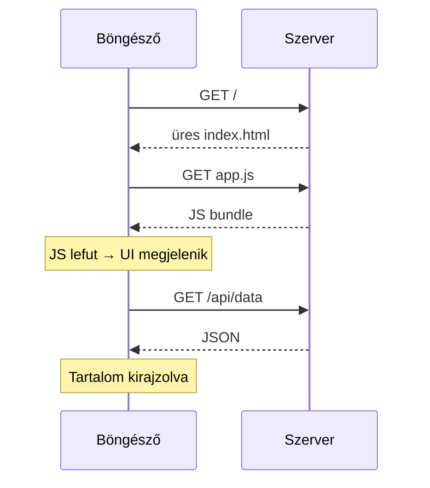
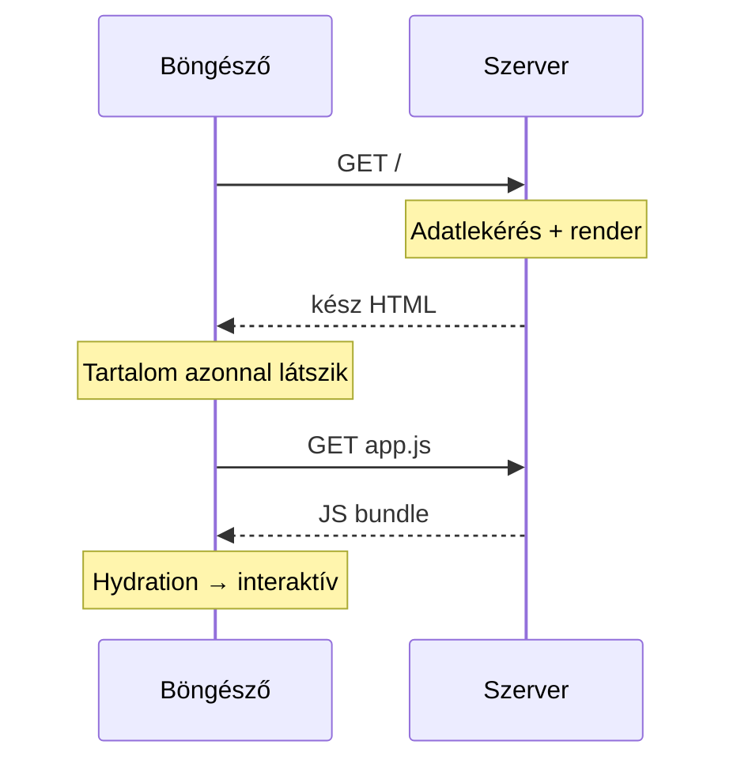
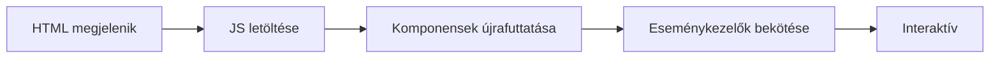

<!-- @slide Címlap -->
<!-- @slide-theme zinc violet zinc -->
<!-- @slide-gradient down zinc-950 -> violet-950 -->

<!-- @color violet -->
## Frontend fejlesztés 2026-ban

# Library vs Framework

<!-- @width 70% -->
React · Angular · Vue · Svelte · Astro · htmx — és a renderelési stratégiák, amelyek mögöttük dolgoznak

<!-- @note -->
> Üdvözlés, rövid bemutatkozás. Három kérdésre keresünk választ: mi a különbség library és framework között, milyen karaktere van a ma legfontosabb eszközöknek, és **hol, mikor** készül el a HTML, amit a felhasználó lát. Kb. 40 perc, a végén kérdések.

---

<!-- @slide Library vs Framework -->
<!-- @slide-theme zinc amber zinc -->
<!-- @grid AB -->

<!-- @color amber -->
## Library

# Te hívod őt

<!-- @set-align left -->
<!-- @set-width 80% -->

- Egy konkrét problémát old meg
- **Te** döntöd el, mikor és hogyan használod
- Könnyen cserélhető, kombinálható
- Példák: *lodash*, *axios*, *date-fns*, **React**

***

<!-- @color violet -->
## Framework

# Ő hív téged

<!-- @set-align left -->
<!-- @set-width 80% -->

- Keretet, szerkezetet és konvenciókat ad
- A **framework** irányítja a vezérlést
- Te csak „kitöltöd a lyukakat”
- Példák: __Angular__, __Next.js__, __Nuxt__, __Astro__

<!-- @note -->
> A leggyakoribb tévhit, hogy a különbség a méret: „a library kicsi, a framework nagy”. Valójában a kérdés az, **ki hív kit**. A library-t te hívod meg, amikor szükséged van rá; a framework hívja a te kódodat a saját életciklusa szerint. Kérdés a közönségnek: szerintetek a React library vagy framework?

---

<!-- @slide Inversion of Control -->
<!-- @slide-theme zinc amber zinc -->
<!-- @layout AB/AB/CC -->

<!-- @color amber -->
### Library — te vezérelsz

```js
import { format }
  from "date-fns";

render(format(now, "yyyy"));
```

***

<!-- @color violet -->
### Framework — ő hív téged

```ts
@Component({
  template: "{{ d }}",
})
class DateCmp {
  d = "";
  ngOnInit() { this.d = now() }
}
```

***

<!-- @set-scale 78% -->

<!-- @callout tip -->
> **Inversion of Control** — *„Ne hívj minket, majd mi hívunk.”*

<!-- @note -->
> Bal oldalon mi hívjuk a `format` függvényt, és mi döntjük el, mi történik az eredménnyel. Jobb oldalon soha nem hívjuk meg az `ngOnInit`-et: az Angular hívja, amikor a komponens létrejött. Ez az **Inversion of Control** — a vezérlés megfordul, más néven a „Hollywood-elv”. Minél több ilyen „hook” van, annál inkább frameworkről beszélünk.

---

<!-- @slide Spektrum -->
<!-- @slide-theme zinc amber zinc -->
<!-- @layout AAAA/BCDE -->

# Nem fekete-fehér: spektrum

<!-- @width 70% -->
Library ⟶ Framework: minél jobbra haladunk, annál több döntést hoz meg helyetted az eszköz.

***

<!-- @set-scale 85% -->

<!-- @color amber -->
### Library

React, Preact, Solid, htmx

***

<!-- @set-scale 85% -->

<!-- @color orange -->
### Progresszív

Vue, Svelte

***

<!-- @set-scale 85% -->

<!-- @color rose -->
### Meta-framework

Next.js, Nuxt, SvelteKit, Astro

***

<!-- @set-scale 85% -->

<!-- @color violet -->
### Teljes framework

Angular

<!-- @note -->
> A valóságban nincs éles határ. A React magát „library for web and native user interfaces”-nek hívja, de szinte mindig egy meta-frameworkkel (Next.js, React Router) használjuk — ott már framework-élményt kapunk. A Vue és a Svelte „progresszív”: kicsiben library-ként is használható, de hivatalos routerrel és meta-frameworkkel teljes keretrendszerré bővíthető.

---

<!-- @slide Library vs Framework táblázat -->
<!-- @slide-theme zinc amber zinc -->

# Library vs Framework

<!-- @set-scale 85% -->

<!-- @width 80% -->
| | Library | Framework |
| --- | --- | --- |
| Vezérlés | Nálad | A keretrendszernél |
| Szabadság | Nagy | Kisebb, de konzisztens |
| Döntések száma | Sok (router, state, build…) | Kevés, előre meghozva |
| Tanulási görbe | Kezdetben lapos | Kezdetben meredekebb |

<!-- @note -->
> A library szabadsága egyben teher is: neked kell kiválasztani a routert, a state managementet, a build eszközt — és ezek kompatibilitását karbantartani. A framework ezeket eldönti helyetted: kevesebb a szabadság, de egy új csapattag gyorsabban eligazodik, mert minden projekt hasonlóan néz ki.

---

<!-- @slide React története -->
<!-- @slide-theme slate cyan sky -->
<!-- @layout AAAA/BCDE/BCDE -->

# React — rövid történet

***

<!-- @set-scale 85% -->

<!-- @color cyan -->
### 2011–2013

Jordan Walke, Facebook — 2013: open source

***

<!-- @set-scale 85% -->

<!-- @color cyan -->
### 2015

**React Native** — ugyanaz a modell mobilon

***

<!-- @set-scale 85% -->

<!-- @color cyan -->
### 2019

**Hookok** (React 16.8) — osztályok helyett függvények

***

<!-- @set-scale 85% -->

<!-- @color cyan -->
### 2024–2025

**React 19**, Server Components, **React Compiler**

<!-- @note -->
> A React a Facebook hírfolyamának problémájára született: túl bonyolult volt kézzel szinkronban tartani a DOM-ot az adatokkal. Az első bemutatáskor a JSX miatt sokan kinevették — „HTML a JavaScriptben?” —, ma ez az iparági standard. A Hookok 2019-ben teljesen átalakították a React kód írását, a Server Components pedig a szerver felé tolja a hangsúlyt.

---

<!-- @slide React -->
<!-- @slide-theme slate cyan sky -->
<!-- @layout AABBB -->

<!-- @set-scale 90% -->

<!-- @color cyan -->
## Meta · 2013

# React

<!-- @set-align left -->

- `UI = f(state)`, **JSX**
- **Virtual DOM** + diffing
- Hookok, egyirányú adatfolyam
- **React 19:** Server Components
- **React Compiler**

***

```jsx
import { useState } from "react";

export function Counter() {
  const [count, setCount] = useState(0);
  const inc = () => setCount(count + 1);

  return (
    <button onClick={inc}>
      Kattintások: {count}
    </button>
  );
}
```

<!-- @note -->
> A React alapgondolata: a UI az állapot függvénye. Minden állapotváltozás **újrafuttatja** a komponens függvényt, majd a Virtual DOM diff alapján csak a változott részek frissülnek a DOM-ban. A React Compiler automatikusan memoizál, így a `useMemo` / `useCallback` nagy része elhagyható. Legnagyobb erőssége az ökoszisztéma és a munkaerőpiac.

---

<!-- @slide React videó -->
<!-- @slide-theme slate cyan sky -->

<!-- @cover -->

<!-- @youtube -->
[React 100 másodpercben](https://www.youtube.com/watch?v=Tn6-PIqc4UM)

<!-- @note -->
> Fireship rövid összefoglalója a Reactről (kb. 2 perc). Jó ismétlés a JSX-ről, a komponensekről és a hookokról; ha kevés az idő, otthoni nézésre ajánlható.

---

<!-- @slide Angular története -->
<!-- @slide-theme slate red rose -->
<!-- @layout AAAA/BCDE/BCDE -->

# Angular — rövid történet

***

<!-- @set-scale 85% -->

<!-- @color red -->
### 2010

**AngularJS** (Google) — kétirányú adatkötés

***

<!-- @set-scale 85% -->

<!-- @color red -->
### 2016

**Angular 2** — teljes újraírás TypeScriptben

***

<!-- @set-scale 85% -->

<!-- @color red -->
### 2022–2023

Standalone komponensek, **Signals**, új control flow

***

<!-- @set-scale 85% -->

<!-- @color red -->
### 2025

**Zoneless** alapértelmezés, modern, könnyebb Angular

<!-- @note -->
> Az AngularJS 2010-ben hatalmas siker volt, de a kétirányú adatkötés nagy alkalmazásoknál lassúnak bizonyult. Az Angular 2 ezért teljes újraírás lett, ami sok csapatot elriasztott — ez segítette a React és a Vue felemelkedését. 2023 óta beszélnek „Angular reneszánszról”: signals, új template szintaxis, új dokumentáció (angular.dev), és búcsú a Zone.js-től.

---

<!-- @slide Angular -->
<!-- @slide-theme slate red rose -->
<!-- @layout AABBB -->

<!-- @set-scale 90% -->

<!-- @color red -->
## Google · 2016

# Angular

<!-- @set-align left -->

- **Teljes framework**, TypeScript
- Router, forms, HTTP, DI, CLI
- **Signals**, zoneless mód
- `@if` · `@for` · `@defer`
- Enterprise kedvenc

***

```ts
import { Component, signal }
  from "@angular/core";
@Component({
  template: `
    <button (click)="inc()">
      Kattintások: {{ count() }}
    </button>
  `,
})
export class Counter {
  count = signal(0);
  inc() {
    this.count.update(c => c + 1);
  }
}
```

<!-- @note -->
> Az Angular „batteries included”: router, űrlapkezelés, HTTP kliens, i18n, dependency injection és CLI mind a csomag része, egy csapat tartja karban. A signal-alapú reaktivitással már nem kell a teljes komponensfát ellenőrizni, csak az érintett részeket. Nagyvállalati környezetben az erős konvenciók miatt népszerű: minden csapat ugyanúgy épít.

---

<!-- @slide Angular videó -->
<!-- @slide-theme slate red rose -->

<!-- @cover -->

<!-- @youtube -->
[Angular 100 másodpercben](https://www.youtube.com/watch?v=Ata9cSC2WpM)

<!-- @note -->
> Fireship összefoglalója az Angularról: komponensek, dekorátorok, dependency injection, CLI. A videó régebbi, a standalone komponensek és a signalok előtti Angulart mutatja.

---

<!-- @slide Vue története -->
<!-- @slide-theme slate emerald green -->
<!-- @layout AAAA/BCDE/BCDE -->

# Vue — rövid történet

***

<!-- @set-scale 85% -->

<!-- @color emerald -->
### 2014

Evan You (ex-Google, AngularJS) mellékprojektje

***

<!-- @set-scale 85% -->

<!-- @color emerald -->
### 2016

**Vue 2** — Virtual DOM, robbanásszerű népszerűség

***

<!-- @set-scale 85% -->

<!-- @color emerald -->
### 2020

**Vue 3** — Composition API, Proxy-reaktivitás

***

<!-- @set-scale 85% -->

<!-- @color emerald -->
### 2025

**Vapor Mode** — Virtual DOM nélküli fordítás

<!-- @note -->
> Evan You az AngularJS-en dolgozott a Google-nél, és azt akarta megtartani belőle, ami jó volt — a template-eket és a reaktivitást —, a nehézkes részek nélkül. A Vue nem nagyvállalati háttérrel, hanem közösségi finanszírozással nőtt nagyra, különösen Ázsiában és a Laravel közösségben. A Vue 3 átállás fájdalmas volt, de ma már stabil alap.

---

<!-- @slide Vue -->
<!-- @slide-theme slate emerald green -->
<!-- @layout AABBB -->

<!-- @set-scale 90% -->

<!-- @color emerald -->
## Evan You · 2014

# Vue

<!-- @set-align left -->

- **Progresszív** bevezetés
- Single File Component
- Proxy-alapú reaktivitás
- Vue Router, Pinia
- **Vapor Mode** · **Nuxt**

***

```vue
<script setup>
import { ref } from "vue";

const count = ref(0);
</script>

<template>
  <button @click="count++">
    Kattintások: {{ count }}
  </button>
</template>
```

<!-- @note -->
> A Single File Component egy fájlban tartja a template-et, a logikát és a stílust. A `ref` egy reaktív érték: ha változik, a Vue pontosan tudja, melyik DOM-részt kell frissíteni. Az Angular struktúrája és a React rugalmassága között helyezkedik el, barátságos tanulási görbével. Meta-frameworkje a Nuxt.

---

<!-- @slide Vue videó -->
<!-- @slide-theme slate emerald green -->

<!-- @cover -->

<!-- @youtube -->
[Vue 100 másodpercben](https://www.youtube.com/watch?v=nhBVL41-_Cw)

<!-- @note -->
> Fireship rövid összefoglalója a Vue-ról: reaktív állapot, template szintaxis, single-file komponensek.

---
<!-- @slide Nuxt videó -->
<!-- @slide-theme slate emerald green -->

<!-- @cover -->

<!-- @youtube -->
[Nuxt 100 másodpercben](https://www.youtube.com/watch?v=dCxSsr5xuL8)

<!-- @note -->
> A Nuxt a Vue-ra épülő meta-framework (fájlalapú routing, SSR, SSG). Nuxt a Vue-nak az, ami a Next.js a Reactnek.

---

<!-- @slide Svelte története -->
<!-- @slide-theme stone orange orange -->
<!-- @layout AAAA/BCDE/BCDE -->

# Svelte — rövid történet

***

<!-- @set-scale 85% -->

<!-- @color orange -->
### 2016

Rich Harris (The Guardian) — „a framework, ami eltűnik”

***

<!-- @set-scale 85% -->

<!-- @color orange -->
### 2019

**Svelte 3** — „Rethinking reactivity”

***

<!-- @set-scale 85% -->

<!-- @color orange -->
### 2022

**SvelteKit 1.0** — hivatalos meta-framework

***

<!-- @set-scale 85% -->

<!-- @color orange -->
### 2024

**Svelte 5** — runes, explicit reaktivitás

<!-- @note -->
> Rich Harris hírgrafikus volt a The Guardiannél, ahol a gyors, könnyű interaktív grafikákhoz kellett eszköz. Az ötlet: a framework ne a böngészőben fusson, hanem **fordításkor** dolgozzon, és tűnjön el. A Svelte 3 „Rethinking reactivity” előadása legendás lett. 2021 óta Rich Harris a Vercelnél főállásban fejleszti a Svelte-et.

---

<!-- @slide Svelte -->
<!-- @slide-theme stone orange orange -->
<!-- @layout AABBB -->

<!-- @set-scale 90% -->

<!-- @color orange -->
## Rich Harris · 2016

# Svelte

<!-- @set-align left -->

- **Fordító**, nem runtime
- Nincs Virtual DOM
- Runes: `$state`, `$derived`
- Kis bundle, kevés kód
- Meta-framework: **SvelteKit**

***

```svelte
<script>
  let count = $state(0);
  let double = $derived(count * 2);
</script>

<button onclick={() => count++}>
  Kattintások: {count} (×2 = {double})
</button>
```

<!-- @note -->
> A Svelte fordító: build időben célzott DOM-utasításokat generál, így nincs szükség Virtual DOM-ra és nagy runtime-ra. A Svelte 5 runes (`$state`, `$derived`, `$effect`) explicitté tették a reaktivitást, így komponenseken kívül is működik. Évek óta a fejlesztői elégedettségi felmérések élén van.

---

<!-- @slide Svelte videó -->
<!-- @slide-theme stone orange orange -->

<!-- @cover -->

<!-- @youtube -->
[SvelteKit 100 másodpercben](https://www.youtube.com/watch?v=H1eEFfAkIik)

<!-- @note -->
> A SvelteKit a Svelte hivatalos meta-frameworkje: fájlalapú routing, SSR, SSG, szerveroldali load függvények. A videó a Svelte alapjait is röviden mutatja.

---

<!-- @slide Astro története -->
<!-- @slide-theme zinc violet fuchsia -->
<!-- @layout AAAA/BCDE/BCDE -->

# Astro — rövid történet

***

<!-- @set-scale 85% -->

<!-- @color violet -->
### 2021

Fred K. Schott és a Snowpack csapata indítja

***

<!-- @set-scale 85% -->

<!-- @color violet -->
### 2022

**Astro 1.0** — Islands architektúra

***

<!-- @set-scale 85% -->

<!-- @color violet -->
### 2024

**Astro 5** — Content Layer, Server Islands

***

<!-- @set-scale 85% -->

<!-- @color violet -->
### 2026

A **Cloudflare** felvásárolja, open source marad

<!-- @note -->
> Az Astro a Snowpack build eszköz csapatától indult, azzal a felismeréssel, hogy a legtöbb weboldal főleg tartalom, mégis teljes SPA-ként szállítjuk őket. Az Islands architektúrát az Astro tette ismertté. 2026 januárjában a Cloudflare megvásárolta az Astro mögötti céget; a projekt MIT licencű és nyílt marad.

---

<!-- @slide Astro -->
<!-- @slide-theme zinc violet fuchsia -->
<!-- @layout AABBB -->

<!-- @set-scale 90% -->

<!-- @color violet -->
## Fred K. Schott · 2021

# Astro

<!-- @set-align left -->

- **Tartalomközpontú** oldalak
- Alapból **0 KB** kliens JS
- **Islands** architektúra
- React, Vue, Svelte együtt

***

```astro
---
import Counter from "./Counter.jsx";
const posts = await getCollection("blog");
---

<h1>Blog</h1>
<ul>
  {posts.map(p => <li>{p.data.title}</li>)}
</ul>

<Counter client:visible />
```

<!-- @note -->
> A frontmatter (a `---` közötti rész) a szerveren vagy build időben fut, a kliensre csak HTML kerül. A `Counter` komponens egy „sziget”: a `client:visible` miatt csak akkor tölt le JavaScriptet, amikor a felhasználó odagörget. Más opciók: `client:load`, `client:idle`. Egy oldalon akár React és Svelte komponens is lehet egyszerre.

---

<!-- @slide Astro videó -->
<!-- @slide-theme zinc violet fuchsia -->

<!-- @cover -->

<!-- @youtube -->
[Astro 100 másodpercben](https://www.youtube.com/watch?v=dsTXcSeAZq8)

<!-- @note -->
> Fireship összefoglalója az Astróról: islands architektúra, tartalomközpontú oldalak, több UI framework egy projektben.

---

<!-- @slide htmx -->
<!-- @slide-theme zinc blue sky -->
<!-- @layout AABBB -->

<!-- @set-scale 90% -->

<!-- @color blue -->
## Carson Gross · 2020

# htmx

<!-- @set-align left -->

- **Hypermedia**: HTML-attribútumok
- A szerver **HTML-t** küld, nem JSON-t
- ~14 KB, nincs build lépés
- Bármilyen backend: Go, Python, PHP…
- Előd: intercooler.js (2013)

***

```html
<button hx-post="/clicked"
        hx-target="#result"
        hx-swap="innerHTML">
  Kattints
</button>

<div id="result"></div>

<!-- a szerver válasza: -->
<p>Kattintások: 3</p>
```

<!-- @note -->
> A htmx az ellenpólus: nem a kliensen építünk UI-t, hanem a HTML-t bővíti ki, hogy bármely elem küldhessen kérést és cserélhessen ki egy oldalrészt a szerver HTML-válaszával. Az intercooler.js utódjaként 2020-ban jelent meg, 2023-ban a GitHub egyik leggyorsabban növő frontend projektje lett, 2024-ben jött a 2.0. Admin felületekhez, CRUD alkalmazásokhoz kiváló; erősen interaktív, offline működő appokhoz kevésbé.

---

<!-- @slide Összehasonlítás -->
<!-- @slide-theme zinc violet zinc -->

# Összehasonlítás

<!-- @set-scale 70% -->

| | React | Angular | Vue | Svelte | Astro | htmx |
| --- | --- | --- | --- | --- | --- | --- |
| Típus | Library | Framework | Progresszív | Fordító | Meta-framework | Library |
| Reaktivitás | VDOM + hookok | Signals | Proxy / ref | Runes | Választott UI | Szerver (HTML) |
| Meta-framework | Next.js | Angular SSR | Nuxt | SvelteKit | — | — |
| Erősség | Ökoszisztéma | Struktúra | Egyensúly | Teljesítmény | Tartalom | Egyszerűség |
| Tipikusan | SPA, web + mobil | Enterprise | Bármi | Könnyű appok | Blog, docs | CRUD, admin |

<!-- @note -->
> Ez a táblázat egyszerűsít, de jól mutatja a karaktereket. Érdemes kiemelni, hogy a „Meta-framework” sor ma legalább olyan fontos, mint maga a UI réteg: a routing, az adatbetöltés és a renderelési stratégia ott dől el. A htmx kilóg a sorból — ott a „state” a szerveren él.

---

<!-- @slide Reaktivitási modellek -->
<!-- @slide-theme zinc violet zinc -->
<!-- @grid ABC -->

<!-- @color cyan -->
## Virtual DOM

<!-- @set-align left -->

- Állapotváltozás → komponens újrafut
- Új fa → **diff** → DOM patch
- Költség: felesleges újrarenderelés

<!-- @space -->

<!-- @align center -->
**React**

***

<!-- @color red -->
## Signals

<!-- @set-align left -->

- Az értékek **tudják**, ki függ tőlük
- Csak az érintett csomópont frissül
- Nincs teljes újrafuttatás

<!-- @space -->

<!-- @align center -->
**Angular, Vue, Solid**

***

<!-- @color orange -->
## Compiler

<!-- @set-align left -->

- A reaktivitást a **fordító** építi be
- Build időben generált DOM-kód
- Minimális runtime

<!-- @space -->

<!-- @align center -->
**Svelte, Vue Vapor**

<!-- @note -->
> Három fő megközelítés, hogyan jut el egy állapotváltozás a DOM-ig. A Virtual DOM egyszerű mentális modellt ad, de mindig a teljes komponenst újrafuttatja. A signals finomszemcsés: csak az a csomópont frissül, ami az adott értéktől függ — ma szinte minden framework (a React kivételével) ebbe az irányba mozdult. A compiler-alapú megoldás a munka nagy részét build időre teszi.

---

<!-- @slide Renderelési stratégiák -->
<!-- @slide-theme zinc sky zinc -->
<!-- @slide-gradient down zinc-950 -> sky-950 -->

<!-- @color sky -->
## 2. rész

# Renderelési stratégiák

<!-- @width 65% -->
**Hol** és **mikor** készül el a HTML? A böngészőben, a szerveren kérésenként, vagy build időben?

<!-- @note -->
> Átvezetés a második részhez. Eddig arról beszéltünk, *hogyan* írjuk a komponenseket. Most arról, hogy *hol* és *mikor* lesz belőlük HTML — ez határozza meg a betöltési sebességet, a SEO-t és a hosting költségét.

---

<!-- @slide CSR -->
<!-- @slide-theme zinc sky zinc -->
<!-- @layout AB -->

<!-- @color sky -->
## Client-Side Rendering

# CSR

<!-- @set-align left -->

Üres HTML + JS bundle — a **böngésző** építi fel a UI-t.

- ✅ Gazdag interaktivitás, olcsó hosting
- ✅ Gyors navigáció betöltés után
- ❌ Lassú első megjelenés, gyengébb SEO

***

<!-- @contain -->



<!-- @note -->
> A klasszikus SPA modell (pl. Create React App, Vite + React). A szerver csak statikus fájlokat ad, ezért a hosting olcsó. Hátránya, hogy amíg a JS le nem töltődik és le nem fut, a felhasználó üres oldalt lát — lassú hálózaton és gyenge telefonon ez másodpercek. Belső admin felületekhez, bejelentkezés mögötti appokhoz ma is jó választás.

---

<!-- @slide SSR -->
<!-- @slide-theme zinc sky zinc -->
<!-- @layout AB -->

<!-- @color sky -->
## Server-Side Rendering

# SSR

<!-- @set-align left -->

A **szerver** minden kérésre kész HTML-t küld, a kliensen a JS „életre kelti”.

- ✅ Gyors első tartalom, jó SEO
- ✅ Mindig friss, személyre szabott adat
- ❌ Szerverköltség + hydration költség

***

<!-- @contain -->



<!-- @note -->
> Az SSR nem új ötlet — a PHP is így működött. Az újdonság, hogy ugyanazt a komponens kódot futtatjuk a szerveren és a kliensen. A felhasználó azonnal látja a tartalmat, a keresőrobotok kész HTML-t kapnak. Az ár: szerver kell minden kéréshez, és a kliensnek ugyanúgy le kell töltenie a JavaScriptet.

---

<!-- @slide SSG és ISR -->
<!-- @slide-theme zinc sky zinc -->
<!-- @grid AB -->

<!-- @color sky -->
## Static Site Generation

# SSG

<!-- @set-align left -->

HTML **build időben**, kiszolgálás CDN-ről.

- ✅ Leggyorsabb, legolcsóbb, kiváló SEO
- ❌ Adatváltozáskor újra kell buildelni

<!-- @space -->

<!-- @align center -->
*Astro, Next.js, Nuxt, SvelteKit*

***

<!-- @color sky -->
## Incremental Static Regeneration

# ISR

<!-- @set-align left -->

Statikus oldalak **háttérben** újragenerálva.

- ✅ SSG sebessége + friss tartalom
- ❌ Rövid ideig elavult tartalom látszhat

<!-- @space -->

<!-- @align center -->
*Next.js, Nuxt, Astro adapterekkel*

<!-- @note -->
> Az SSG-nél minden oldal egyszer, build időben készül el — blogokhoz, dokumentációhoz ideális. Ha viszont tízezer termékünk van, és az árak naponta változnak, a teljes rebuild nem járható út. Az ISR erre válasz: az oldal statikus, de egy idő után vagy eseményre a háttérben újragenerálódik, a következő látogató már a friss verziót kapja.

---

<!-- @slide Hydration problémája -->
<!-- @slide-theme zinc sky zinc -->

# A hydration problémája

<!-- @width 70% -->
SSR után a böngésző **újra lefuttatja** az alkalmazást, hogy eseménykezelőket kössön a meglévő HTML-re.



<!-- @callout warning -->
# Uncanny valley
> Az oldal **kész látszik**, de kattintásra még nem reagál — ez rontja az INP mutatót.

<!-- @note -->
> Ez az SSR rejtett költsége: a szerver már elvégezte a renderelést, a kliens mégis megismétli, csak hogy tudja, melyik gombhoz melyik eseménykezelő tartozik. Amíg ez nem fut le, a felhasználó kattint, de nem történik semmi. A következő dián lévő technikák mind ezt a problémát próbálják csökkenteni.

---

<!-- @slide Modern technikák -->
<!-- @slide-theme zinc sky zinc -->
<!-- @grid AB/CD -->

<!-- @color sky -->
### 🏝️ Islands

<!-- @set-align left -->
Csak az interaktív „szigetek” hidratálódnak, a többi statikus HTML.

*Astro, Fresh*

***

<!-- @color sky -->
### 🌊 Streaming SSR

<!-- @set-align left -->
A HTML darabokban érkezik, a lassú részek `Suspense` mögött később.

*Next.js, SvelteKit, Nuxt*

***

<!-- @color sky -->
### ⚛️ Server Components

<!-- @set-align left -->
Csak a **szerveren** futó komponensek, kódjuk nem kerül a kliensre.

*Next.js, React Router*

***

<!-- @color sky -->
### ⏳ Deferred / Resumability

<!-- @set-align left -->
Késleltetett hidratálás (`@defer`), vagy hydration helyett **folytatás**.

*Angular, Qwik*

<!-- @note -->
> Négy irány ugyanarra a problémára. Islands: kevesebbet hidratálunk. Streaming: hamarabb küldünk valamit. Server Components: bizonyos kód soha nem jut el a kliensre. Deferred hydration és resumability: később, vagy egyáltalán nem futtatjuk újra a komponenseket. A htmx is ide sorolható: ott eleve nincs mit hidratálni.

---

<!-- @slide Stratégiák összevetése -->
<!-- @slide-theme zinc sky zinc -->

# Stratégiák összevetése

<!-- @set-scale 75% -->

| | CSR | SSR | SSG | ISR | Islands |
| --- | :---: | :---: | :---: | :---: | :---: |
| HTML készül | Böngészőben | Kérésenként | Build időben | Build + háttér | Build / kérés |
| Első megjelenés | 🐢 | ⚡ | ⚡⚡ | ⚡⚡ | ⚡⚡ |
| SEO | Gyenge | Jó | Kiváló | Kiváló | Kiváló |
| Szerver igény | Nincs | Van | Nincs (CDN) | Van | Opcionális |
| Kliens JS | Sok | Sok | Változó | Változó | Minimális |

<!-- @note -->
> Fontos üzenet: ezek nem kizárják egymást. A modern meta-frameworkök **útvonalanként** keverik őket: a landing oldal SSG, a termékoldal ISR, a kosár SSR, a bejelentkezés utáni dashboard CSR.

---

<!-- @slide Melyiket válasszam -->
<!-- @slide-theme zinc emerald zinc -->

# Hogyan válasszunk?

<!-- @set-scale 65% -->

<!-- @width 80% -->
| Ha a projekt… | Jó választás |
| --- | --- |
| főleg tartalom (blog, docs, marketing) | **Astro** + SSG |
| nagy, hosszú életű enterprise app | **Angular** |
| ökoszisztémát és munkaerőpiacot igényel | **React** + Next.js |
| egyszerű, gyorsan tanulható legyen | **Vue** + Nuxt |
| kicsi, gyors, kevés JS-sel | **Svelte** + SvelteKit |
| szerveroldali app, kevés interaktivitással | **htmx** |

<!-- @reveal -->
<!-- @width 80% -->
<!-- @callout success -->
> **Nincs „legjobb”** — renderelési stratégiát **oldalanként** válassz.

<!-- @note -->
> Ez ökölszabály, nem törvény. A legfontosabb szempontok sokszor nem technikaiak: mit ismer a csapat, kit tudunk felvenni, meddig kell karbantartani a rendszert. Egy jól ismert eszköz szinte mindig jobb választás, mint egy papíron gyorsabb, de ismeretlen. Kattintásra jön az utolsó gondolat.

---

<!-- @slide Összefoglalás -->
<!-- @slide-theme zinc violet zinc -->
<!-- @slide-gradient down zinc-950 -> violet-950 -->

# Összefoglalás

<!-- @set-width 70% -->
<!-- @set-align left -->

- **Library** = te hívod · **Framework** = ő hív téged
- React: ökoszisztéma · Angular: struktúra · Vue: egyensúly · Svelte: fordító · Astro: tartalom · htmx: hypermedia
- A trend: **signals**, **compilerek**, **kevesebb kliens JS**
- CSR → SSR → SSG → ISR → Islands / RSC: egyre finomabb kontroll

<!-- @gap 4 -->

<!-- @set-align center -->
<!-- @color violet -->
## Köszönöm a figyelmet! Kérdések?

<!-- @note -->
> Rövid összefoglalás, majd kérdések. Ha marad idő, érdemes megkérdezni a közönséget, ki milyen eszközt használ és miért — jó beszélgetésindító. Linkek kérésre: react.dev, angular.dev, vuejs.org, svelte.dev, astro.build, htmx.org.
